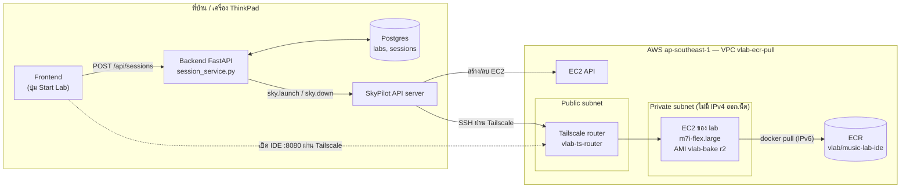
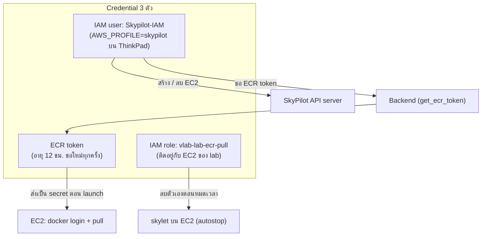
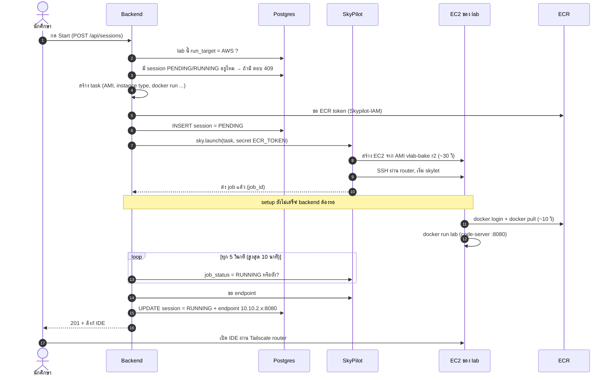
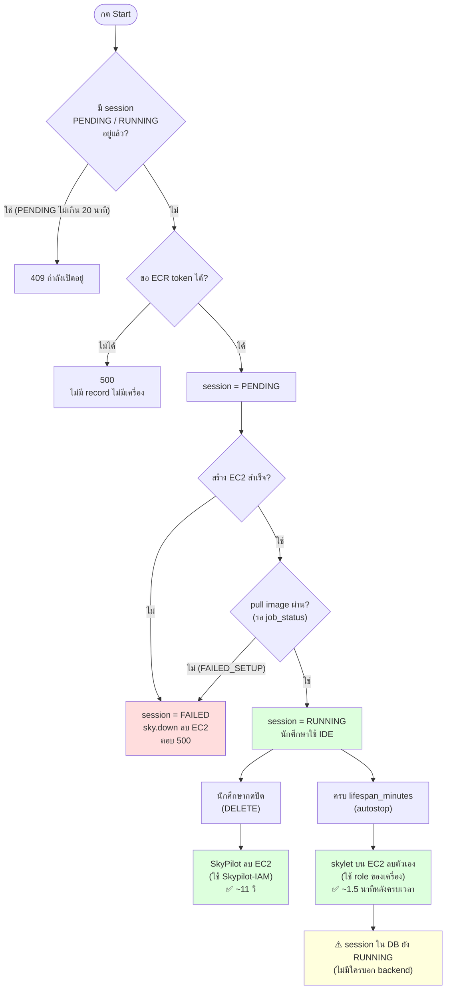
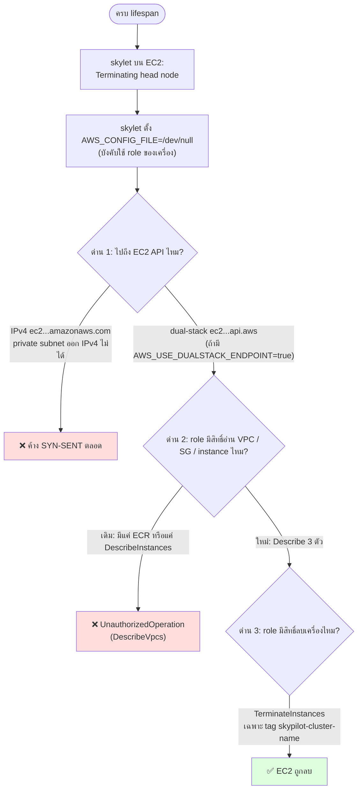

# AWS Lab Flow — เปิด/ปิด lab บน AWS ทั้งระบบ

> ภาพรวมของทุกอย่างที่เกี่ยวกับการ launch lab ไป AWS (PR #88 + branch `infra/ecr-pull-experiment`)
> สถานะ ณ 2026-10-11 แต่ละรูปตอบคำถามเดียว อ่านตามลำดับ 1 → 6

---

## 1. มีใครอยู่ในระบบบ้าง (ชิ้นส่วน)

| ชิ้น | หน้าที่ |
|---|---|
| Backend | รับคำขอ เลือกว่า lab ไป K3s หรือ AWS (`labs.run_target`) สร้าง task ส่งให้ SkyPilot บันทึก session |
| SkyPilot API server | คนที่สั่ง AWS จริง (สร้าง EC2, SSH เข้าไปติดตั้ง, ลบ EC2) |
| Tailscale router | ประตูเดียวเข้า private subnet ทั้ง SkyPilot (SSH) และนักศึกษา (IDE) ต้องผ่านตัวนี้ |
| EC2 ของ lab | 1 เครื่องต่อ 1 session รัน lab เป็น docker container |
| ECR | เก็บ image ของ lab |

---

## 2. ใครใช้กุญแจ (credential) อะไร

| ตัว | สิทธิ์ | ห้าม |
|---|---|---|
| `Skypilot-IAM` | EC2 (สร้าง/ลบ), PassRole, ECR pull `vlab/music-lab-ide` | ไม่ใช่ root |
| `vlab-lab-ecr-pull` | ECR pull + **ลบเครื่องที่มี tag `skypilot-cluster-name`** (เพิ่มใหม่) | container ของ lab เอาไปใช้ไม่ได้ (metadata hop limit = 1) |
| ECR token | pull image | ไม่ลง DB ไม่โผล่ใน log (เทสแล้ว) |
| profile `default` บน ThinkPad | **root** | ห้ามใช้กับระบบนี้ |

---

## 3. กด Start Lab → ได้ IDE (เส้นปกติ ~85 วินาที)

---

## 4. ทุกทางที่ session จบได้

- `lifespan_minutes` = **อายุสูงสุด** ของ lab (`wait_for: none`) ครบแล้วลบเลยแม้ยังใช้อยู่
- ถ้า backend ตายกลาง launch session จะค้าง PENDING ครบ 20 นาทีระบบจะเคลียร์ให้ตอนมีคนกด Start ใหม่

---

## 5. autostop ต้องผ่านอะไรบ้าง (เคยติด 3 จุด แก้ครบแล้ว)

| ด่าน | ปัญหา | แก้ที่ | สถานะ |
|---|---|---|---|
| 1 ทางเน็ต | skylet ข้าม `~/.aws/config` เลยไม่ใช้ dual-stack | AMI `ami-0da9046ec7f57f3af` (`vlab-bake-0.12.3.post1-r2`) มี `AWS_USE_DUALSTACK_ENDPOINT=true` ใน `/etc/environment` | ✅ |
| 2 อ่าน | ขาด `DescribeVpcs` / `DescribeSecurityGroups` | `terraform/lab_autostop.tf` (inline policy `skypilot-autostop`) | ✅ |
| 3 ลบ | role มีแค่สิทธิ์ ECR | `terraform/lab_autostop.tf` | ✅ |

เทสแล้ว (2026-10-11): lifespan 1 นาที ได้ 201 เวลา 21:20:39 → EC2 `shutting-down` เวลา 21:22:09
skylet เช็กทุก 1 นาทีและต้องปิด Ray ก่อน เลยช้ากว่า lifespan ราว 1–1.5 นาที

---

## 6. ขั้นต่อไป

autostop ใช้ได้แล้ว งานที่เหลือ

- **session ใน DB ไม่รู้ว่าเครื่องโดน autostop ลบ** ค้าง RUNNING จนมีคนกด Start ใหม่หรือ DELETE (กำลังออกแบบ)
- เปิดพอร์ต 5173 / 8443 ที่ router ถ้าจะใช้ lab ที่มีหลายพอร์ต (`lab_access.tf`)
- push `skypilot/music-lab` ขึ้น ECR ถ้าจะให้ lab OOP ไป AWS
- rule `0.0.0.0/0` ที่ SkyPilot เพิ่มใน SG ของ lab
- `terraform apply` บน Windows ให้ state ตรงกับของจริง (ถ้าใส่ policy ผ่าน Console)
- ลบ root access key ออกจาก ThinkPad

---

## ไฟล์ / branch ที่เกี่ยวข้อง

| อะไร | อยู่ที่ |
|---|---|
| โค้ด launch (backend) | `web-portal/backend/app/services/session_service.py` — branch `feature/sky-aws-launch` (PR #88) |
| รายละเอียด flow ของ API | `docs/Flow.md` — PR #88 |
| Terraform (VPC, router, role, สิทธิ์ autostop) | `terraform/` — branch `infra/ecr-pull-experiment` |
| script สร้าง AMI | `docker/bake/provision-ami.sh` — branch `infra/ecr-pull-experiment` |
| ผลทดลองทั้งหมด | `docs/EXPERIMENT_ECR_PULL_RESULT.md` — branch `infra/ecr-pull-experiment` |
