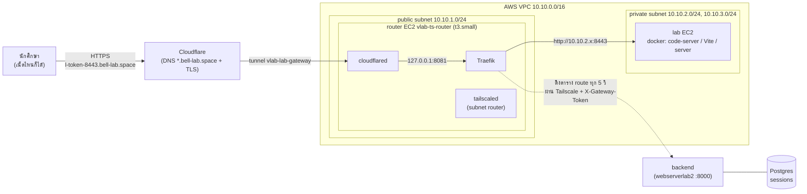
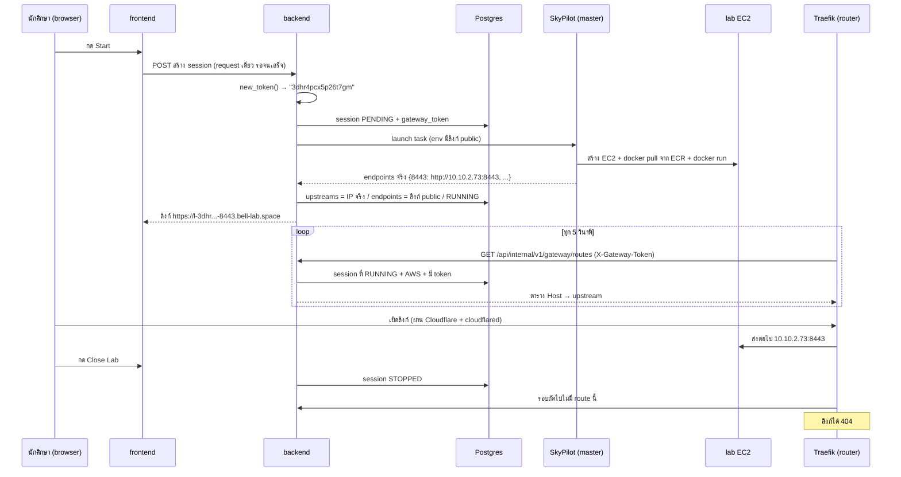

# Lab Gateway: ลิงก์ public ให้ lab บน AWS (เฟส 1)

> เอกสารฉบับสมบูรณ์ของงาน lab gateway อธิบายว่า **ทำอะไร ทำไม และทำงานยังไง** ทุกชั้น ตั้งแต่ backend, AWS, Terraform, Tailscale, Cloudflare จนถึง Ansible
> พร้อมขั้นตอนติดตั้งตามที่ทำจริง ผลเทส ปัญหาที่เจอ และงานที่ยังค้าง
>
> รวมเอกสารเดิม 4 ตัวไว้ที่นี่ที่เดียว (ยังดูได้ใน git history): `AWS_LAB_PUBLIC_ACCESS.md` (ภาพรวมเฟส 1–3 ก่อนลงมือ), `AWS_LAB_GATEWAY_ROUTER.md` (ออกแบบเฟส 1 บน router), `AWS_LAB_PUBLIC_ACCESS_RUNBOOK.md` (แผนลงมือ), `AWS_LAB_PUBLIC_ACCESS_PROGRESS.md` (บันทึกระหว่างทำ)
>
> branch `feature/aws-dns` / ทำ 2026-11-10 → 2026-11-12

## สารบัญ

1. [ปัญหาและผลลัพธ์](#1-ปัญหาและผลลัพธ์)
2. [ภาพรวมสถาปัตยกรรม](#2-ภาพรวมสถาปัตยกรรม)
3. [วงจรชีวิตของ lab หนึ่งตัว](#3-วงจรชีวิตของ-lab-หนึ่งตัว)
4. [Backend](#4-backend)
5. [โครงสร้างบน AWS](#5-โครงสร้างบน-aws)
6. [Terraform](#6-terraform)
7. [Tailscale](#7-tailscale)
8. [Cloudflare](#8-cloudflare)
9. [Ansible](#9-ansible)
10. [ขั้นตอนติดตั้งตั้งแต่ต้น (ตามที่ทำจริง)](#10-ขั้นตอนติดตั้งตั้งแต่ต้น-ตามที่ทำจริง)
11. [ผลเทส](#11-ผลเทส)
12. [ปัญหาที่เจอและบทเรียน](#12-ปัญหาที่เจอและบทเรียน)
13. [ข้อจำกัดและงานค้าง](#13-ข้อจำกัดและงานค้าง)
14. [คู่มือใช้งานและแก้ปัญหา](#14-คู่มือใช้งานและแก้ปัญหา)
15. [คำศัพท์](#15-คำศัพท์)
16. [แผนเฟส 2: public portal (ยังไม่ทำ)](#16-แผนเฟส-2-public-portal-ยังไม่ทำ)
17. [เฟส 3 และความเสี่ยงที่รู้อยู่](#17-เฟส-3-และความเสี่ยงที่รู้อยู่)
18. [อ้างอิงภายนอก](#18-อ้างอิงภายนอก)

> กล่อง **💡 รู้ไว้** ที่แทรกตามหัวข้อ = ความรู้ที่ได้จากปัญหาที่เจอจริงระหว่างทำ (รายละเอียดเต็มอยู่ในข้อ 12)

---

## 1. ปัญหาและผลลัพธ์

### ปัญหา

lab ที่รันบน AWS อยู่ใน **private subnet** (`10.10.2.x` / `10.10.3.x`) ไม่มี public IP และเข้าได้ทางเดียวคือผ่าน **Tailscale** (VPN ของทีม) โดยใช้ router EC2 เป็นประตู

- นักศึกษาในห้องแลป / ทีมงาน: อยู่ใน tailnet → เปิด `http://10.10.2.x:8443` ได้
- นักศึกษาที่อยู่บ้าน (คาบ online): **ไม่อยู่ใน tailnet → เปิดไม่ได้** และเราไม่อยากให้นักศึกษาทุกคนลง Tailscale

### ผลลัพธ์

lab บน AWS ได้ลิงก์แบบนี้ เปิดจากเน็ตไหนก็ได้ (มือถือ 4G ก็ได้)

```
https://l-3dhr4pcx5p26t7gm-8443.bell-lab.space
         └──── token ────┘ └port┘ └── domain ──┘
```

- **token** (16 ตัว สุ่มใหม่ทุก session) = กุญแจ ใครไม่รู้ token เปิด lab ไม่ได้
- **port** = พอร์ตของ lab (8443 = code-server, 5173 = Vite, 8080 = server)
- ปิด lab เมื่อไหร่ ลิงก์ได้ 404 ภายในไม่กี่วินาที

### หลักการที่ยึดไว้

| หลักการ | ทำยังไง |
|---|---|
| ไม่เปิดพอร์ตขาเข้าที่ AWS เลย | ใช้ Cloudflare Tunnel: router เป็นฝ่ายต่อ **ออก** ไปหา Cloudflare |
| backend ไม่ต้องคุยกับ router | Traefik บน router เป็นฝ่าย **ดึง** ตาราง route จาก backend เอง (pull) |
| router ทำได้แค่ส่งต่อไป lab | backend กรองปลายทาง (ต้องอยู่ใน subnet lab + พอร์ต 3000–9999) / Tailscale ACL ให้ router ถึง backend ได้แค่ `:8000` |
| merge แล้วของเดิมไม่เปลี่ยน | ทุกอย่างอยู่หลัง flag `LAB_GATEWAY_ENABLED` (ค่าเริ่ม `false`) |
| ไม่เพิ่มเครื่อง | ใช้ router EC2 ตัวเดิม (ขยายจาก `t3.micro` เป็น `t3.small`) |

---

## 2. ภาพรวมสถาปัตยกรรม

### 2.1 แผนภาพ



### 2.2 เส้นทางของ request หนึ่งครั้ง (ทีละช่วง)

| # | จาก → ถึง | เกิดอะไรขึ้น |
|---|---|---|
| 1 | มือถือ → Cloudflare | DNS ของ `*.bell-lab.space` ชี้ Cloudflare / Cloudflare ถือ TLS (HTTPS) ให้ |
| 2 | Cloudflare → cloudflared | ส่งผ่าน **tunnel** ที่ cloudflared บน router ต่อค้างไว้ (ขาออกจาก router ทาง tcp 7844) |
| 3 | cloudflared → Traefik | ส่งต่อเป็น HTTP ธรรมดาไป `127.0.0.1:8081` (อยู่ในเครื่องเดียวกัน) |
| 4 | Traefik ดู Host | หา router ที่ `rule = Host(l-<token>-8443.bell-lab.space)` ในตารางล่าสุด / ไม่เจอ = 404 |
| 5 | Traefik → lab | ส่งต่อไป `http://10.10.2.73:8443` ผ่าน network ภายใน VPC (SG อนุญาต router → lab 3000–9999) |
| 6 | lab ตอบกลับ | ย้อนทางเดิม |

**สังเกต:** ช่วงที่ 1–6 ไม่ผ่าน backend เลย backend ล่ม lab ที่เปิดอยู่ยังใช้ได้ (Traefik ใช้ตารางล่าสุดที่ดึงได้)

### 2.3 ส่วนประกอบและเจ้าของ

| ส่วน | อยู่ที่ไหน | ตั้งด้วย |
|---|---|---|
| DNS / TLS / tunnel / rules | Cloudflare dashboard | มือ (dashboard) |
| VPC, subnet, SG, router EC2 | AWS | Terraform (`terraform/`) |
| ใครคุยกับใครใน tailnet | Tailscale | `tailscale/vlab-acl.hujson` + `script/tailscale-acl.sh` |
| cloudflared + Traefik บน router | router EC2 | Ansible role `lab-gateway` |
| backend (ตาราง route, token) | VM `webserverlab2` | โค้ด `web-portal/backend` + Ansible role `web-service` |
| lab | EC2 ที่ SkyPilot สร้างตอนกด Start | SkyPilot (สั่งจาก backend) |

### 2.4 ทำไมเลือกทางนี้ (สรุป)

| ทางเลือก | ทำไมไม่เลือก |
|---|---|
| ให้ lab มี public IP / ALB | ต้องเปิดพอร์ตขาเข้า, ต้องจัดการ cert เอง, IPv4 public คิดเงิน |
| cloudflared ในทุก lab EC2 | ต้องสร้าง DNS record ต่อ lab (มีเพดาน), token ของ tunnel ไปอยู่ในเครื่องนักศึกษา, รื้อของเดิมเยอะ |
| EC2 gateway ตัวใหม่ (`t4g.small` + docker compose + `tag:vlab-gateway`) | แยก blast radius ได้ดีที่สุด แต่เพิ่มค่าเครื่อง + public IPv4 (~$15–20/เดือน) ทั้งที่ router ทำได้ถ้าจำกัดสิทธิ์ (ติด tag, ไม่ลง Docker, จำกัดทรัพยากรด้วย systemd) / ถ้าเทสโหลด (G10) ไม่ผ่าน ค่อยย้ายไปทางนี้ ฝั่ง backend ไม่ต้องแก้ |
| ลง gateway ที่ backend / master | ยังต้องผ่าน router อยู่ดี (Tailscale เข้า `10.10.x` ได้ทาง subnet route ของ router เท่านั้น) และ traffic อ้อมผ่านเน็ตของ on-prem (อาจตกไป DERP relay) |
| **router ตัวเดิม + Traefik + cloudflared** ✅ | ไม่เพิ่มเครื่อง ไม่เปิดพอร์ตขาเข้า ใช้ wildcard DNS ตัวเดียว |

**ความกังวลด้านความปลอดภัยตอนเลือก router:** router เป็นเครื่องที่รับ traffic จากอินเทอร์เน็ต (ผ่าน tunnel) ถ้าถูกเจาะ ต้องเข้า tailnet ได้น้อยที่สุด → ติด `tag:vlab-router` ให้ไปได้แค่ backend `:8000` (ข้อ 7) และ proxy ต้องกินเครื่องไม่หมด ไม่งั้น SkyPilot SSH เข้า EC2 ไม่ได้ทั้งระบบ → `MemoryMax` / `CPUQuota` (ข้อ 9.2)

### 2.5 ทำไมลิงก์หน้าตาแบบนี้

| แบบ | ตัวอย่าง | ผล |
|---|---|---|
| path | `lab.bell-lab.space/<course>/<lab>/<token>/3000/` | ❌ app ที่อ้าง asset แบบ absolute (`/assets/x.js`, `/@vite/client`) พังหมด ต้องตั้ง base path ทุก lab และทุก lab อยู่ origin เดียวกัน = localStorage / cookie ปนกันข้ามนักศึกษา |
| **subdomain ชั้นเดียว** ✅ | `l-<token>-3000.bell-lab.space` | app อยู่ที่ `/` เหมือนรันในเครื่อง แต่ละ session แต่ละพอร์ตเป็นคนละ origin / Universal SSL ฟรีครอบ `*.bell-lab.space` |
| subdomain 2 ชั้น | `<token>-3000.lab.bell-lab.space` | ⚠️ Universal SSL ไม่ครอบชั้นที่ 2 ต้องซื้อ Advanced Certificate Manager |
| DNS record ต่อเครื่อง → private IP | `s1.lab…` → `10.10.2.14` | ❌ คนนอก tailnet ยังไปไม่ถึง private IP อยู่ดี |

- ไม่ใส่ course / lab id ใน URL: proxy ใช้แค่ token หาเครื่อง ใส่ไปก็เปิดเผยข้อมูลภายในเปล่า ๆ
- token 1 ตัวต่อ session ทุกพอร์ตของ session ใช้ token เดียวกัน / label ยาว ~25 ตัว (DNS จำกัด 63)
- record ที่ตั้งชื่อชัดเจน (`skypilot.bell-lab.space`) ชนะ wildcard เสมอ ของเดิมจึงไม่กระทบ

---

## 3. วงจรชีวิตของ lab หนึ่งตัว



จุดที่ควรเข้าใจ:

- **token สุ่มก่อน launch** เพราะต้องใส่ลิงก์ public ลงใน env ของ container ตอน `docker run` และ prelaunch (คาบ online) ก็ได้ token ตั้งแต่ PENDING
- **`endpoints` กับ `upstreams` แยกกัน:** `endpoints` = สิ่งที่นักศึกษาเห็น (ลิงก์ public) / `upstreams` = ปลายทางจริงที่ Traefik ส่งต่อ (IP ภายใน) นักศึกษาไม่เห็น IP ภายใน
- **ไม่มีขั้น "ลบ route":** Traefik เอาตารางใหม่ทั้งก้อนแทนของเดิมทุกรอบ session หยุดเมื่อไหร่ รอบถัดไปก็หายเอง
- **หน้ารอ lab ไม่ใช่ WebSocket:** frontend ส่ง HTTP request เดียว backend ถือไว้จน lab พร้อม (`LabDetail.tsx`) ระหว่างรอห้ามรีเฟรช

> 💡 **รู้ไว้:** เพราะ request เดียวรอนาน 1–3 นาที ถ้าวันหนึ่ง portal ผ่าน Cloudflare (เฟส 2) จะโดนตัดที่ 100 วินาที → เฟส 2 จึงต้องทำ Start แบบ async (ข้อ 16.2)
>
> 💡 **รู้ไว้:** กด Start แล้วได้ "User already has a running session" ทั้งที่ไม่มี lab เปิด = มี session เก่าค้างสถานะ RUNNING (ที่เจอคือ session ตัวอย่างจาก seed ลิงก์ `localhost` หมดอายุไปแล้ว) ปิดใน UI หรือตั้ง STOPPED ใน DB

---

## 4. Backend

ทั้งหมดอยู่ใน `web-portal/backend/`

### 4.1 ไฟล์ที่แก้

| ไฟล์ | เปลี่ยนอะไร |
|---|---|
| `app/configs/settings.py` | ตัวแปร `LAB_GATEWAY_*` + validator |
| `app/models/session.py` | column `gateway_token`, `upstreams` |
| `migrations/versions/20261111_01_session_lab_gateway.py` | migration เพิ่ม 2 column |
| `app/services/lab_gateway_service.py` | **ใหม่** ฟังก์ชันทั้งหมดของ gateway |
| `app/routes/lab_gateway_route.py` | **ใหม่** endpoint ที่ Traefik เรียก |
| `app/routes/__init__.py` | ลงทะเบียน router ใหม่ |
| `app/services/session_service.py` | สุ่ม token, ใส่ env, แยก endpoints/upstreams |
| `app/main.py` | ซ่อน token / upstreams ในหน้า admin |
| `.env.example`, `.dockerignore` | ตัวอย่างตัวแปร / ไม่ copy `.venv` เข้า image |
| `tests/session/test_lab_gateway.py` | **ใหม่** 84 test |

### 4.2 ตัวแปรตั้งค่า (`settings.py`)

| ตัวแปร | ค่าเริ่ม | ใช้ทำอะไร |
|---|---|---|
| `LAB_GATEWAY_ENABLED` | `False` | สวิตช์หลัก ปิด = lab AWS ได้ลิงก์ `http://10.10.2.x` แบบเดิม |
| `LAB_GATEWAY_DOMAIN` | `""` | โดเมนของลิงก์ เช่น `bell-lab.space` |
| `LAB_GATEWAY_TOKEN` | `""` | รหัสลับร่วมกับ Traefik (header `X-Gateway-Token`) ต้อง ≥ 32 ตัว |
| `LAB_GATEWAY_PORT_MIN` / `MAX` | `3000` / `9999` | พอร์ตที่เปิดผ่าน gateway ได้ (กัน 22 / 80 ออกอินเทอร์เน็ต) ต้องตรงกับ SG ของ router |
| `LAB_GATEWAY_UPSTREAM_CIDRS_STR` | `10.10.2.0/24,10.10.3.0/24` | subnet ที่ Traefik ส่งต่อได้ |

**validator 2 ตัว:**

- `clean_lab_gateway_domain`: ทำโดเมนให้สะอาด `".Bell-Lab.Space # comment"` → `"bell-lab.space"`
- `check_lab_gateway` (`model_validator`): ถ้าเปิด flag แต่ค่าไม่ครบ (ไม่มี domain / token สั้น / ช่วงพอร์ตผิด / CIDR ว่าง) **backend ไม่ยอม start** ดีกว่ารันแบบไม่ปลอดภัย ใช้ `model_validator` เพราะต้องดูหลาย field พร้อมกัน และตอนปิด flag token ต้องว่างได้
- property `lab_gateway_upstream_cidrs`: แปลง string เป็น list ของ `ip_network`

### 4.3 ฐานข้อมูล

ตาราง `sessions` เพิ่ม 2 column (migration `20261111_01`, ต่อจาก `20261031_01`)

| column | ชนิด | ตัวอย่าง | หมายเหตุ |
|---|---|---|---|
| `gateway_token` | `String(32)` unique, nullable | `3dhr4pcx5p26t7gm` | null = session นี้ไม่ผ่าน gateway (K3s / เปิดตอน flag ปิด) |
| `upstreams` | `JSONB` nullable | `{"8443": "http://10.10.2.73:8443"}` | ปลายทางจริงของแต่ละพอร์ต |

- nullable ทั้งคู่ → ไม่ต้องเติมข้อมูลให้ session เก่า
- unique กัน token ซ้ำ (โอกาสซ้ำต่ำมากอยู่แล้ว แต่ซ้ำ = route ชนกัน)
- **ห้ามส่ง 2 field นี้ออก API:** token = กุญแจเข้า lab, upstreams = IP ภายใน / หน้า admin (`main.py` `SessionAdmin`) ซ่อนทั้งในตาราง หน้า detail และฟอร์ม

### 4.4 `lab_gateway_service.py` ทีละฟังก์ชัน

ส่วนบนเป็นฟังก์ชันล้วน (ไม่แตะ DB) ส่วนล่างอ่าน DB

| ฟังก์ชัน | รับ → คืน | ทำอะไร / ทำไม |
|---|---|---|
| `new_token()` | → `"3dhr4pcx5p26t7gm"` | สุ่ม 10 byte ด้วย `secrets` (ไม่ใช่ `random`) → base32 ตัวเล็ก 16 ตัว = 80 bit / ใช้ได้แค่ a-z, 2-7 เพราะเป็นส่วนหนึ่งของชื่อโดเมน (DNS ไม่รับตัวใหญ่ `+` `=`) |
| `port_allowed(port)` | `8443` / `"8443"` → `True` | พอร์ตอยู่ในช่วง MIN–MAX ไหม รับทั้ง int และ str (key ของ JSONB เป็น str) / `None`, `"abc"`, `True`, `-1` = `False` |
| `public_host(token, port)` | → `l-<token>-8443.bell-lab.space` | ชื่อโฮสต์ของพอร์ตนั้น / ขึ้นต้น `l-` ให้ rule ของ Cloudflare จับได้ และไม่ชนชื่ออื่นอย่าง `skypilot` |
| `public_endpoints(token, ports)` | → `{"8443": "https://l-…"}` | ลิงก์ที่นักศึกษาเห็น พอร์ตนอกช่วงถูกตัดทิ้ง |
| `gateway_envs(token, ports)` | → dict env | env ที่ใส่ใน container: `__VITE_ADDITIONAL_SERVER_ALLOWED_HOSTS=.bell-lab.space` และ `VLAB_PUBLIC_URL_<port>` (⚠ ตัวแรกใช้ไม่ได้กับ Vite 5.4 ดูข้อ 13) |
| `upstream_ok(url)` | `"http://10.10.2.73:8443"` → `True` | **ด่านสุดท้ายก่อนใส่ตาราง:** ต้องเป็น `http`, มีพอร์ตในช่วง, host เป็น IP ใน subnet ของ lab / กันค่าใน DB เพี้ยนจน router กลายเป็นทางเข้าเครื่องอื่น (เช่น backend หรือ `8.8.8.8`) |
| `routable_sessions(db)` | → list session | session ที่ควรมีลิงก์: `RUNNING` + `is_cloud` + มี token + มี upstreams + ไม่ถูกลบ + (ไม่ใช่ prelaunch ที่ยังไม่มีคนรับ) |
| `build_routes(db)` | → dict ของ Traefik | สร้างตาราง route (รูปแบบด้านล่าง) / upstream ที่ไม่ผ่าน `upstream_ok` ถูกข้าม + log warning โดย session อื่นยังใช้ได้ / **ไม่มี route = คืน `{}`** |

**รูปแบบที่ `build_routes` คืน** (Traefik HTTP provider dynamic config)

```json
{
  "http": {
    "routers": {
      "s-3dhr4pcx5p26t7gm-8443": {
        "rule": "Host(`l-3dhr4pcx5p26t7gm-8443.bell-lab.space`)",
        "service": "s-3dhr4pcx5p26t7gm-8443",
        "entryPoints": ["web"]
      }
    },
    "services": {
      "s-3dhr4pcx5p26t7gm-8443": {
        "loadBalancer": { "servers": [{ "url": "http://10.10.2.73:8443" }] }
      }
    }
  }
}
```

- 1 พอร์ตของ 1 session = **router** 1 ตัว (จับ Host) + **service** 1 ตัว (ปลายทาง)
- `entryPoints: ["web"]` ตรงกับชื่อใน `traefik.yml` ของ role `lab-gateway`
- **ทำไมตารางว่างต้องเป็น `{}`:** Traefik 3.7 อ่าน `{"http":{"routers":{}, "services":{}}}` และ `{"http":{}}` ไม่ได้ (`routers cannot be a standalone element`) แล้วไม่อัปเดตตาราง ลองกับ Traefik 3.7.16 จริงแล้วมีแค่ `{}` ที่ผ่าน (บั๊กที่เจอตอน E6 ดูข้อ 12)

> 💡 **รู้ไว้ (JSON ที่ "ถูกตามหลัก" อาจไม่ถูกสำหรับโปรแกรมที่อ่าน):** `{"routers": {}}` เป็น JSON ที่ถูกต้อง และ test ของเราผ่านหมด แต่ Traefik decode config ด้วย library ของมันเอง (paerser) ซึ่งไม่รับ map ว่าง บั๊กแบบนี้ unit test จับไม่ได้ เพราะ test เช็กแค่ "คืนรูปแบบที่เราคิดไว้" ไม่ได้เช็ก "โปรแกรมปลายทางอ่านออกไหม"
> วิธีที่ใช้ยืนยัน: ดาวน์โหลด Traefik รุ่นเดียวกับบน router มารันใน WSL แล้วให้ HTTP server ปลอมส่ง body ทีละแบบ ดูว่าแบบไหนมี `Provider error` → ได้คำตอบจากของจริงใน 1 นาที แทนการเดา

### 4.5 `lab_gateway_route.py`: endpoint ที่ Traefik เรียก

```
GET /api/internal/v1/gateway/routes
Header: X-Gateway-Token: <LAB_GATEWAY_TOKEN>
```

| สถานการณ์ | ตอบ |
|---|---|
| flag ปิด / ไม่มี header / token ผิด | **404** (เหมือนไม่มี endpoint นี้ ไม่บอกคนนอกว่ามีอยู่) |
| token ถูก | 200 + ผลของ `build_routes` ตรง ๆ (ไม่ห่อ `ApiResponse` เพราะ Traefik อ่านรูปแบบของมันเอง) |

- `_token_ok()` เทียบด้วย `hmac.compare_digest` เวลาเทียบไม่ขึ้นกับว่าตรงกี่ตัวแรก (กันเดา token ทีละตัวจากเวลาตอบ)
- `include_in_schema=False` ไม่โผล่ใน OpenAPI / ไม่ใช้ JWT เพราะ Traefik ไม่ใช่ user
- ลงทะเบียนใน `app/routes/__init__.py` เป็น `api_router.include_router(lab_gateway_router)`

> 💡 **รู้ไว้:** endpoint นี้ตอบ 404 ทุกกรณีที่ไม่ผ่าน (ปิด flag / ไม่มี token / token ผิด) ดีด้านความปลอดภัย แต่ตอน debug ต้องจำว่า "Traefik log ขึ้น `response code: 404`" **ไม่ได้แปลว่า URL ผิด** ส่วนใหญ่คือ flag ยังปิด (เจอจริงตอน E6) หรือ token สองฝั่งไม่ตรง

### 4.6 `session_service.py`: แก้ตรงไหน

| ฟังก์ชัน | แก้อะไร |
|---|---|
| `create_session` (ส่วนสร้าง session) | ถ้า flag เปิดและเป็น AWS → `gateway_token = new_token()` **ก่อน** สร้าง task แล้วบันทึกลง record |
| `create_fastapi_task` | รับ `gateway_token` ส่งต่อให้ `_build_aws_task` เท่านั้น (K3s ไม่ผ่าน gateway) |
| `_build_aws_task` | ถ้ามี token → เพิ่ม `gateway_envs` เข้า `docker run -e …` |
| หลัง launch เสร็จ | มี token → `upstreams` = endpoint จริง, `endpoints` = `public_endpoints(...)` / พอร์ตนอกช่วงถูกตัดและ log warning / ไม่มี token → `endpoints` แบบเดิม |

> 💡 **รู้ไว้:** พอร์ตของ lab image ที่อยู่นอก 3000–9999 (เช่น 80) **จะไม่มีปุ่มบนหน้าเว็บเลยเมื่อรันบน AWS** (บนเครื่องแลปยังเห็น) → ต้องบอกอาจารย์ที่อัปโหลด lab image ว่าพอร์ตต้องอยู่ในช่วงนี้

**AWS launch ทำงานยังไง (ของเดิม เข้าใจไว้)**: backend ขอ ECR token → SkyPilot สร้าง EC2 จาก **AMI ที่ bake SkyPilot runtime ไว้แล้ว** (`AWS_LAB_AMI`) → ขั้น `setup` ทำ `docker login` + `docker pull <ECR_REGISTRY_HOST>/skypilot/music-lab:lab-01` → ขั้น `run` ทำ `docker run -p 8080 -p 5173 -p 8443 -e …` / ดึง image ผ่าน endpoint dual-stack ทาง IPv6 เพราะ private subnet ไม่มี NAT / instance type `m7i-flex.large` (Pete ตั้ง เพราะบัญชี AWS free plan สร้างได้แค่บางชนิด)

> 💡 **รู้ไว้:** ไฟล์ใน lab (เช่น `vite.config.js`) มาจาก **image ใน ECR** ไม่ใช่โค้ดใน repo → แก้ repo อย่างเดียว lab ไม่เปลี่ยน ต้อง build + push image ใหม่ แล้ว lab ที่ Start หลังจากนั้นถึงได้ของใหม่
>
> 💡 **รู้ไว้ (ข้อสมมติที่ผิด):** แผนเดิมเชื่อว่า env `__VITE_ADDITIONAL_SERVER_ALLOWED_HOSTS` ทำให้ Vite รับโดเมนเรา เพราะตรวจกับ Vite 8 ใน frontend ของเราแล้วมี แต่ music-lab ใช้ Vite 5.4 ซึ่งไม่มี (โหลดซอร์สมาค้นแล้ว) → **เช็กกับเวอร์ชันที่ใช้จริง ไม่ใช่เวอร์ชันที่บังเอิญมีในเครื่อง**

### 4.7 Test (`tests/session/test_lab_gateway.py`)

84 test แบ่งเป็น class:

| class | เทสอะไร |
|---|---|
| `TestToken` | token ยาว 16, ใช้แค่ตัวที่ DNS รับ, ไม่ซ้ำ |
| `TestPortAllowed` | ช่วงพอร์ต, ค่าเพี้ยน (`None`, `"abc"`, `True`) |
| `TestPublicLinks` | `public_host` / `public_endpoints` / ตัดพอร์ตนอกช่วง |
| `TestUpstreamOk` | IP นอก subnet, พอร์ต 22, https, URL พัง |
| `TestBuildRoutes` | ว่าง = `{}`, หลาย session, สถานะที่ไม่ควรมี route, prelaunch, upstream เพี้ยนถูกข้าม, session หยุดแล้วหลุด |
| `TestRoutesEndpoint` | token ถูก / ผิด / ไม่มี / flag ปิด = 404, ไม่อยู่ใน OpenAPI |
| `TestTaskEnvs` | env ลิงก์ public เข้า `docker run` เฉพาะ AWS |
| `TestStartWithGateway` | Start แล้ว token ไหลเข้า task + record, `endpoints` / `upstreams` แยกกัน |
| `TestNotExposed` | API ของ session ไม่ส่ง token / upstreams ออกไป |
| `TestAdminHidden` | หน้า admin ซ่อน 2 field นี้ |

> validator ของ settings (`check_lab_gateway`) ยังไม่มี test ตรง ๆ

รัน: test ที่ใช้ DB ต้องมี Postgres database ชื่อลงท้าย `_test` (conftest บังคับ กันลบข้อมูลจริง)

```bash
# ในเครื่อง (WSL + Docker Desktop)
docker start virtual_lab_db
cd web-portal/backend && source .venv/bin/activate && python -m pytest tests/session/test_lab_gateway.py -q

# บน VM ทดสอบ (ไม่มี Docker ในเครื่อง): container ชั่วคราว + DB virtual_lab_test
docker run --rm --network host -v /opt/web-service/backend:/src:ro -w /src \
  -e PYTHONDONTWRITEBYTECODE=1 virtual-lab-backend python -m pytest -p no:cacheprovider -q
```

---

## 5. โครงสร้างบน AWS

### 5.1 Network (region `ap-southeast-1` Singapore)

```
VPC 10.10.0.0/16 (+ IPv6 /56)
├── public subnet  10.10.1.0/24  (AZ a)  ── route 0.0.0.0/0 → Internet Gateway
│     └── router EC2 vlab-ts-router  10.10.1.234 (public IP เปลี่ยนทุกครั้งที่ start)
├── private subnet 10.10.2.0/24  (AZ a)  ┐
└── private subnet 10.10.3.0/24  (AZ b)  ┴ route ::/0 → Egress-only IGW (IPv6 ออกได้อย่างเดียว)
                                            + S3 Gateway Endpoint (ดึง layer ของ ECR ทาง IPv4)
      └── lab EC2 ที่ SkyPilot สร้าง (ไม่มี public IP, ไม่มี NAT)
```

| ชิ้นส่วน | ทำหน้าที่ |
|---|---|
| Internet Gateway | ให้ public subnet เข้า/ออกอินเทอร์เน็ตทาง IPv4 (router ใช้) |
| Egress-only IGW | private subnet **ออก** IPv6 ได้ แต่ข้างนอกเริ่มต่อเข้ามาไม่ได้ (ใช้ดึง image จาก ECR dual-stack) |
| S3 Gateway Endpoint | ECR เก็บ layer ของ image ไว้ใน S3 → private subnet ดึงได้ทาง IPv4 โดยไม่ต้องมี NAT (ประหยัดค่า NAT) |
| ไม่มี NAT Gateway | ตั้งใจ ประหยัด ~$32/เดือน และ lab ออกเน็ต IPv4 ไม่ได้ |

### 5.2 router EC2 (`vlab-ts-router`) ข้างในมีอะไร

| บริการ | ทำอะไร | ตั้งด้วย |
|---|---|---|
| `tailscaled` | **subnet router:** ประกาศ route `10.10.2.0/24`, `10.10.3.0/24` เข้า tailnet → เครื่องใน tailnet (master, PC ทีม) เข้า lab ได้ / SkyPilot SSH เข้า lab ผ่านทางนี้ / ใช้ **Tailscale SSH** แทน sshd ปกติ | มือ (Session Manager) **ห้าม role ไปแตะ** |
| `cloudflared-lab` | ต่อ tunnel `vlab-lab-gateway` ออกไปหา Cloudflare / รับ traffic `*.bell-lab.space` มาส่งให้ Traefik / จุดตรวจสุขภาพ `127.0.0.1:20241/ready` | Ansible `lab-gateway` |
| `traefik` | reverse proxy ฟัง `127.0.0.1:8081` / ดึงตาราง route จาก backend ทุก 5 วิ | Ansible `lab-gateway` |
| `ip_forward = 1` | ให้เคอร์เนลส่งต่อ packet ระหว่าง tailnet กับ VPC (ของ subnet router) | มือ |

- ชนิด `t3.small` (2 vCPU, 2 GB) / CPU credit `unlimited` / IAM role มีแค่ SSM (เข้าฉุกเฉินผ่าน Session Manager)
- ใช้ RAM จริงหลังลง gateway: เหลือ ~1450 MB (Traefik ~14 MB, cloudflared ~15 MB) / systemd จำกัด Traefik 384M, cloudflared 256M กันแย่ง RAM กับ Tailscale
- IP ที่สำคัญ: **Tailscale `100.84.123.59` และ private `10.10.1.234` ไม่เปลี่ยน** / public IP เปลี่ยนทุกครั้งที่ stop/start (ไม่มีใครใช้ ไม่ต้องมี Elastic IP)

> 💡 **รู้ไว้ (ทำไมห้ามลง Docker บน router):** Docker ตอนติดตั้งจะตั้ง iptables chain `FORWARD` ให้ policy เป็น **DROP** และเพิ่ม chain ของตัวเอง (`DOCKER`, `DOCKER-USER` ฯลฯ) แต่หน้าที่หลักของ router คือ **forward** packet จาก `tailscale0` ไป `ens5` (tailnet → VPC) → ลง Docker แล้ว traffic ของทั้งทีมที่ไป AWS อาจโดน DROP ทันที (SkyPilot SSH เข้า lab ไม่ได้ / launch ค้าง) จึงลง Traefik และ cloudflared เป็น binary + systemd และ role เช็กตอนท้ายว่า `iptables -S FORWARD` เหมือนก่อนลง
>
> 💡 **รู้ไว้ (IP 3 แบบของ EC2):** private IP ผูกกับ network interface (อยู่จนลบเครื่อง) / Tailscale IP ผูกกับ key ของ Tailscale บน disk / public IP ยืมจาก AWS ชั่วคราว คืนทุกครั้งที่ stop → ระบบที่ **ต่อออก** ไปหาคนอื่นเอง (cloudflared, Tailscale) ไม่สนว่า public IP จะเปลี่ยน ส่วน Elastic IP คิดเงินแม้เครื่องปิด
>
> 💡 **รู้ไว้:** ใช้ `t3.small` แต่ Traefik + cloudflared ใช้รวมแค่ ~30 MB สิ่งที่กิน RAM คือ OS + Tailscale ที่ต้องเหลือที่ให้เสมอ เพราะ router ล่ม = ทั้งทีมเข้า AWS ไม่ได้ (ไม่ใช่แค่ลิงก์ lab)

### 5.3 Security Group (ไฟร์วอลล์ของ AWS)

**`ts_router` (router)**

| ทิศ | โปรโตคอล / พอร์ต | ไป/จาก | ทำไม |
|---|---|---|---|
| เข้า | udp 41641 | 0.0.0.0/0 | Tailscale ต่อตรง (ไม่ผ่าน relay) |
| ออก | tcp 443 | 0.0.0.0/0 | Tailscale, DERP, SSM, apt https, cloudflared (สำรอง) |
| ออก | tcp 80 | 0.0.0.0/0 | apt |
| ออก | udp ทั้งหมด | 0.0.0.0/0 | WireGuard / STUN (รวม QUIC 7844 ของ cloudflared) |
| ออก | tcp 22 | SG lab | SkyPilot SSH เข้า lab |
| ออก | **tcp 3000–9999** | SG lab | **ใหม่ (แทน 8080):** Traefik / ผู้ใช้ Tailscale ส่งต่อไปเว็บของ lab |
| ออก | **tcp 7844** | 0.0.0.0/0 | **ใหม่:** cloudflared ต่อ tunnel แบบ `http2` |

ไม่มีพอร์ตขาเข้าสำหรับเว็บเลย → เว็บเข้ามาได้ทาง tunnel เท่านั้น

**`lab_instances` (lab EC2)**

| ทิศ | โปรโตคอล / พอร์ต | ไป/จาก | ทำไม |
|---|---|---|---|
| เข้า | tcp 22 | SG router | SSH ผ่าน router |
| เข้า | ทั้งหมด | SG ตัวเอง | เครื่อง lab คุยกันได้ |
| เข้า | **tcp 3000–9999** | SG router | **ใหม่:** รับ traffic จาก gateway ทุก lab (ไม่พึ่ง rule ที่ SkyPilot เปิดรายเครื่อง) |
| ออก | tcp 443 / 80 | `::/0` | ECR dual-stack, apt (IPv6) |
| ออก | tcp 443 | S3 prefix list | layer ของ ECR บน S3 |

> rule ขาเข้า 5173 / 8443 / 8080 จาก `0.0.0.0/0` ไม่มี description ที่เห็นใน console = SkyPilot เปิดเองตาม `ports:` ของ task ไม่ใช่ Terraform อย่าลบ / ในทางปฏิบัติเข้าได้แค่จากใน VPC เพราะ lab ไม่มี public IPv4
>
> 💡 **รู้ไว้:** Terraform จัดการแค่ rule ที่อยู่ใน `.tf` rule ที่คนเพิ่มด้วยมือใน console (เช่น router egress 5173 / 8443 เดิม) Terraform มองไม่เห็นและไม่ลบให้ ต้องลบเอง (เราลบด้วย `aws ec2 revoke-security-group-egress`) / แยกให้ออกด้วย description: rule ของ Terraform มี description เสมอ

### 5.4 IAM ที่เกี่ยวข้อง

| role / user | สิทธิ์ | ใช้โดย |
|---|---|---|
| `vlab-ts-router` | SSM เท่านั้น | router |
| `vlab-lab-ecr-pull` | ECR pull + terminate/stop เครื่องที่ SkyPilot ติด tag (autostop) | lab EC2 |
| IAM user `Dev-mawn` | ของ Panupong: plan/apply Terraform (managed policy `vlab-terraform`) | คนรัน Terraform |
| profile `skypilot` | สร้าง/ลบ EC2 ของ lab | backend / SkyPilot |

---

## 6. Terraform

### 6.1 Terraform คืออะไรในงานนี้

เขียนโครงสร้าง AWS เป็นไฟล์ `.tf` → `terraform plan` เทียบไฟล์กับของจริงแล้วบอกว่าจะเปลี่ยนอะไร → `terraform apply` ทำตาม / **state** = ไฟล์ที่จำว่า resource ไหนใน `.tf` คือของจริงตัวไหน (ไม่มี state = Terraform คิดว่ายังไม่มีอะไรแล้วจะสร้างใหม่หมด)

### 6.2 ทุกไฟล์ใน `terraform/`

| ไฟล์ | มีอะไร |
|---|---|
| `versions.tf` | Terraform ≥ 1.10 (ต้องใช้กับ `use_lockfile`), provider `hashicorp/aws ~> 5.0` |
| `backend.tf` | **state อยู่ใน S3** `vlab-tfstate-568318158381` key `aws/terraform.tfstate`, `encrypt`, `use_lockfile` (Pete เพิ่ม ดู 6.4) |
| `providers.tf` | region + profile (ส่งเองทุกครั้ง) + `default_tags` (`Project`, `ManagedBy`, `Experiment`) ติดทุก resource |
| `variables.tf` | `region` (ค่าเริ่ม `ap-southeast-1`), `aws_profile` (**ไม่มีค่าเริ่ม** กันเผลอใช้ root หรือ user ของ SkyPilot), `ssh_public_key_path` |
| `data.tf` | ค้น AMI Ubuntu 24.04 amd64 ล่าสุดของ Canonical, policy ให้ EC2 assume role, account id |
| `network.tf` | VPC, IGW, EIGW, subnet 3 ตัว, route table 2 ชุด, S3 endpoint (ข้อ 5.1) |
| `security_groups.tf` | SG `ts_router`, `lab_instances` และ rule ทุกตัว (ข้อ 5.3) |
| `router.tf` | IAM role/instance profile ของ router + `aws_instance.ts_router` |
| `lab_iam.tf` | role `vlab-lab-ecr-pull` (ECR pull + autostop) |
| `ecr.tf` | repo `vlab/music-lab-ide` + lifecycle เก็บ 10 image ล่าสุด |
| `experiment.tf` | key pair, test instance 2 ตัว (`t3.micro` ต่อ AZ), repo `vlab/hello` (ของการทดลองเดิม) |
| `outputs.tf` | ค่าที่พิมพ์หลัง apply (VPC id, router id/IP, IP ของ test instance, URL ของ ECR) |

### 6.3 ที่งานนี้แก้

**`router.tf`**

```hcl
resource "aws_instance" "ts_router" {
  ami                    = data.aws_ami.ubuntu.id
  instance_type          = "t3.small" # เดิม t3.micro (1 GB) ไม่พอ Tailscale + cloudflared + Traefik
  ...
  credit_specification {
    cpu_credits = "unlimited"         # credit หมดกลางคาบ = proxy ช้าทั้งห้อง
  }
  lifecycle {
    ignore_changes = [ami]            # AMI ใหม่ต้องไม่ทำให้ router ถูกสร้างใหม่ (Tailscale หาย)
  }
}
```

- T3 เป็น `unlimited` อยู่แล้ว plan จึงไม่ขึ้น `credit_specification` / เขียนไว้ให้เห็นว่าตั้งใจ
- เปลี่ยน instance type = **แก้ในที่เดิม** (stop → แก้ → start) ไม่สร้างเครื่องใหม่ / provider **start ให้หลังแก้เสมอ** แม้เดิมจะ stopped

> 💡 **รู้ไว้:** ตอน apply router stopped อยู่ แต่หลัง apply กลับเป็น running (ค่าเครื่องเริ่มนับ) ถ้าไม่ได้ใช้ต่อให้ stop เอง / ก่อน apply ที่แตะ router ทำ **AMI สำรอง** ไว้ (ตอนเครื่อง stopped ไม่ต้องติ๊ก No reboot) ราคาคือค่า snapshot ~$0.05/GB/เดือน AMI ขึ้น `pending` นานกว่า snapshot เสร็จได้หลายนาที เป็นเรื่องปกติ

**`security_groups.tf`** (3 จุด)

| resource | เปลี่ยน |
|---|---|
| `aws_vpc_security_group_egress_rule.ts_router_lab_web` | 8080 → **3000–9999** (แทนทั้ง 8080 และ 5173 / 8443 ที่เคยเพิ่มด้วยมือ) |
| `aws_vpc_security_group_egress_rule.ts_router_cloudflared` | **ใหม่** tcp 7844 ออก |
| `aws_vpc_security_group_ingress_rule.lab_web_from_router` | **ใหม่** lab รับ 3000–9999 จาก SG router |

ทำไมช่วง 3000–9999: ต้องตรงกับ `LAB_GATEWAY_PORT_MIN/MAX` ของ backend ถ้า backend ยอมให้พอร์ตที่ SG ไม่เปิด จะได้ลิงก์ที่เปิดไม่ได้

### 6.4 state บน S3 (Pete ทำ PR `chore/terraform-s3-state`)

เดิม state อยู่ในเครื่อง Windows ของ Pete เครื่องเดียว → คนอื่น plan/apply ไม่ได้ Pete เลยย้ายขึ้น S3:

- bucket สร้างด้วยมือ (private, versioning, SSE, block public access) **ไม่อยู่ใน Terraform** กัน `destroy` แล้วลบ state ของตัวเอง
- `use_lockfile = true`: ตอน apply เขียนไฟล์ `.tflock` ใน S3 → สองคน apply พร้อมกันไม่ได้ (ไม่ต้องมี DynamoDB)
- `experiment.tf`: `aws_key_pair.pete` ignore `public_key` ไม่งั้นคนที่รันจากเครื่องอื่นจะลบ key pair แล้วสร้างใหม่จาก `~/.ssh/id_ed25519.pub` ของตัวเอง

### 6.5 คำสั่ง (รันใน WSL)

```bash
cd terraform
# key ของ Dev-mawn อยู่ใน ~/.aws ของ Windows → ชี้ให้ Terraform ใน WSL ใช้ไฟล์นั้น
export AWS_SHARED_CREDENTIALS_FILE=/mnt/c/Users/Panup/.aws/credentials
export AWS_CONFIG_FILE=/mnt/c/Users/Panup/.aws/config

terraform init -reconfigure -backend-config="profile=default"   # ตั้ง backend ตาม backend.tf (ไม่ย้าย/ไม่ทับ state)
terraform plan  -var aws_profile=default -out gateway.tfplan     # ดูว่าจะเปลี่ยนอะไร เก็บแผนไว้
terraform apply gateway.tfplan                                   # ทำตามแผนเป๊ะ ๆ
terraform plan  -var aws_profile=default                         # รอบสองต้อง No changes
```

| สิ่งที่ต้องเข้าใจ | |
|---|---|
| `-backend-config="profile=…"` | key ที่ใช้คุยกับ **S3** (state) |
| `-var aws_profile=…` | key ที่ใช้คุยกับ **EC2 / VPC** (provider) |
| `-reconfigure` | ตั้ง backend ใหม่ ไม่สนค่าเก่าใน `.terraform/` **ไม่ย้าย state** |
| ห้ามใช้ | `-migrate-state`, `terraform state push` (ทับ state บน S3) |
| อ่าน plan | `~ update in-place` = แก้ที่เดิม ✅ / `must be replaced` หรือ `destroy` ที่ router / VPC = **หยุด** / เห็น `42 to add` = ไม่เห็น state **หยุด** |
| `*.tfplan`, `.terraform/` | gitignore แล้ว |

ผลจริง: `Plan: 2 to add, 2 to change, 0 to destroy` → `Apply complete!` (router แก้ 25 วินาที)

> 💡 **รู้ไว้ (key ของ AWS ใน WSL):** WSL เป็น Linux หา key ที่ `~/.aws` ของ Linux ไม่ใช่ `C:\Users\…\.aws` ของ Windows → ชี้ด้วย `AWS_SHARED_CREDENTIALS_FILE` แทนการ copy key ซ้ำสองที่ / เช็กว่า key ใช้ได้และเป็นใครด้วย `aws sts get-caller-identity` / IAM access key **ไม่หมดอายุเอง** ใช้ได้จนกว่าจะถูกปิด (key ที่ตายแล้วตอบ `InvalidClientTokenId`)
>
> 💡 **รู้ไว้:** `terraform init` ไม่ได้โหลด state มาเก็บในเครื่อง แค่จำ "ที่อยู่" ของ state ทุก plan / apply ดึงจาก S3 สด ๆ → ทุกคนเห็น state เดียวกันเสมอ

---

## 7. Tailscale

### 7.1 แนวคิดที่ต้องรู้

- **tailnet** = เครือข่าย VPN ของทีม (ของ `minecopper.55@gmail.com`) ทุกเครื่องได้ IP `100.x.x.x`
- **ACL** (policy) = กฎว่าใครคุยกับใครได้ มีแต่ `accept` (ไม่มีกฎ = ห้าม)
- เครื่องที่**ไม่ติด tag** = เป็นของ user (`autogroup:member`) → ได้กฎ `*:*` (เข้าได้ทุกที่)
- เครื่องที่**ติด tag** = ไม่ใช่ของ user แล้ว → ได้แค่สิทธิ์ที่เขียนให้ tag นั้น
- **subnet route** = เครื่องหนึ่งประกาศว่า "ส่ง `10.10.2.0/24` มาที่ฉัน" ต้องถูก approve ก่อนใช้ได้
- **Tailscale SSH** = Tailscale รับ SSH แทน sshd ดูสิทธิ์จาก ACL ส่วน `"ssh"` (ไม่ดู `authorized_keys`)
- **Tailscale IP ≠ การยืนยันตัวตน** ปลายทางยังต้อง auth อีกชั้น

### 7.2 ที่เพิ่มใน policy (5 จุด ไม่แตะของเดิม)

| เพิ่ม | ทำไม |
|---|---|
| `tagOwners`: `"tag:vlab-router": ["autogroup:admin"]` | ต้องประกาศ tag ก่อนถึงติดให้เครื่องได้ |
| acls ข้อ 5: `tag:vlab-router` → `100.124.148.97:8000` (tcp) | ติด tag แล้ว router ไม่ได้ `*:*` → ต้องเปิดให้ Traefik ดึงตาราง route จาก backend / ให้แค่ `:8000` ไม่ใช่ทั้งเครื่อง |
| `autoApprovers.routes`: `10.10.2.0/24`, `10.10.3.0/24` → `tag:vlab-router` | หลังติด tag route ยัง approved อยู่ ไม่งั้น SkyPilot / master เข้า EC2 ไม่ได้ |
| `ssh`: `autogroup:admin` → `tag:vlab-router` users `ubuntu`, `root` แบบ `accept` | เครื่องติด tag ไม่ใช่ `autogroup:self` ของใคร กฎ SSH เดิมใช้ไม่ได้ / `accept` ไม่ใช่ `check` เพราะ Ansible ต่อ SSH หลายรอบ ไม่ต้อง login เว็บซ้ำ |
| `tests`: router accept `:8000` / deny backend `:22` `:5432`, server `:22` `:6443`, worker `:22` `:8080`, registry `:5001` | Tailscale รัน test ทุกครั้งที่ save ไม่ผ่าน = ไม่ยอม save |

**ทำไมต้องติด tag ที่ router:** ถ้าไม่ติด router เป็นเครื่องของ Pete ได้ `*:*` → ถ้า router ถูกเจาะผ่าน cloudflared / Traefik ก็เข้าได้ทุกเครื่องในทีม ติด tag แล้วเข้าได้แค่ backend `:8000`

> 💡 **รู้ไว้ (SSH ไม่ได้ทั้งที่เข้า Tailscale IP ได้):** `ssh ubuntu@100.84.123.59` ได้ `tailnet policy does not permit you to SSH to this node` = เครื่องนั้นใช้ **Tailscale SSH** → ส่ง public key ไปใส่ `authorized_keys` **ไม่ช่วย** ต้องเพิ่มกฎในส่วน `"ssh"` ของ ACL และกฎ ssh ชี้เครื่องของ user คนอื่นตรง ๆ ไม่ได้ ต้องชี้ผ่าน tag / ถ้าได้ `Permission denied (publickey)` แทน = sshd ปกติ ขาด key
>
> 💡 **รู้ไว้:** ก่อนติด tag ให้ดูว่าใครพึ่ง route ของเครื่องนั้นบ้าง (`tailscale status --json` ดู `Tags` / `PrimaryRoutes`) เครื่องที่ไม่ติด tag (member) และ `tag:vlab-server` ยังเข้า AWS ได้ตามกฎเดิม จึงติด tag ได้โดยไม่มีใครเสียสิทธิ์

### 7.3 ไฟล์และวิธี apply

| ไฟล์ | commit? | คืออะไร |
|---|---|---|
| `tailscale/vlab-acl.hujson.example` | ✅ | ตัวอย่างให้ทีมเห็นว่าต้องเพิ่มอะไร |
| `tailscale/vlab-tags.tsv.example` | ✅ | ตัวอย่าง IP → tag |
| `tailscale/vlab-acl.hujson` | ❌ gitignore | **policy ทั้งก้อนจริง** (copy จาก JSON editor แล้วเพิ่มของเรา) |
| `tailscale/vlab-tags.tsv` | ❌ gitignore | ใส่แค่ router บรรทัดเดียว |
| `tailscale/backup/` | ❌ gitignore | policy เดิมที่ script สำรองไว้ |

**ห้าม `cp .example` ทับ:** `script/tailscale-acl.sh` ส่งไฟล์ขึ้นไป **ทับทั้งก้อน** และ policy จริงมีของที่ `.example` ไม่มี (เช่น grant `tag:friend-master` ของฟิลม์)

```bash
sudo apt install -y jq                     # script ต้องใช้
# API access token: admin console → Settings → Keys (อายุ 1 วัน) script จะถามเอง ไม่โชว์บนจอ
./script/tailscale-acl.sh plan             # backup + validate + tests + diff + tag ที่จะติด (ไม่เขียน)
./script/tailscale-acl.sh apply            # ถามยืนยัน → ตั้ง policy → ติด tag
./script/tailscale-acl.sh rollback tailscale/backup/acl-20261112-051655.hujson   # ถอยกลับ
```

อ่าน diff: ต้องมีแต่บรรทัด `+` ถ้ามี `-` แปลว่ามีคนแก้ policy ใน console หลังเรา copy มา → copy ใหม่ก่อน

---

## 8. Cloudflare

ทำใน dashboard ทั้งหมด (โดเมน `bell-lab.space`)

| # | ตั้งอะไร | ค่า | ทำไม |
|---|---|---|---|
| C1 | ตรวจ record `*` เดิม | เดิม A `198.54.117.242` (หน้า parking ของ Namecheap) | ไม่มีอะไรใช้ ลบได้ / ชื่อที่ใช้งานจริง (`skypilot`, `www` ฯลฯ) มี record ของตัวเอง wildcard ไม่ทับ |
| D1 | Zero Trust → Networks → Tunnels → Create | tunnel `vlab-lab-gateway` (id `de38c1ed-…`) | ได้ **tunnel token** ไปใส่ `all.yml` (`vault_lab_gateway_tunnel_token`) |
| D2 | Published application ของ tunnel | `*.bell-lab.space` → `HTTP 127.0.0.1:8081` | wildcard ตัวเดียวรับทุก lab ไม่ต้องสร้าง DNS ต่อ lab / `127.0.0.1:8081` = Traefik บน router (ผูก localhost) / Cloudflare สร้าง CNAME `*` → `<id>.cfargotunnel.com` ให้ |
| D3a | Cache Rule `lab gateway no cache` | Bypass cache เมื่อ `http.request.full_uri wildcard "https://l-*.bell-lab.space/*"` | หน้า lab เปลี่ยนตลอด (IDE / HMR) cache = เห็นของเก่า หรือเห็นของคนอื่น |
| D3b | Configuration Rule `lab gateway no rewrite` | ปิด Rocket Loader, Email Obfuscation, Automatic HTTPS Rewrites (เงื่อนไขเดียวกัน) | 3 อย่างนี้แก้ HTML/JS ระหว่างทาง → code-server / Vite พังได้ |
| D4 | เช็กไม่กระทบชื่ออื่น | `skypilot.bell-lab.space` ตอบเหมือนเดิม | |

- เงื่อนไข `l-*` ทำให้ rule มีผลแค่ลิงก์ lab ไม่กระทบเว็บอื่นของโดเมน
- dashboard เตือน "may not apply" เพราะไม่มี record ชื่อ `l-` ตรงตัว → กด Ignore and deploy ได้ (traffic ผ่าน `*` อยู่แล้ว)
- เช็กหลังตั้ง: ก่อนลง router `curl https://l-test-8080.bell-lab.space/` = `error code: 1033` (ถึง tunnel แล้ว แต่ยังไม่มี connector) / หลังลง = 404 จาก Traefik

> 💡 **รู้ไว้ (อ่านรหัส error ของ Cloudflare):** ใช้ `curl` ไล่ทีละช่วงได้โดยไม่ต้องเข้าเครื่อง
>
> | ได้ | แปลว่า |
> |---|---|
> | `521` | DNS ชี้ IP ที่ไม่ตอบ (ของเดิม: record `*` ชี้หน้า parking) |
> | `1033` / `530` | DNS ชี้ tunnel แล้ว แต่ไม่มี cloudflared ต่ออยู่ (router ปิด / service ล่ม) |
> | 404 ข้อความสั้น | ถึง Traefik แล้ว แต่ไม่มี route ของ Host นี้ |
> | 502 / 504 | Traefik ส่งต่อไป lab ไม่ถึง |
> | หน้าของแอปเอง (เช่น 404 ของ Flask, "Blocked request" ของ Vite) | **ถึง lab แล้ว** ปัญหาอยู่ในแอป ไม่ใช่ gateway |
>
> 💡 **รู้ไว้:** dashboard ของ Cloudflare เปลี่ยนหน้าตาบ่อย Public hostname ของ tunnel ตอนนี้เรียกว่า **Published application** และ IP ที่ตอบกลับจาก `dig` ของชื่อที่ Proxied คือ IP ของ Cloudflare ไม่ใช่เครื่องเรา

---

## 9. Ansible

### 9.1 role `web-service` (backend) ที่แก้

| ไฟล์ | แก้อะไร | ทำไม |
|---|---|---|
| `defaults/main.yml` | `webservice_lab_gateway_enabled: false`, `_domain: bell-lab.space`, `_token: "{{ vault_lab_gateway_token }}"` | ตัวแปรใหม่ ปิดไว้ก่อนจน router พร้อม |
| `tasks/main.yml` | task `Validate lab gateway settings` (assert: มี domain, token ≥ 32, ใช้แค่ `A-Za-z0-9_-`) | ตั้งผิด = backend ไม่ start → เช็กก่อนลงอะไรทั้งหมด / ตัวอักษรอื่น (`#` ช่องว่าง quote) ทำให้ `.env` อ่านผิด |
| `tasks/main.yml` | rsync `--exclude=.venv` | เดิม copy `.venv` ของเครื่องเราไป VM |
| `templates/backend.env.j2` | `LAB_GATEWAY_ENABLED`, `LAB_GATEWAY_DOMAIN`, `LAB_GATEWAY_TOKEN` | เขียนลง `.env` ของ backend |

เปิด gateway: ใส่ host var ใน `inventory.yml` (ไม่ใช้ `-e` กันรันครั้งหน้าลืมแล้ว flag กลับเป็น false)

```yaml
webservice:
  hosts:
    webservice-1:
      ansible_host: "100.124.148.97"
      webservice_lab_gateway_enabled: true   # เปิดที่ backend ตัวนี้ตัวเดียว
```

**เปิดได้แค่ backend ตัวเดียว** เพราะ Traefik ชี้ไปที่ backend เครื่องเดียว

> 💡 **รู้ไว้:** role `web-service` ต้อง SSH ไปอ่าน kubeconfig จาก **master** ด้วย → VM master ปิด = deploy backend ไม่ผ่าน (`UNREACHABLE` ที่ task `Read kubeconfig from master`) ทั้งที่ไม่ได้แก้อะไรของ master
>
> 💡 **รู้ไว้:** `DEPRECATION WARNING: The connection's stdin object is deprecated` ตอน rsync เป็นคำเตือนของ Ansible รุ่นนี้ ไม่มีผลอะไร

### 9.2 role ใหม่ `lab-gateway` (ลงบน router)

```
ansible/roles/lab-gateway/
├── defaults/main.yml                  ตัวแปร
├── tasks/main.yml                     21 task
├── handlers/main.yml                  reload systemd / restart 2 service
└── templates/
    ├── traefik.yml.j2                 config ของ Traefik
    ├── traefik.service.j2             systemd unit
    └── cloudflared-lab.service.j2     systemd unit
```

**ตัวแปร (`defaults/main.yml`)**

| ตัวแปร | ค่า | หมายเหตุ |
|---|---|---|
| `lab_gateway_domain` | `bell-lab.space` | |
| `lab_gateway_listen` | `127.0.0.1:8081` | ต้องตรงกับ Published application ของ tunnel |
| `lab_gateway_backend_ip` / `_port` / `_url` | ดึงจาก group `webservice` ใน inventory | เปลี่ยนเครื่อง backend แก้ inventory ที่เดียว |
| `lab_gateway_token` / `lab_gateway_tunnel_token` | จาก `vault_*` ใน `all.yml` | รหัสลับ gitignore |
| `lab_gateway_traefik_version` | `3.7.16` | ปักรุ่นที่ออกมา ≥ 2 สัปดาห์ |
| `lab_gateway_cloudflared_version` / `_sha256` | `2026.10.5` / `149d1ec4…ac0ed` | เช็ก checksum ตอนดาวน์โหลด |
| `lab_gateway_cloudflared_metrics` | `127.0.0.1:20241` | จุดตรวจ `/ready` |
| `lab_gateway_traefik_memory_max` / `cloudflared_…` | `384M` / `256M` | กันแย่ง RAM กับ Tailscale |

**task ทีละช่วง (`tasks/main.yml`)**

| ช่วง | task | ทำอะไร / ทำไม |
|---|---|---|
| เตรียม | `Check lab gateway secrets` | assert token ≥ 32 + มี tunnel token (`no_log` ไม่โชว์ค่า) ลืมใส่ = หยุดก่อนแตะเครื่อง |
| | `Snapshot FORWARD chain before install` | จด iptables ไว้เทียบตอนท้าย |
| | `System users for traefik and cloudflared` | user ระบบ ไม่มี shell ไม่มี home (ไม่รันเป็น root) |
| Traefik | `Download traefik release` | ดึงจาก GitHub เช็ก sha256 กับไฟล์ checksums ของ release |
| | `Install traefik binary` | แตกเฉพาะไฟล์ `traefik` ไป `/usr/local/bin` / **ใช้ binary ไม่ใช้ Docker** ประหยัด RAM และไม่ไปแก้ iptables ของ router |
| | `traefik config dir` / `traefik config` | `/etc/traefik/traefik.yml` (`0640` root:traefik เพราะมี token) |
| cloudflared | `Download cloudflared .deb` / `Install cloudflared` | เช็ก sha256 แล้วติดตั้งด้วย apt |
| | `cloudflared env dir` / `cloudflared tunnel token` | `/etc/cloudflared/lab-gateway.env` = `TUNNEL_TOKEN=…` (`0600` root) systemd อ่านก่อนสลับ user |
| systemd | `systemd units` | วาง unit 2 ตัว แล้ว notify handler |
| | `Flush handlers before verify` | reload + restart ตอนนี้เลย ไม่รอท้าย play |
| | `Enable and start` | เปิดและตั้งให้เปิดเองตอน boot |
| เช็ก | `traefik answers 404 for unknown host` | ยิง `Host: l-nope-8080…` ต้องได้ 404 |
| | `Wait for traefik to poll the backend` + `traefik can read routes from backend` | รอ 12 วิ แล้วดู log ว่าไม่มี `Provider error` (backend ปิด / token ผิด / ACL `:8000` ไม่เปิด / รูปแบบตารางผิด จะ fail ตรงนี้) |
| | `cloudflared connected to Cloudflare` | `GET /ready` ต้อง 200 และ `readyConnections > 0` (cloudflared ตอบเป็น `text/plain` → ต้อง `from_json` เอง) |
| | `Router must still route` / `still forward packets` / `FORWARD chain unchanged` | `tailscale status` ยังขึ้น, `ip_forward = 1`, iptables เหมือนก่อนลง → **router ยังทำหน้าที่เดิมได้** |

**`traefik.yml.j2` ส่วนสำคัญ**

```yaml
global:
  checkNewVersion: false            # ไม่ต่อออกเน็ตเอง
entryPoints:
  web:
    address: "127.0.0.1:8081"
    forwardedHeaders:
      trustedIPs: ["127.0.0.1/32"]  # เชื่อ X-Forwarded-* จาก cloudflared เครื่องเดียวกันเท่านั้น
    transport:
      respondingTimeouts:
        readTimeout: 600s           # ค่าเริ่ม 60s ตัด websocket / upload นาน ๆ
        idleTimeout: 600s
providers:
  http:
    endpoint: "http://100.124.148.97:8000/api/internal/v1/gateway/routes"
    pollInterval: 5s
    pollTimeout: 5s
    headers:
      X-Gateway-Token: "<token>"
api: { dashboard: false }
accessLog:
  fields: { headers: { defaultMode: drop } }   # ไม่เก็บ cookie / header ของนักศึกษา
```

> 💡 **รู้ไว้ (`passHostHeader` ต้องเป็น true):** ค่าเริ่มของ Traefik คือส่ง Host เดิม (`l-<token>-8443.bell-lab.space`) ต่อให้ lab ไม่เปลี่ยนเป็น `10.10.2.x` ซึ่งจำเป็นกับ **code-server** เพราะมันเทียบ Origin ของ websocket กับ Host (หรือ `X-Forwarded-Host`) ไม่ตรง = terminal / editor ต่อไม่ได้ / ผลข้างเคียงคือ Vite เห็นโดเมนเราแล้วบล็อก (ข้อ 13) — ถ้าจะแก้ Vite ด้วยการปิด `passHostHeader` (ทาง B) ต้องเทส code-server ก่อนเสมอ

> 💡 **รู้ไว้ (เขียนขั้นเช็กให้ถูกทั้งรอบแรกและรอบรันซ้ำ):** เจอบั๊กในขั้นเช็กของ role เอง 2 ครั้ง ทั้งที่ tunnel ทำงานปกติ
> 1. เดิมนับบรรทัด `Registered tunnel connection` ใน log **3 นาทีล่าสุด** → รอบแรกผ่าน (service เพิ่ง start) แต่รันซ้ำแล้วไม่ restart บรรทัดนั้นเก่าเกินช่วง → นับได้ 0 → เปลี่ยนเป็นถามสถานะตรง ๆ ที่ `/ready`
> 2. `/ready` ตอบ `{"readyConnections":4}` แต่ส่ง header `content-type: text/plain` → module `uri` ของ Ansible ไม่แปลงเป็น `.json` ให้ (แปลงเฉพาะ `application/json`) → ใช้ `content | from_json` เอง
>
> หลักคิด: **ถามสถานะปัจจุบันจากโปรแกรม ดีกว่าค้น log ตามช่วงเวลา** / อย่าเชื่อ content-type ของ endpoint ที่ไม่ใช่ API ของเรา

**systemd unit** ทั้งสองตัว: รันเป็น user ของตัวเอง, `Restart=on-failure`, `MemoryMax`, `CPUQuota`, `NoNewPrivileges`, `ProtectSystem=strict`, `ProtectHome`, `PrivateTmp` (จำกัดสิทธิ์ ถ้าถูกเจาะก็ทำอะไรกับเครื่องได้น้อย) / cloudflared รัน `tunnel --no-autoupdate --protocol http2 --metrics 127.0.0.1:20241 run` โดย token มาจาก `EnvironmentFile` (ไม่โผล่ใน `ps` / log)

### 9.3 ไฟล์อื่นของ Ansible

| ไฟล์ | เปลี่ยน |
|---|---|
| `site.yml` | play ใหม่ `hosts: aws_router` รันแค่ role `lab-gateway` (**ไม่รัน `common` / `tailscale`** เพราะ Tailscale ของ router ตั้งด้วยมือ ห้าม role ไปแตะ flag subnet route) |
| `inventory.yml.example` | group `aws_router` (`ansible_user: ubuntu`) / group `webportal` → `webservice` ให้ตรงกับ `site.yml` |
| `group_vars/all.yml.example` | `vault_lab_gateway_token`, `vault_lab_gateway_tunnel_token` |
| `inventory.yml`, `group_vars/all.yml` | ของจริง **gitignore ห้าม commit** |
| `roles/k3s-server/tasks/main.yml` | `registry_ip` เป็น `tags: [always]` (แก้ข้างทาง: รันด้วย `--tags` บางชุดแล้วตัวแปรไม่มี) |
| `roles/siem-layer1-collector/tasks/main.yml` | `ansible.builtin.Environment` → `environment` (แก้ข้างทาง: syntax ผิด) |

### 9.4 คำสั่ง

```bash
cd ansible
# backend (ต้องเปิด VM master ด้วย เพราะ role อ่าน kubeconfig จาก master)
ansible-playbook -i inventory.yml site.yml --limit webservice --tags web-service -K
# router (user ubuntu sudo ไม่ใช้รหัส ไม่ต้อง -K)
ansible-playbook -i inventory.yml site.yml --limit aws_router --tags lab-gateway --check --diff   # ซ้อม
ansible-playbook -i inventory.yml site.yml --limit aws_router --tags lab-gateway                  # จริง
```

`--check` จะ fail ที่ `Install traefik binary` เสมอ (โหมดซ้อมไม่ดาวน์โหลดจริง) ถือว่าปกติ ที่สำคัญคือ SSH / sudo / assert ผ่าน

> 💡 **รู้ไว้ (error ที่เปลี่ยนไป = คืบหน้า):** ตอนรัน role จริง ขั้น "read routes" fail 3 รอบด้วย error คนละแบบ แต่ละแบบบอกว่าผ่านมาถึงช่วงไหนแล้ว
>
> | error ใน log ของ Traefik | แปลว่า | สาเหตุที่เจอ |
> |---|---|---|
> | `context deadline exceeded` | ต่อ backend ไม่ติดเลย | VM backend ปิด |
> | `received non-ok response code: 404` | ต่อติด ACL ผ่าน แต่ backend ปฏิเสธ | flag ยังปิด |
> | `cannot decode configuration data` | ได้ข้อมูลแล้ว แต่อ่านไม่ออก | รูปแบบ JSON (`{}`) |
>
> 💡 **รู้ไว้:** ก่อนรันอะไรที่แตะหลายเครื่อง เช็ก `tailscale status` ว่าเครื่องที่เกี่ยวข้อง (master, web, router) online ครบ หลายรอบที่ fail ไม่ใช่เพราะโค้ด แต่เพราะ VM บน PC ค้าง / ปิด (ดูอาการ `rx 0` = ส่งไปแต่ไม่มีอะไรตอบ)

---

## 10. ขั้นตอนติดตั้งตั้งแต่ต้น (ตามที่ทำจริง)

| ขั้น | ทำอะไร | ใคร / ที่ไหน | เช็กว่าผ่าน |
|---|---|---|---|
| **A1–A10** | โค้ด backend + test (ข้อ 4) | โค้ด | pytest ผ่าน |
| **B1–B2** | ตัวแปร `web-service` + สร้าง `vault_lab_gateway_token` (`python3 -c 'import secrets;print(secrets.token_urlsafe(48))'`) | Ansible | assert ผ่าน |
| **B3** | deploy backend ลง VM `webserverlab2` (flag ยังปิด) | `--limit webservice --tags web-service` | `/health` ok, endpoint routes = 404, alembic head |
| **C1** | ตรวจ record `*` เดิม | Cloudflare | |
| **D1–D4** | tunnel + Published application + Cache Rule + Configuration Rule | Cloudflare | `l-test-8080` = error 1033 |
| **E1** | Terraform: router `t3.small` + SG (AMI สำรองก่อน) | WSL `terraform apply` | `2 added, 2 changed, 0 destroyed` |
| **E2** | ลบ rule 5173 / 8443 ที่เพิ่มด้วยมือใน router SG | AWS CLI / console | plan รอบสอง No changes |
| **E3** | Tailscale ACL + tag router | `tailscale-acl.sh apply` | router มี tag, route ยัง approved |
| **E4** | SSH เข้า router + group `aws_router` | Tailscale SSH | `ansible aws_router -m ping` = pong |
| **E5** | เขียน role `lab-gateway` | โค้ด | syntax-check ผ่าน |
| **E6** | รัน role | `--limit aws_router --tags lab-gateway` | `failed=0` |
| **F1** | เปิด flag ที่ backend | inventory host var + รัน `web-service` | `.env` = `LAB_GATEWAY_ENABLED=true` |
| **F2–F4** | เทส (ข้อ 11) | | |

ก่อนรันขั้นที่แตะเครื่อง ต้องเปิด: VM `masterlab2` (SkyPilot + kubeconfig), VM `webserverlab2` (backend), router EC2 / เช็กด้วย `tailscale status`

---

## 11. ผลเทส

| # | เทส | ผล |
|---|---|---|
| pytest | `test_lab_gateway.py` | ✅ 84/84 |
| F2 | endpoint routes พร้อม token ตอนไม่มี lab | ✅ `{}` |
| G8 | ไม่มี token / token ผิด | ✅ 404 / 404 |
| G6 | ลิงก์ token มั่วจากอินเทอร์เน็ต | ✅ 404 |
| R1 | master ยังเห็น route `10.10.2.0/24`, `10.10.3.0/24` ผ่าน router | ✅ |
| G9 | จาก router ต่อ master `:22` `:6443`, backend `:22` `:5432` | ✅ blocked ทั้งหมด / backend `:8000` เปิด |
| R2 | กด Start lab บน AWS | ✅ cluster `music-lab-…` ขึ้น |
| G1 | หน้าเว็บแสดงลิงก์ `https://l-<token>-{5173,8080,8443}.bell-lab.space` | ✅ ตาราง route มี 3 router → `10.10.2.73` |
| G2 (บางส่วน) | 8443 code-server ผ่านลิงก์ | ✅ ได้หน้า login (รหัส `musiclab`) |
| 8080 | server ผ่านลิงก์ | ✅ ได้หน้า 404 ของ Flask (= ถึง lab แล้ว `/` ไม่มี route) |
| G4 | 5173 Vite | ❌ "Blocked request" (ข้อ 13) |
| G5 | ปิด lab แล้วลิงก์ 404 ภายใน 10 วิ | ⏳ |
| G3 | ทิ้ง code-server 5 นาที ไม่หลุด | ⏳ |
| G11 | restart Traefik ระหว่างใช้ ต่อใหม่เอง | ⏳ |
| G12 | backend ล่ม ลิงก์ที่เปิดอยู่ยังใช้ได้ | ✅ (เกิดเองตอน VM ค้าง Traefik ใช้ตารางล่าสุด) |
| G10 | 30 session พร้อมกัน | ⏳ ข้ามไว้ (ค่า EC2) |

---

## 12. ปัญหาที่เจอและบทเรียน

| # | ช่วง | อาการ | สาเหตุ | แก้ | ประเภท |
|---|---|---|---|---|---|
| 1 | B3 | playbook ไม่เจอเครื่อง web | `.example` เขียน group `webportal` แต่ `site.yml` ใช้ `webservice` | เปลี่ยนชื่อ | config |
| 2 | B3 | rsync copy `.venv` ไป VM | ไม่ได้ exclude | `--exclude=.venv` + `.dockerignore` | บั๊ก role |
| 3 | B3, E6 | `DEPRECATION WARNING … stdin` | Ansible รุ่นนี้ | ไม่ต้องแก้ | ปกติ |
| 4 | B3 | ต่อ SkyPilot ได้ 401 | token ออกโดย server ตัวอื่น | Service Account ใหม่บน `masterlab2` | config |
| 5 | B3 | pod บน master resolve ชื่อไม่ได้ | role `k3s-server` ฝัง DNS ของเน็ตตอนติดตั้ง | รัน `--tags k3s-server` ใหม่ (ถาวรยังค้าง) | บั๊ก role |
| 6 | B3 | VM ค้างระหว่าง restart k3s | RAM ของ PC / sleep | reset VM | สภาพแวดล้อม |
| 7 | B3 | task scan ของ k3s fail | ไม่มี `registry_users` | ค้าง (ไม่เกี่ยว) | config |
| 8 | E4 | SSH router ไม่ได้ `tailnet policy does not permit` | Tailscale SSH ดู ACL | กฎ `ssh` admin → `tag:vlab-router` | config |
| 9 | E6 | `--check` fail ที่ Install traefik | โหมดซ้อมไม่ดาวน์โหลด | ไม่ต้องแก้ | ปกติ |
| 10 | E6 | `context deadline exceeded` | VM backend ปิด | เปิด VM | สภาพแวดล้อม |
| 11 | E6 | backend ตอบ 404 | flag ยังปิด | host var + deploy | config |
| 12 | E6 | อ่าน kubeconfig ไม่ได้ | VM master ปิด | เปิด VM | สภาพแวดล้อม |
| 13 | E6 | เช็ก cloudflared fail ทั้งที่ต่ออยู่ | นับบรรทัด log ช่วง 3 นาที รันซ้ำแล้วเก่าเกินช่วง | ถาม `/ready` | บั๊กขั้นเช็กของ role |
| 14 | E6 | Traefik `routers cannot be a standalone element` | backend คืน `{"http":{"routers":{}}}` | คืน `{}` | **บั๊ก backend** |
| 15 | E6 | `/ready` = 200 แต่ยัง fail | ตอบ `text/plain` → ไม่มี `.json` | `content \| from_json` | บั๊กขั้นเช็กของ role |
| 16 | E6 | รัน test DB ในเครื่องไม่ได้ | Docker Desktop ปิด | รันบน VM ทดสอบ DB `virtual_lab_test` | สภาพแวดล้อม |
| 17 | F | VM `webserverlab2` ค้าง / Tailscale หลุดชั่วคราว | RAM ของ PC / relay | reset VM | สภาพแวดล้อม |
| 18 | F | Start ไม่ได้ "already has a running session" | session ตัวอย่างจาก seed ค้าง RUNNING | ตั้ง STOPPED ใน DB ทดสอบ | ข้อมูล seed |
| 19 | F | 5173 "Blocked request" | Vite ≥ 5.4.12 บล็อก host ที่ไม่รู้จัก | ค้าง (ข้อ 13) | ข้อกำหนดของ lab image |

**บทเรียน**

- บั๊กในโค้ดแอปมีตัวเดียว (#14) ไม่มี unit test ตัวไหนจับได้ เพราะ test เช็กรูปแบบที่เราคิดเอง ไม่เคยลองกับ Traefik จริง แต่ขั้นเช็กท้าย role จับได้ → **รูปแบบที่ส่งให้โปรแกรมอื่นอ่าน ต้องลองกับโปรแกรมตัวจริง**
- ขั้นเช็กต้องถูกทั้งตอนรันครั้งแรก (service เพิ่ง start) และตอนรันซ้ำ (#13, #15)
- error ที่เปลี่ยนทุกรอบ = คืบหน้า: timeout → 404 → decode error = ผ่าน network → ACL → token → รูปแบบข้อมูล ทีละช่วง
- เช็ก `tailscale status` ก่อนรันทุกครั้ง หลายรอบ fail เพราะเครื่องปิด
- ข้อสมมติในแผน (env `__VITE_ADDITIONAL_SERVER_ALLOWED_HOSTS`) ผิด → เช็กกับซอร์สของโปรแกรมจริงก่อนเชื่อ

---

## 13. ข้อจำกัดและงานค้าง

### ต้องแก้

| เรื่อง | รายละเอียด | ทางแก้ |
|---|---|---|
| **Vite บล็อกพอร์ต 5173** | Vite ≥ 5.4.12 ตอบ "Blocked request" ถ้า Host ไม่ใช่ localhost / IP / อยู่ใน `server.allowedHosts` / image `skypilot/music-lab:lab-01` ใช้ `vite ^5.4.0` / env `__VITE_ADDITIONAL_SERVER_ALLOWED_HOSTS` ที่ backend ส่ง **ไม่มีผล** (โหลด Vite 5.4.11 / 5.4.12 / 5.4.21 / 6.0.9 มาค้นแล้วไม่มีรุ่นไหนอ่าน) | **A (แนะนำ):** เพิ่ม `allowedHosts: [".bell-lab.space"]` ใน `music-lab/client/vite.config.js` → build + push ECR (`skypilot/music-lab`) / **B:** Traefik `passHostHeader: false` (ไม่ต้อง build image แต่ต้องเทส code-server) / ทดสอบชั่วคราว: แก้ไฟล์นั้นใน IDE ของ lab ที่เปิดอยู่ |
| env ที่ใช้ไม่ได้ | `__VITE_ADDITIONAL_SERVER_ALLOWED_HOSTS` ใน `gateway_envs` | ลบออก หรือเก็บไว้ (ไม่มีผลเสีย) |
| รหัส code-server | `musiclab` เหมือนกันทุก lab และอยู่ใน repo (`music-lab/skypilot/run.sh`) → กุญแจจริงเหลือแค่ token ในลิงก์ | backend สุ่มรหัสต่อ session ส่ง `IDE_PASSWORD` |
| เทสที่เหลือ | G3, G5, G11 (G10 ข้ามได้) | |

### app ใน lab ต้องรู้อะไรเมื่อเปิดผ่าน gateway (บอกอาจารย์ที่ทำ lab image)

| app | ผล | ต้องทำ |
|---|---|---|
| code-server (8443) | ✅ Host ตรงกับ Origin เพราะ Traefik ส่ง Host จริง / ได้ HTTPS = secure context (webview / clipboard ใช้ได้ ซึ่งบน http เดิมใช้ไม่ได้) | ไม่ต้อง |
| Vite dev (5173) | ❌ Vite ≥ 5.4.12 / 6.0.9 บล็อก Host ที่ไม่ใช่ localhost / IP | `server.allowedHosts: [".bell-lab.space"]` / HMR ต่อ `wss://` ที่ host เดียวกับหน้าเว็บเอง ถ้า lab ตั้ง `server.hmr.clientPort` เองจะพัง |
| Flask / FastAPI / Express | ✅ ไม่ตรวจ Host | — |
| Django | `ALLOWED_HOSTS` ต้องมี `.bell-lab.space` | ใส่ใน lab image |
| frontend เรียก backend ใน lab คนละพอร์ต | `fetch("http://localhost:8080")` พัง (browser เรียก localhost ของนักศึกษาเอง) — พังมาตั้งแต่ก่อนมี gateway | ใช้ proxy ของ dev server แบบที่ `music-lab/client/vite.config.js` ทำกับ `/api` หรืออ่าน `VLAB_PUBLIC_URL_<port>` |
| พอร์ตนอก 3000–9999 | ไม่มีปุ่มบนหน้าเว็บเมื่อรันบน AWS | ใช้พอร์ตในช่วงนี้ |

### ดูแล / เก็บกวาด

- **ลบ AMI สำรอง** `vlab-ts-router-before-gateway` (`ami-0cea83b0b6deedcd8`) หลังเทสผ่าน: Deregister AMI **และ** Delete snapshot `snap-0d337b828a87a1e27` (snapshot ≈ $0.05/GB/เดือน)
- revoke API token ของ Tailscale (ถ้ายังไม่หมดอายุ)
- tunnel token และ SkyPilot token เคยถูกส่งในแชต → ถ้าใช้ยาว refresh ใน dashboard
- ลบ user `vlab-backend` (รหัส `1234`) ที่สร้างผิดแท็บใน SkyPilot dashboard / SA token หมดอายุ 2027-11-11
- DNS ของ k3s แบบถาวร (override `1.1.1.1` / `8.8.8.8` ใน role `k3s-server`)
- DB ของ VM ทดสอบ: lab "OOP with Spring Boot" ถูกตั้ง `run_target = AWS` และ session seed ถูกตั้ง STOPPED / คืนค่าด้วย `update labs set run_target='KUBERNETES' where id='03a18386-…'`
- ก่อนใช้สอนจริง: backend ต้องอยู่เครื่องที่เปิดตลอด (VM บน PC ค้างบ่อย)

### เฟส 2 (เลื่อนไว้)

public portal (`vlab.bell-lab.space`) ให้นักศึกษาเข้า portal จากข้างนอกด้วย แผนลงมืออยู่ใน [ข้อ 16](#16-แผนเฟส-2-public-portal-ยังไม่ทำ) / เฟส 3 อยู่ใน [ข้อ 17](#17-เฟส-3-และความเสี่ยงที่รู้อยู่)

---

## 14. คู่มือใช้งานและแก้ปัญหา

### เปิด / ปิด gateway

```bash
# เปิด: inventory.yml → webservice-1: webservice_lab_gateway_enabled: true
# ปิด (ถอยกลับ): ตั้งเป็น false
ansible-playbook -i inventory.yml site.yml --limit webservice --tags web-service -K
```

ปิดแล้ว session ใหม่กลับไปใช้ `http://10.10.2.x` ทันที / session ที่เปิดอยู่ใช้ลิงก์เดิมจนปิด

### เช็กสุขภาพ (จากเครื่องใน tailnet)

```bash
# router
ssh ubuntu@100.84.123.59 'systemctl is-active traefik cloudflared-lab; free -m'
ssh ubuntu@100.84.123.59 'sudo journalctl -u traefik --since -5min | grep -c "Provider error"'   # ต้อง 0
ssh ubuntu@100.84.123.59 'curl -s 127.0.0.1:20241/ready'                                       # readyConnections > 0

# backend (token อยู่ใน all.yml ห้ามแปะในแชต)
curl -s -H "X-Gateway-Token: $TOKEN" http://100.124.148.97:8000/api/internal/v1/gateway/routes

# จากอินเทอร์เน็ต
curl -s -o /dev/null -w "%{http_code}\n" https://l-test-8080.bell-lab.space/   # 404 = ถึง Traefik แล้ว
```

### อาการ → สาเหตุ

| อาการ | น่าจะเป็น | ดูที่ |
|---|---|---|
| ลิงก์ได้ Cloudflare `error 1033` / 530 | cloudflared บน router ไม่ได้ต่อ (router ปิด / service ล่ม) | `systemctl status cloudflared-lab`, tunnel ใน dashboard |
| ลิงก์ได้ 404 ทั้งที่ lab RUNNING | Traefik ไม่มี route นี้: backend ปิด / flag ปิด / token ไม่ตรง / ACL `:8000` | `journalctl -u traefik` หา `Provider error` |
| `Provider error … context deadline exceeded` | router ต่อ backend ไม่ได้ (VM ปิด / Tailscale หลุด) | `tailscale status` |
| `Provider error … response code: 404` | backend flag ปิด หรือ token สองฝั่งไม่ตรง | `.env` ของ backend, `traefik.yml` |
| `Provider error … cannot decode` | รูปแบบตารางผิด | `build_routes` |
| ลิงก์ได้ 502 / 504 | Traefik ส่งต่อไป lab ไม่ถึง: lab ยังไม่พร้อม / SG | SG `lab_web_from_router`, lab EC2 |
| "Blocked request. This host … is not allowed" | Vite ใน lab | ข้อ 13 |
| หน้า 404 แบบ Flask "The requested URL was not found" | ถึง lab แล้ว แค่ path นั้นไม่มี | ปกติ |
| Start lab: "already has a running session" | session เก่าค้าง RUNNING | ปิดใน UI / DB |

### ถอยกลับทีละส่วน

| ส่วน | ถอยยังไง |
|---|---|
| backend | flag = false แล้วรัน `web-service` |
| router gateway | `sudo systemctl disable --now traefik cloudflared-lab` |
| Tailscale | `./script/tailscale-acl.sh rollback tailscale/backup/acl-20261112-051655.hujson` + เอา tag ออกจาก router |
| Terraform | แก้ `.tf` กลับแล้ว apply / router พังหนัก: สร้างจาก AMI สำรอง |
| Cloudflare | ลบ Published application `*` แล้วสร้าง A `*` → `198.54.117.242` Proxied |

---

## 15. คำศัพท์

| คำ | ความหมาย |
|---|---|
| **lab gateway** | ระบบทั้งหมดในเอกสารนี้: ทางเข้าจากอินเทอร์เน็ตไป lab บน AWS |
| **reverse proxy** | โปรแกรมที่รับ request แทนเซิร์ฟเวอร์จริงแล้วส่งต่อ (Traefik) |
| **Cloudflare Tunnel / cloudflared** | โปรแกรมที่ต่อ **ออก** จากเครื่องเราไปหา Cloudflare ค้างไว้ Cloudflare ส่ง traffic กลับมาทางนั้น → ไม่ต้องเปิดพอร์ตขาเข้า |
| **wildcard DNS** | record `*.bell-lab.space` ตัวเดียวครอบทุกชื่อย่อย |
| **upstream** | ปลายทางจริงที่ proxy ส่งต่อ (`http://10.10.2.73:8443`) |
| **HTTP provider (Traefik)** | ให้ Traefik ดึง config จาก URL เป็นระยะ แทนเขียนไว้ในไฟล์ |
| **subnet router** | เครื่องใน tailnet ที่ประกาศ route ไป network อื่น (router EC2 → VPC) |
| **tag (Tailscale)** | ป้ายของเครื่อง ทำให้เครื่องไม่ใช่ของ user และได้สิทธิ์ตามกฎของ tag |
| **Security Group** | ไฟร์วอลล์ของ AWS ระดับเครื่อง (stateful: อนุญาตขาออกแล้วขากลับผ่านเอง) |
| **private subnet** | subnet ที่ไม่มี route จากอินเทอร์เน็ตเข้ามา |
| **IaC (Infrastructure as Code)** | เขียนโครงสร้างระบบเป็นโค้ด (Terraform) |
| **state (Terraform)** | ไฟล์ที่จับคู่ resource ในโค้ดกับของจริง |
| **idempotent (Ansible)** | รันซ้ำกี่รอบผลเหมือนเดิม ของที่ถูกแล้วขึ้น `ok` ไม่ใช่ `changed` |
| **handler (Ansible)** | task ที่รันเฉพาะเมื่อมี task อื่น `notify` (เช่น restart เมื่อ config เปลี่ยน) |
| **flag** | สวิตช์เปิด/ปิดฟีเจอร์ (`LAB_GATEWAY_ENABLED`) |

---

## 16. แผนเฟส 2: public portal (ยังไม่ทำ)

> **แผนก่อนลงมือ ยังไม่ได้ทำและยังไม่ได้ทดสอบ** (เขียน 2026-11-09 จากการไล่โค้ด) ย้ายมาจาก runbook เดิม / ก่อนทำให้ไล่โค้ดยืนยันอีกรอบ เลขบรรทัดอาจเลื่อนแล้ว และคำสั่ง Ansible ใช้ inventory ของตัวเอง (`inventory.yml`) ไม่ใช่ `inventory.home.yml` ของ Pete

### 16.0 เป้าหมายและลำดับ

เฟส 1 ทำให้ **lab** เปิดจากข้างนอกได้ แต่นักศึกษายังต้องเข้า **portal** (`http://100.124.148.97`) ผ่าน tailnet เพื่อกด Start เฟส 2 เพิ่มทางเข้า `https://vlab.bell-lab.space` ผ่าน Cloudflare Tunnel โดย **เก็บทางเดิมของห้องแลปไว้**

**ทำไมต้องมี 2 ทางเข้า (ทำไมไม่ย้าย portal ไปหลัง Cloudflare เฉย ๆ):** backend ตัดสินว่า "กดจากเครื่องในห้องแลปไหม" โดยเทียบ IP ของ connection กับ Tailscale IP ของ worker (`node_for_ip`) → ในห้อง = warm pod บน K3s / ข้างนอก = EC2 ถ้า portal อยู่หลัง Cloudflare อย่างเดียว backend เห็น IP ของ cloudflared ทุก request → **นักศึกษาในห้องแลปทุกคนถูกส่งไป AWS** (warm pod ไม่ถูกใช้ + เสียเงินทุกคาบ) / อ่าน `CF-Connecting-IP` ก็ไม่ช่วย เพราะเป็น public IP ของมหาลัยหลัง NAT ไม่ใช่ Tailscale IP

```
เครื่องในห้องแลป ── http://<tailscale ip>/ ──────────────► nginx (frontend) ─┐  X-Real-IP = Tailscale IP ของ worker
                    (ทางเดิม ไม่ผ่าน Cloudflare)                             ├─► backend :8000
นักศึกษาที่บ้าน ── https://vlab.bell-lab.space/ ── CF ──► cloudflared ──► nginx ┘  X-Vlab-Entry = public → ข้างนอกเสมอ
```

**auth / cookie / SSO ในเฟส 2**
- Bearer token ใน localStorage ใช้ได้ทั้งสอง origin (login แยกกันต่อ origin รับได้)
- cookie `Secure` ตั้งตาม `X-Forwarded-Proto` ต่อ request (ทาง public = HTTPS / ทางเดิม = HTTP) แทนค่าคงที่ `AUTH_COOKIE_SECURE`
- SSO: Google รับ redirect URI ที่เป็น HTTPS + domain เท่านั้น ไม่รับ IP → **SSO จะใช้ได้จริงครั้งแรกบน public domain**

**ข้อควรรู้:** นักศึกษาที่นั่งในห้องแลปแต่เปิดผ่าน `vlab.bell-lab.space` = นับเป็นข้างนอก → ได้ EC2 (เสียเงิน) กันด้วยให้ browser ของเครื่องแลปเปิด Tailscale URL เป็นหน้าแรก และหน้าเว็บบน public origin แสดงป้าย "เปิดจากข้างนอก"

| ขั้น | ทำอะไร | merge แล้วมีผลไหม |
|---|---|---|
| 2A | backend อ่าน IP จริงหลัง nginx + cookie `Secure` ตาม proto | ไม่ (ตัวแปรว่าง) |
| 2B | กด Start แบบ async (ไม่รอเกิน 100 วิ) | ไม่ (flag ปิด) |
| 2C | frontend เรียก `/api` แบบ relative + poll สถานะ | rebuild frontend |
| 2D | nginx เป็น host network + proxy `/api` + cloudflared ของ portal | ใช่ |
| 2E | Ansible `web-service`: ตัวแปร / env / whoami ผ่าน nginx | ใช่ |
| 2F | Cloudflare tunnel ของ portal + SSO | ใช่ |
| 2G | เทส | — |

ลำดับ: 2A กับ 2B ทำพร้อมกันได้ → 2C ต่อจาก 2B → 2D ต่อจาก 2A + 2C → 2E → 2F → 2G

**ข้อที่เจอตอนไล่โค้ด (ต้องระวังในเฟส 2):**

| # | เรื่อง | ผลต่อแผน |
|---|---|---|
| D4 | nginx (bridge network) ส่ง `X-Real-IP $remote_addr` แต่ traffic จาก `tailscale0` เข้า container แบบ bridge ถูก MASQUERADE → ทุกคนกลายเป็น `172.18.0.1` (เคยเจอ 2026-10-23) | nginx ต้องใช้ `network_mode: host` แบบ backend **ยืนยันบนเครื่องจริงก่อน** |
| D5 | Cloudflare ตัด request ที่ 100 วิ / เครื่อง prelaunch ที่ยัง PENDING ก็รอใน request ได้นานถึง `JOB_START_TIMEOUT` | async ทั้งทาง launch ใหม่และทาง claim |
| D8 | frontend ส่ง `redirect_uri = ${window.location.origin}/auth/callback` เอง (`AuthContext.tsx`) = หน้า frontend ไม่ใช่ path ของ backend | ลงทะเบียน SSO callback `https://vlab.bell-lab.space/auth/callback` |
| D14 | `LabDetail.tsx` เก็บ session แค่ใน state รีเฟรชแล้วหาย (Start ซ้ำได้ 409) — ทาง async ทำให้เจอบ่อยขึ้น | โหลด session ที่เปิดอยู่ตอนเข้าหน้า (16.3) |

### 16.1 (2A) backend อ่าน IP จริงหลัง nginx + cookie ตาม proto

**ทำไม:** backend ตัดสินว่า "กดจากเครื่องในห้องแลปไหม" จาก IP ผู้กด (ในห้อง → K3s, ข้างนอก → AWS) พอมี nginx คั่นหน้า backend จะเห็น IP ของ nginx แทน ต้องอ่านจาก header แต่ **เชื่อ header เฉพาะจาก nginx ของเราเอง** ไม่งั้นใครก็ปลอม `X-Real-IP` ได้

`app/configs/settings.py`

```python
    # peer ที่เชื่อ header X-Real-IP / X-Forwarded-Proto / X-Vlab-Entry ได้ (nginx ของ frontend)
    # ว่าง = ไม่เชื่อ header ใดเลย (พฤติกรรมเดิม) — คนละตัวกับ TAILSCALE_TRUSTED_PROXY_CIDRS_STR ของหน้า admin
    TRUSTED_PROXY_CIDRS_STR: str = ""
```
พร้อม property แปลงเป็น `ip_network` แบบเดียวกับ `tailscale_trusted_proxy_cidrs`

`app/utils/client_ip.py` (ใหม่)

```python
import ipaddress
from typing import Optional
from fastapi import Request
from app.configs.settings import settings


def _trusted_peer(request: Request) -> bool:
    if not request.client:
        return False
    try:
        peer = ipaddress.ip_address(request.client.host)
    except ValueError:
        return False
    return any(peer in net for net in settings.trusted_proxy_cidrs)


def client_ip(request: Request) -> Optional[str]:
    """IP ของเครื่องที่กด — เชื่อ X-Real-IP เฉพาะจาก nginx ของเราเอง (peer ใน TRUSTED_PROXY_CIDRS_STR)"""
    peer = request.client.host if request.client else None
    if not _trusted_peer(request):
        return peer
    if request.headers.get("X-Vlab-Entry") == "public":
        return None          # เข้าทาง Cloudflare = ข้างนอกเสมอ ไม่ต้องเทียบ worker
    return (request.headers.get("X-Real-IP") or "").strip() or peer


def is_https(request: Request) -> bool:
    if _trusted_peer(request):
        return request.headers.get("X-Forwarded-Proto") == "https"
    return request.url.scheme == "https"
```

ใช้ helper:

| ไฟล์ | จุด |
|---|---|
| `app/routes/session_route.py` (`create_session`, `whoami`) | `client_ip = client_ip(http_request)` |
| `app/services/auth_service.py` (set / delete cookie) | `secure=is_https(request)` แทน `settings.AUTH_COOKIE_SECURE` |

> uvicorn เชื่อ `X-Forwarded-For` จาก `127.0.0.1` เป็นค่าเริ่มต้น → nginx ต้อง proxy ไปที่ `BIND_IP:8000` (ไม่ใช่ 127.0.0.1) และไม่ส่ง `X-Forwarded-For` ไม่งั้น uvicorn เขียน `request.client` ทับเอง

test:

| เคส | คาดหวัง |
|---|---|
| peer ไม่ trusted + `X-Real-IP: <worker ip>` | ได้ peer (ปลอมไม่ได้) |
| peer trusted + `X-Real-IP: <worker ip>` | ได้ worker ip → นับเป็นเครื่องแลป |
| peer trusted + `X-Vlab-Entry: public` | ข้างนอก |
| `TRUSTED_PROXY_CIDRS_STR` ว่าง | พฤติกรรมเดิมทุกเคส |
| login ผ่าน `X-Forwarded-Proto: https` จาก trusted | cookie มี `Secure` / http = ไม่มี |

**ผ่านเมื่อ:** test ผ่าน และ deploy โดยไม่ตั้ง `TRUSTED_PROXY_CIDRS_STR` แล้ว whoami จาก worker ยังผ่าน

### 16.2 (2B) กด Start แบบ async

**ทำไม:** ตอนนี้ request เดียวรอ 1–3 นาที (ข้อ 3) Cloudflare ตัดที่ 100 วิ → Start ต้องตอบทันที (PENDING) แล้ว launch เบื้องหลัง frontend poll สถานะเอา

- ย้าย `ThreadPoolExecutor` + `_launch_job` จาก `app/services/prelaunch_service.py` ไป `app/services/launch_runner.py` (ใหม่) ให้ prelaunch และ Start ใช้ตัวเดียวกัน: `submit(fn)`, `launch_job(session_id, task, lab_image_id, lifetime_minutes=None)` เปิด `SessionLocal()` ของ thread เอง / หลัง launch สำเร็จ ถ้า `session.claimed_at` มีค่า → ตั้ง autostop ตาม `lifespan_minutes` + `expires_at` แบบ `_claim_prelaunched`
- `settings.py`:
  ```python
      # Start lab AWS ตอบทันที (PENDING) แล้ว launch ใน background — จำเป็นเมื่อเข้าผ่าน Cloudflare (ตัดที่ 100 วิ)
      SESSION_ASYNC_LAUNCH: bool = False
  ```
- `session_service.py`:

  | จุด | แก้ |
  |---|---|
  | `create_session` ท้ายสุด | ถ้า `SESSION_ASYNC_LAUNCH`: หลัง `_new_sky_session` → `launch_runner.submit(launch_job(...))` แล้วตอบทันที ไม่งั้นแบบเดิม |
  | `_sky_result` | `"status": session.status.value` แทน `"running"` ตายตัว |
  | `_claim_prelaunched` | ถ้า async และยัง PENDING: ตั้ง `claimed_at` แล้วตอบ pending ทันที (ไม่ loop รอ) |
  | warm pod / direct pod | ไม่แก้ (เกิดจากเครื่องแลปเท่านั้น ไม่ผ่าน Cloudflare) |

- test: async เปิด → `POST /sessions` ตอบ `pending` ภายใน < 2 วิ (mock sky) แล้วกลายเป็น RUNNING / launch พัง → FAILED / prelaunch PENDING + async → `claimed_at` ถูกตั้ง autostop = lifespan / async ปิด → test เดิมผ่านหมด

### 16.3 (2C) frontend

- `services/session.ts` เพิ่ม `get(sessionId)` เรียก `GET /sessions/{id}` (ใช้ poll)
- `pages/LabDetail.tsx`: `create` ตอบ `pending` → แสดง `LabLoader` ต่อ แล้ว poll ทุก 3 วิ / หยุดเมื่อ `running` (แสดงลิงก์) / `failed`, `stopped` (แสดง error) / เกิน 6 นาที ("ยังเปิดไม่เสร็จ ลองรีเฟรช") / clear interval ตอน unmount
- เข้าหน้า / รีเฟรช (D14): โหลด session ของ lab นี้จาก `GET /sessions?status=pending` และ `?status=running` มี RUNNING → แสดงลิงก์ทันที มี PENDING → poll ต่อ (แทนการกด Start ซ้ำแล้วได้ 409)
- `VITE_API_URL` เป็น relative (`/api`) ไม่ต้องแก้โค้ด เปลี่ยนค่าที่ Ansible (16.5) / dev ใช้ `.env` ของตัวเอง

**ผ่านเมื่อ:** `npm run build`, `npm test` ผ่าน / backend เปิด `SESSION_ASYNC_LAUNCH=true` แล้วกด Start เห็น loader จนได้ลิงก์

### 16.4 (2D) nginx + cloudflared ของ portal

`web-portal/frontend/nginx.conf` → `nginx.conf.template` (nginx image แทน `${BIND_IP}` ด้วย env ตอน start / `$host` ฯลฯ ไม่ถูกแทน)

```nginx
# ทางเดิม: เครื่องใน tailnet (เครื่องแลป / ทีม) — $remote_addr = Tailscale IP จริงเพราะ host network
server {
    listen ${BIND_IP}:80;
    include /etc/nginx/conf.d/vlab-common.inc;

    location /api/ {
        proxy_pass http://${BIND_IP}:8000;
        proxy_set_header Host $host;
        proxy_set_header X-Real-IP $remote_addr;      # ทับของที่ client ส่งมาเสมอ
        proxy_set_header X-Forwarded-Proto http;
        proxy_set_header X-Vlab-Entry tailnet;
        proxy_set_header X-Forwarded-For "";
        proxy_read_timeout 600s;                      # ทางเดิมยังรอ launch แบบ sync ได้
        client_max_body_size 100m;
    }
}

# ทาง public: cloudflared บนเครื่องเดียวกันต่อเข้ามา — ข้างนอกเสมอ
server {
    listen 127.0.0.1:8088;
    include /etc/nginx/conf.d/vlab-common.inc;

    location /api/ {
        proxy_pass http://${BIND_IP}:8000;
        proxy_set_header Host $host;
        proxy_set_header X-Real-IP $http_cf_connecting_ip;
        proxy_set_header X-Forwarded-Proto https;
        proxy_set_header X-Vlab-Entry public;
        proxy_set_header X-Forwarded-For "";
        proxy_read_timeout 90s;                       # ต่ำกว่า 100 วิ ของ Cloudflare
        client_max_body_size 100m;                    # Cloudflare Free จำกัด 100MB ต่อ request
    }
}
```

- ย้าย `root` / `location /` / `location /assets/` / `gzip` เดิมไป `nginx.common.inc`
- `frontend/Dockerfile` stage 2: `COPY nginx.conf.template /etc/nginx/templates/default.conf.template` + `COPY nginx.common.inc /etc/nginx/conf.d/vlab-common.inc`

`web-portal/docker-compose.prod.yml`

```yaml
  frontend:
    # host network เหมือน backend: ผ่าน bridge แล้ว Tailscale MASQUERADE → $remote_addr กลายเป็น 172.18.0.1 ทุกคน
    network_mode: host
    environment:
      BIND_IP: ${BIND_IP}
    # ลบ ports: เดิม (host network ใช้ ports ไม่ได้)

  # ทางเข้า public ของ portal (docs/AWS_LAB_GATEWAY.md ข้อ 16) เปิดด้วย COMPOSE_PROFILES=public
  cloudflared-portal:
    image: cloudflare/cloudflared:<ปัก version เดียวกับ lab gateway>
    profiles: ["public"]
    restart: unless-stopped
    network_mode: host
    command: ["tunnel", "--no-autoupdate", "--protocol", "http2", "run"]
    environment:
      TUNNEL_TOKEN: ${PORTAL_TUNNEL_TOKEN:-}
    depends_on:
      - frontend
```

> `net.ipv4.ip_nonlocal_bind=1` ที่ role ตั้งไว้แล้ว ทำให้ nginx bind `BIND_IP` ได้แม้ Tailscale ยังไม่ขึ้นตอนบูต

**ผ่านเมื่อ:** จาก worker `curl -s http://<BACKEND_TS_IP>/api/v1/whoami` ได้ `clientIp` = IP ของ worker และ `labMachine` ไม่ว่าง **ได้ IP อื่น (172.x / BIND_IP) = หยุด** ไม่งั้นทุกคนในห้องแลปถูกส่งไป AWS

### 16.5 (2E) Ansible `web-service`

`defaults/main.yml`

```yaml
# --- ทางเข้า public ของ portal (docs/AWS_LAB_GATEWAY.md ข้อ 16) ---
webservice_public_enabled: false
webservice_public_domain: vlab.bell-lab.space
webservice_portal_tunnel_token: "{{ vault_portal_tunnel_token | default('') }}"
webservice_session_async_launch: "{{ webservice_public_enabled }}"
```

`templates/compose.env.j2` (แทนบรรทัด `VITE_API_URL=http://...` เดิม)

```jinja
# relative: build ครั้งเดียวใช้ได้ทั้งทาง Tailscale และทาง public (nginx proxy /api ไป backend)
VITE_API_URL={{ webservice_api_prefix }}
COMPOSE_PROFILES={{ 'public' if webservice_public_enabled else '' }}
PORTAL_TUNNEL_TOKEN={{ webservice_portal_tunnel_token }}
```

`templates/backend.env.j2`

```jinja
# nginx (host network) ต่อ backend จาก BIND_IP — เชื่อ X-Real-IP เฉพาะจากตรงนี้
TRUSTED_PROXY_CIDRS_STR={{ webservice_bind_ip }}/32
SESSION_ASYNC_LAUNCH={{ webservice_session_async_launch | string | lower }}
CORS_ORIGINS_STR=http://{{ webservice_bind_ip }},http://{{ webservice_bind_ip }}:{{ webservice_http_port }},https://{{ webservice_public_domain }}

GOOGLE_CLIENT_ID={{ vault_google_client_id }}
GOOGLE_CLIENT_SECRET={{ vault_google_client_secret }}
# ค่าสำรองเท่านั้น: frontend ส่ง redirect_uri = <origin>/auth/callback มาเองทุกครั้ง (D8)
GOOGLE_REDIRECT_URI=https://{{ webservice_public_domain }}/auth/callback

```

> Google ไม่รับ redirect URI ที่เป็น IP (`http://100.x…`) → SSO ใช้ได้เฉพาะทาง public ทางเดิมยัง login ด้วยรหัสผ่าน

`tasks/main.yml` — **เก็บ** task whoami เดิม (ยิง `:8000` ตรง) แล้วเพิ่มอีกตัว พิสูจน์ทางที่ browser ใช้จริง

```yaml
# ทางที่ browser ใช้จริงหลังเฟส 2: worker → nginx (host network) → backend ต้องยังเห็น IP ของ worker
- name: Verify backend sees the real IP of a lab machine through nginx
  ansible.builtin.uri:
    url: "http://{{ webservice_bind_ip }}:{{ webservice_http_port }}{{ webservice_api_prefix }}/v1/whoami"
    return_content: true
  delegate_to: "{{ groups['workers'][0] }}"
  become: false
  register: whoami_nginx
  failed_when: >-
    whoami_nginx.json.data.clientIp != hostvars[groups['workers'][0]]['ansible_host']
    or whoami_nginx.json.data.labMachine is none
  when: groups['workers'] | default([]) | length > 0
```

รันตอน public ยังปิด: `ansible-playbook -i inventory.yml site.yml --limit webservice --tags web-service -K` → **ผ่านเมื่อ** deploy จบ (whoami ผ่าน nginx), เครื่องแลปกด Start ได้ warm pod, เครื่องนอกห้องกด Start AWS ได้

### 16.6 (2F) Cloudflare portal + SSO

1. Zero Trust → Tunnels → Create tunnel `vlab-portal` → token ใส่ `all.yml` เป็น `vault_portal_tunnel_token`
2. Published application: `vlab.bell-lab.space` → `HTTP 127.0.0.1:8088`
3. DNS: `vlab` CNAME `<portal-tunnel-id>.cfargotunnel.com` Proxied (record ชื่อตรงชนะ wildcard `*` ของ lab gateway)
4. (SSO) Google Cloud Console → OAuth client → Authorized redirect URI `https://vlab.bell-lab.space/auth/callback`
5. deploy ด้วย `-e webservice_public_enabled=true` (หรือ host var แบบ lab gateway)

**ผ่านเมื่อ:** tunnel `vlab-portal` Healthy, มือถือ 4G เปิด `https://vlab.bell-lab.space` เห็นหน้า login / **ถอย:** `webservice_public_enabled=false` (cloudflared-portal หยุด ทางเดิมไม่กระทบ)

### 16.7 (2G) เทสเฟส 2

| # | เคส | ต้องเห็น |
|---|---|---|
| P1 | ansible deploy | task whoami (ผ่าน nginx) ผ่าน = เห็น IP จริงของ worker |
| P2 | เครื่องแลปเปิด Tailscale URL กด Start | warm pod เหมือนเดิม |
| P3 | มือถือ 4G เปิด `vlab.bell-lab.space` login + กด Start (ไม่มี prelaunch) | ได้ PENDING ทันที poll จน RUNNING (~2 นาที) ไม่มี error 524 |
| P4 | ส่ง `X-Real-IP: <IP worker>` เองจากข้างนอก / ยิง `:8000` ตรงจาก tailnet | ยังนับเป็นข้างนอก |
| P5 | คาบ online + มือถือ 4G | claim เครื่องที่เปิดรอไว้ได้ใน < 5 วิ เปิด lab ผ่าน gateway ได้ |
| P6 | SSO บน public domain | login ได้ |
| P7 | เครื่องแลปเปิดทาง Tailscale แล้ว login | cookie ไม่มี `Secure` แต่ login ค้างได้ |
| P8 | มือถือเปิดทาง public แล้ว login | cookie มี `Secure` |
| P9 | ส่ง `X-Vlab-Entry: tailnet` + `X-Real-IP: <worker>` จากมือถือทาง public | ยังได้ AWS (nginx ทับ header) |
| P10 | หน้า admin (sqladmin) | ยังเข้าได้แบบเดิม (เข้าทาง `:8000` ตรง) |
| P11 | อัปโหลด lab image ผ่านทาง public | ไฟล์ขึ้น R2 ตรง (presigned) ไม่ติด 100MB ของ Cloudflare |

### 16.8 แบ่ง PR และถอยกลับ

| PR | ไฟล์ | merge แล้วมีผลไหม |
|---|---|---|
| `fix/music-lab-vite-hosts` | `music-lab/client/vite.config.js` (ข้อ 13) | ต้อง build image ใหม่ |
| `feature/portal-client-ip` | 16.1 | ไม่ (`TRUSTED_PROXY_CIDRS_STR` ว่าง) |
| `feature/async-start` | 16.2 + 16.3 | ไม่ (`SESSION_ASYNC_LAUNCH=false`) |
| `feature/portal-public-entry` | 16.4 + 16.5 | **ใช่** (nginx เปลี่ยนเป็น host network) |

ถอยกลับเรียงจากเบาไปหนัก: `webservice_public_enabled=false` (ปิดทาง public) → `webservice_lab_gateway_enabled=false` (lab ใหม่กลับเป็น IP ภายใน) → ปิด traefik / cloudflared-lab บน router → rollback ACL → revert Terraform → สร้าง router จาก AMI สำรอง

---

## 17. เฟส 3 และความเสี่ยงที่รู้อยู่

### 17.1 เฟส 3 (ยังไม่ทำ เขียนไว้ให้เห็นทาง)

- **forward-auth:** ตอนนี้ใครรู้ลิงก์ก็เข้า lab ได้ → ให้ Traefik `forwardAuth` ถาม backend ทุก request ว่าผู้เปิดเป็นเจ้าของ session ไหม / browser ไม่ส่ง Bearer ไปที่ `l-*.bell-lab.space` ต้องมี handshake: portal เปิด `https://l-…/__vlab/auth?ticket=<ใช้ครั้งเดียว 60 วิ>` → gateway แลก ticket เป็น cookie ของ host นั้น แล้ว redirect ไป `/`
- **แยก domain ของ lab** (ซื้อ domain ใหม่สำหรับ lab โดยเฉพาะ ปีละไม่กี่ร้อยบาท): โค้ดใน lab คือโค้ดที่นักศึกษาเขียนเอง ถ้าอยู่ใต้ `bell-lab.space` เดียวกับ portal มันตั้ง cookie `Domain=bell-lab.space` ได้ ซึ่งจะถูกส่งไปที่ `vlab.bell-lab.space` ด้วย (**cookie tossing / login CSRF**) / ระหว่างยังไม่แยก cookie ของ portal ควรขึ้นต้นด้วย `__Host-` (ถูก cookie จาก subdomain อื่นทับไม่ได้) แต่ทำได้เฉพาะ HTTPS (ต้อง `Secure` + ไม่มี `Domain`) ทางเดิมที่เป็น HTTP ใช้ไม่ได้ จึงเลื่อนมาทำพร้อมเฟส 3

### 17.2 ความเสี่ยง

| ความเสี่ยง | ระดับ | รับมือตอนนี้ / ต่อไป |
|---|---|---|
| ลิงก์ lab หลุด → คนอื่นเข้า IDE / app ได้จนกว่า session จะจบ | กลาง | token 80 bit + ลิงก์ตายพร้อม session / รหัส code-server ยังเหมือนกันทุก lab (ข้อ 13) / เฟส 3 forward-auth |
| router ถูกเจาะผ่าน cloudflared / Traefik | กลาง | ไม่มีพอร์ตขาเข้า, ACL ไปได้แค่ backend `:8000`, SG ไปได้แค่พอร์ต lab, IAM มีแค่ SSM, service รันเป็น user จำกัดสิทธิ์ |
| EC2 ของนักศึกษาคุยข้ามกันได้ทุกพอร์ต (`lab_self_in` = all) | กลาง (**มีอยู่ก่อนแล้ว ไม่ใช่ของใหม่**) | แยก issue: ตัด `lab_self_in` หรือจำกัดเป็น SSH ของ SkyPilot |
| ใช้ domain ของเราทำ phishing / ฝากไฟล์ (lab เปิด public ได้) | ต่ำ–กลาง | ลิงก์อายุเท่า lifespan, access log ของ Traefik, เฟส 3 |
| router หรือ backend ล่ม | กลาง | router ล่ม = เปิด lab AWS ไม่ได้ (และทีมเข้า AWS ไม่ได้) / backend ล่ม = Traefik ใช้ตารางล่าสุดต่อ (เทสแล้ว G12) |
| Cloudflare Free จำกัด | ต่ำ | upload ≤ 100MB ต่อ request, request ≤ 100 วิ (เฟส 2 แก้ด้วย async), ไม่ใช้ส่งวิดีโอยาว ๆ |

---

## 18. อ้างอิงภายนอก

| หัวข้อ | ลิงก์ | ใช้ตรงไหน |
|---|---|---|
| Docker แก้ iptables `FORWARD` | https://docs.docker.com/engine/network/packet-filtering-firewalls/ | เหตุผลที่ไม่ลง Docker บน router (ข้อ 5.2) |
| Traefik HTTP provider | https://doc.traefik.io/traefik/providers/http/ | Traefik ดึงตาราง route จาก backend (ข้อ 4.4, 9.2) |
| Traefik entryPoint `respondingTimeouts` | https://doc.traefik.io/traefik/routing/entrypoints/ | `readTimeout` / `idleTimeout` 600s (ข้อ 9.2) |
| Cloudflare Tunnel ingress / wildcard | https://developers.cloudflare.com/cloudflare-one/connections/connect-networks/configure-tunnels/local-management/configuration-file/ | `*.bell-lab.space` → `127.0.0.1:8081` (ข้อ 8) |
| Tailscale tags | https://tailscale.com/kb/1068/tags | ติด `tag:vlab-router` (ข้อ 7) |
| Vite `server.allowedHosts` | https://vite.dev/config/server-options.html#server-allowedhosts | "Blocked request" ของพอร์ต 5173 (ข้อ 13) |
| Vite advisory ที่เพิ่มการบล็อก Host | GHSA-vg6x-rcgg-rjx6 (CVE-2025-24010) | ทำไม Vite ≥ 5.4.12 บล็อก (กัน DNS rebinding) |
| Cloudflare wildcard DNS แบบ proxied | https://developers.cloudflare.com/dns/manage-dns-records/reference/wildcard-dns-records/ | ใช้ได้ทุก plan (ข้อ 8) |
| Universal SSL ครอบ root + subdomain ชั้นแรก | https://developers.cloudflare.com/ssl/edge-certificates/universal-ssl/limitations/ | ทำไมลิงก์เป็น subdomain ชั้นเดียว (ข้อ 2.5) |
| code-server origin check | https://github.com/coder/code-server/releases/tag/v4.15.0 | ทำไมต้อง `passHostHeader` (ข้อ 9.2) |
| Cloudflare ตัดที่ 100 วิ (error 524) | https://community.cloudflare.com/t/100-second-proxy-read-timeout-524-gateway-error-increase/684447 | ทำไมเฟส 2 ต้อง Start แบบ async (ข้อ 16.2) |
| SkyPilot `open_ports` บน AWS | `sky/provision/aws/instance.py` ใน `.venv` (SkyPilot 0.12) | rule `0.0.0.0/0` ที่ SkyPilot เปิดเอง (ข้อ 5.3) |
