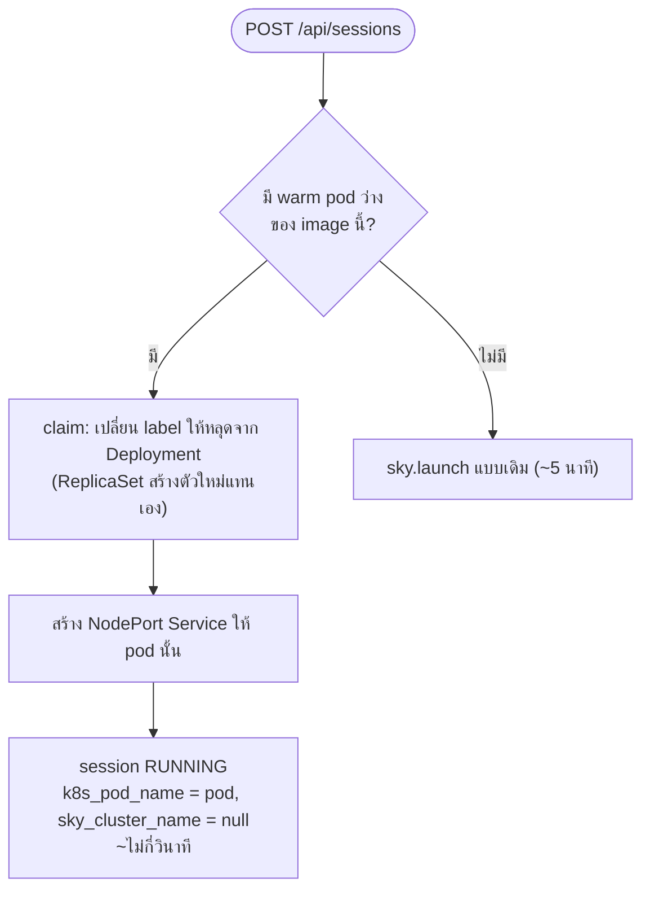

# Experiment: Pre-pull lab image ด้วย DaemonSet

## ภาพรวม architecture (จาก diagram)

- **Database** → อ่านตาราง `class_slots` (ดู add-class-schedule-tables.md)
- **Scheduler (x time)** → เป็น process ของเราเอง (ไม่ใช่ kube-scheduler) ทำงานตามเวลาที่ตั้งไว้
  - อ่านจาก Database ว่าคาบไหนใกล้ถึงเวลา
  - สั่งสร้าง **DaemonSet A** และ **DaemonSet B**
- **DaemonSet** = สร้าง pod 1 ตัวต่อ 1 node อัตโนมัติ (1 node : 1 pod)
  - 1 DaemonSet = 1 image ถ้ามีหลาย image ต้องมีหลาย DaemonSet
- **ใน cluster**: ทุก worker node จะมีทั้ง `Pod A` (จาก DaemonSet A) และ `Pod B` (จาก DaemonSet B)
- ทิศทาง: Scheduler → DaemonSet A → Pod A ทุก node / Scheduler → DaemonSet B → Pod B ทุก node

## Cluster

- K3s, worker node 2 ตัว: `worker-pete`, `thinkpad`
- (diagram วาดไว้ 3 node เพื่อแสดงแนวคิด ของจริงมี 2)

## Experiment 1: DaemonSet installing

1. Push image K3s "Hello" เข้า registry
2. สร้าง **DaemonSet A** ให้ pull image จาก registry ไปรอไว้ที่ทั้ง 2 node (`worker-pete`, `thinkpad`)

อย่างไรก็ตามยังไม่มี thinkpad เป็น k3s worker ให้ Ansible playbook install ลงเครื่องนี้ได้เลยนะ
3. สร้าง **DaemonSet B** อีกตัว ให้ pull image อีกตัวจาก registry
4. สร้าง **Scheduler** ที่สั่งให้ DaemonSet ทั้ง 2 ตัว pull image K3s Hello
5. สร้าง API 1 เส้น คล้ายกับเส้น launch สำหรับ [ยังไม่ระบุ — ถามผมก่อน]

## Experiment 2: Integrating

1. แก้ database ตามที่ระบุใน `add-class-schedule-tables.md`
2. ให้ Scheduler อ่าน `class_slots` แล้วพอใกล้ถึงคาบ ให้สร้าง DaemonSet ที่ทำให้ pod (และ image) ไปอยู่ครบทุก worker
   - คำถาม: ทำได้ไหม และควรทำแบบไหน

## ข้อตกลง

- ทำทีละ experiment ทำ Experiment 1 ให้ผ่านก่อนแล้วค่อยไป 2
- ถ้าตรงไหนไม่ชัดหรือขัดกับโค้ดที่มี ให้ถามก่อนลงมือ

---

## Exp1 — สิ่งที่ทำแล้ว (branch `experiment/prewarm-daemonset`)

| ชิ้น | ไฟล์ | หน้าที่ |
|---|---|---|
| DaemonSet | `web-portal/backend/app/services/prewarm_service.py` | 1 image = 1 DaemonSet ลงเฉพาะ worker (nodeAffinity ไม่ลง control-plane) สร้างซ้ำได้ (409 = ผ่าน) |
| Scheduler | `web-portal/backend/app/services/prewarm_scheduler.py` | งานพื้นหลังใน backend ทุก `PREWARM_INTERVAL_SECONDS` เทียบ "image ที่ต้องมีตอนนี้" กับ DaemonSet ที่มี → สร้างตัวที่ขาด ลบตัวที่หมดเวลา |
| API | `GET /api/prewarm`, `GET /api/prewarm/{name}` | ดูว่า worker ไหน pull เสร็จแล้ว (`waiting` / `pulling` / `pulled` / `error`) และใช้เวลากี่วินาที |
| Image | `experiments/prewarm/hello/Dockerfile` | busybox + ไฟล์สุ่ม 50 MB, `v1` / `v2` layer คนละชุด |
| เทส | `web-portal/backend/tests/prewarm/` | 19 เคส (FakeK8s ไม่ต่อ cluster จริง) |

ตั้งค่าใน `web-portal/backend/.env` (Exp1 กำหนดเวลาเอง Exp2 จะเปลี่ยนไปอ่าน `class_slots` แทน แก้แค่ `desired_images`)

```env
PREWARM_ENABLED=true            # ค่าเริ่มต้น false (เพิ่มหลัง Exp1) ไม่เปิด = scheduler ไม่ทำงาน
PREWARM_INTERVAL_SECONDS=20
PREWARM_TARGETS=[{"image":"100.127.74.48:5001/vlab/hello:v1","start_at":"2026-10-17T14:00:00+07:00","end_at":"2026-10-17T14:30:00+07:00"},{"image":"100.127.74.48:5001/vlab/hello:v2","start_at":"2026-10-17T14:00:00+07:00","end_at":"2026-10-17T14:30:00+07:00"}]
```

### ขั้นตอนทดลอง (Pete รัน)

**0. ThinkPad เป็น worker** — เพิ่มใน `ansible/inventory.yml` group `workers`

```yaml
        thinkpad:
          ansible_host: "<Tailscale IP ของ ThinkPad>"   # tailscale ip -4
          ansible_connection: local
```

```bash
cd ansible
ansible-playbook -i inventory.yml site.yml --limit thinkpad --list-tasks   # ดูก่อนว่าจะทำอะไร
ansible-playbook -i inventory.yml site.yml --limit thinkpad -K
kubectl --kubeconfig web-portal/backend/kubeconfig.yaml get nodes -o wide  # worker-pete + thinkpad = Ready
```

ข้อควรระวัง: role `common` ลง package + เปิด ip_forward, role `k3s-agent` ลง k3s agent (containerd ของตัวเอง แยกจาก Docker)
ThinkPad รัน Postgres / backend / SkyPilot API อยู่ pod ของ lab ที่มาลงเครื่องนี้จะแย่ง RAM ด้วย
ต้องมี `ansible/artifacts/node-token` และ host ใน group `master` / `registry` ที่ถูกต้องใน inventory

**1. build + push hello**

```bash
docker build --build-arg VERSION=v1 -t 100.127.74.48:5001/vlab/hello:v1 experiments/prewarm/hello
docker build --build-arg VERSION=v2 -t 100.127.74.48:5001/vlab/hello:v2 experiments/prewarm/hello
docker push 100.127.74.48:5001/vlab/hello:v1 && docker push 100.127.74.48:5001/vlab/hello:v2
```

**2. ตั้ง `.env` ข้างบนให้ `start_at` อีก ~2 นาที แล้วเปิด backend** → log ต้องขึ้น `Prewarm scheduler: {'created': [...]}`

**3. ดูสถานะ** `curl -s localhost:8000/api/prewarm | jq` จนทั้ง 2 worker เป็น `pulled` จด `pulled_in_seconds`

**4. หลัง `end_at`** log ต้องขึ้น `removed` และ DaemonSet หาย แต่ image ยังอยู่บน node:
`sudo k3s crictl images | grep hello` (รันบนแต่ละ worker)

**5. วัด cache** ตั้ง target ใหม่ด้วย image เดิม → `pulled_in_seconds` ควรเหลือไม่กี่วินาที

**6. tag ผิด** ใส่ `hello:nope` → GET ต้องเป็น `error` + `ErrImagePull` / `ImagePullBackOff`

### ผล Exp1

รอบที่ 1: 2026-10-17 `start_at` 01:26:30 / `end_at` 01:36:30, `PREWARM_INTERVAL_SECONDS=20`, image `vlab/hello:v1` + `v2` (~55 MB ต่อตัว)

| เคส | worker-pete | thinkpad | หมายเหตุ |
|---|---|---|---|
| ThinkPad join cluster | – | ✅ | ต้องลบ k3s server เดิมบน ThinkPad ก่อน (`script/k3s-remove-local.sh`) |
| สร้าง DaemonSet A/B ตรงเวลา | ✅ | ✅ | สร้างตอน 01:26:39 (tick แรกหลัง `start_at`) ไม่ลง master, `workerfilm` (NotReady) = `waiting / node NotReady` |
| pull ครั้งแรก (ไม่มี cache) `pulled_in_seconds` | v1 45.0 s / v2 45.0 s | v1 108.0 s / v2 120.0 s | kubelet วัดเฉพาะ pull: worker-pete 21.5 / 18.7 s, thinkpad 1m44.8 / 1m57.5 s — ThinkPad ต่อ Wi-Fi 2.4 GHz |
| backend restart กลางช่วง | ✅ | ✅ | backend หยุดไปแล้วเปิดใหม่ 01:33 ไม่สร้างซ้ำ (ใช้ annotation เทียบ) |
| ลบหลัง `end_at` image ยังอยู่ | ✅ | ✅ | ลบตอน 01:36:40 `node.status.images` ยังมี v1 / v2 ครบ |
| pull ซ้ำ (มี cache) | ⏭️ | ⏭️ | ข้าม (Pete ตัดสินใจ 2026-10-17) ยังไม่ได้วัดตัวเลขจริง |
| tag ผิด → error | ⏭️ | ⏭️ | ข้าม มีแค่เทส unit (`test_pull_error`) |

สิ่งที่เจอระหว่างทดลอง
- `worker-pete` เป็น NotReady ~15 วินาที (01:28:21–01:28:36) DaemonSet ลด desired เหลือ 1 ทันที แต่ API ยังตอบ
  `worker-pete=pulled` เพราะสถานะ pod ค้างค่าเดิม → ควรเพิ่ม field `node_ready` แยก
- `GET /api/prewarm` ใช้ 1–2 วินาที บางครั้งเกิน 5 วินาที (เรียก k8s API 3 ครั้งผ่าน Tailscale) ถ้าหน้าเว็บจะ poll ควร cache
- ThinkPad pull ช้ากว่า ~5 เท่า: Wi-Fi 2.4 GHz และ pull 2 image พร้อมกัน (~1 MB/s)

---

## Exp3 (ร่าง รอ Pete อนุมัติก่อนเขียนโค้ด) — warm pod

แนวคิด: ก่อนคาบสร้าง pod ของ lab ขึ้นรอไว้เลย เส้น launch ดูว่ามี pod ว่างไหม ถ้ามีแจกให้ทันที ถ้าไม่มีค่อย launch ผ่าน SkyPilot แบบเดิม
ได้มากกว่า pre-pull เพราะ SkyPilot บน K3s ใช้ ~5 นาทีแม้ image อยู่ใน cache แล้ว (provision + ลง runtime ใน pod)



| เรื่อง | ข้อเสนอ |
|---|---|
| ตัวถือ pool | **Deployment ไม่ใช่ DaemonSet** — DaemonSet ได้ 1 pod/node (2 worker = 2 pod) แต่คาบมี 40 ที่ replicas = min(`expected_seats`, ที่เครื่องรับไหว) DaemonSet ยังใช้ pre-pull ต่อ |
| แจก pod | patch label `vlab/pool=warm` → `claimed` ใช้ `resourceVersion` กัน 2 request แย่ง pod เดียวกัน (ชนได้ 409 ก็ลองตัวถัดไป) |
| endpoint | NodePort Service ต่อ pod เก็บใน `sessions.endpoints` รูปแบบเดียวกับของ SkyPilot (`{"8080": "http://..."}`) |
| อายุ lab | ไม่มี autostop ของ SkyPilot → reconciler ลบ pod + Service เองเมื่อถึง `expires_at` |
| DB | ใช้ `sessions.k8s_pod_name` ที่มีอยู่แล้ว reconciler / delete เพิ่มเคส "มี pod ไม่มี cluster" (ตอนนี้ข้ามแถวแบบนี้) |
| ข้อจำกัด | env ของ pod ตั้งตอนสร้าง = เหมือนกันทุกคน (เช่น `IDE_PASSWORD`) / worker-pete RAM ใช้ได้ ~3 GB ถ้า lab ขอ 2+ GB ได้ ~1 pod ต่อเครื่อง / pod ว่างกินทรัพยากรแม้ไม่มีคนใช้ |
| ขัดกับ doc | `add-class-schedule-tables.md` ห้ามแก้ logic launch เดิม — Exp3 ต้องแก้ จึงรออนุมัติ |

---

## Exp2 — ตารางเรียน + scheduler อ่านคาบจาก DB (branch `experiment/prewarm-daemonset`)

ทำตาม `add-class-schedule-tables.md` + ต่อ scheduler (Pete ตัดสินใจ 2026-10-17: migration แบบ drop DB + init + seed,
scheduler เขียน `class_slots.status` ด้วย, scheduler ปิดไว้เป็นค่าเริ่มต้น)

| ชิ้น | ไฟล์ |
|---|---|
| model | `app/models/class_schedule.py`, `app/models/class_slot.py`, `sessions.class_slot_id` ใน `app/models/session.py` |
| generate slot | `app/services/schedule_service.py` (`generate_slots`) |
| scheduler | `app/services/prewarm_scheduler.py` อ่าน `class_slots` + `PREWARM_TARGETS` ใน .env |
| seed | `app/seeds/seed.py` ข้อ 12 |
| คาบทดลอง | `script/prewarm_demo_slots.py` (2 คาบ คนละ image คาบแรกจบก่อน) |
| เทส | `tests/prewarm/test_class_slots.py` (21 เคส ใช้ DB เทส) |

ตั้งค่า (.env)

| ค่า | default | ความหมาย |
|---|---|---|
| `PREWARM_ENABLED` | `false` | สวิตช์หลัก ไม่เปิด = ไม่สร้าง / ลบ DaemonSet ไม่แตะ slot (GET /api/prewarm ยังใช้ได้) |
| `PREWARM_INTERVAL_SECONDS` | `60` | เทียบทุกกี่วินาที |
| `PREWARM_LEAD_MINUTES` | `30` | เริ่ม pull ก่อน `starts_at` กี่นาที ลบ DaemonSet ตอน `ends_at` |
| `PREWARM_NODE_GRACE_MINUTES` | `5` | worker ที่หลุดไม่เกินกี่นาทียังนับว่าต้องมี image (READY รอจนกลับมา) หลุดนานกว่านี้ = ปิดเครื่อง ไม่นับ |

กฎของ scheduler
- desired = image ของ slot ที่ `starts_at - lead <= now < ends_at`, ไม่ถูกลบ, status ไม่ใช่ DONE / CANCELLED, `run_target = KUBERNETES`
- 2 คาบคนละ image = 2 DaemonSet คาบไหนจบลบของคาบนั้น / image เดียวกัน = DaemonSet เดียว ลบตอนคาบสุดท้ายจบ
- status: SCHEDULED → PREWARMING (สร้าง DaemonSet แล้ว) → READY (`all_pulled`) → DONE (เลย `ends_at`)
  `all_pulled` = worker ที่ Ready ทุกเครื่อง pull แล้ว **และ**ไม่มีเครื่องที่เพิ่งหลุด (ไม่ใช้ `number_ready >= desired` ของ
  DaemonSet เพราะ k8s ลด desired ตามเครื่องที่หลุด)
  READY กลับเป็น PREWARMING ได้ถ้ามี worker ใหม่ที่ยัง pull ไม่เสร็จ
- image เต็ม = `DOCKER_REGISTRY_HOST/<repository>:<tag>` แบบเดียวกับ `_build_k8s_task` (ต้องตรงกัน ไม่งั้น cache คนละชื่อ)
- backend หลายตัว: advisory lock `880_002` (reconciler ใช้ `880_001`)

### Constraint อยู่ที่ไหน

| กฎ | ระดับ | ที่ |
|---|---|---|
| `weekday` 0–6, `end_time > start_time`, `valid_until >= valid_from`, `expected_seats > 0` | DB (CHECK) | `class_schedules` |
| `ends_at > starts_at`, `expected_seats > 0` | DB (CHECK) | `class_slots` |
| slot วิชาเดียวกันห้ามทับกัน (ยกเว้น CANCELLED / ลบแล้ว, ต่อกันพอดีได้) | DB (EXCLUDE gist + `btree_gist`) | `ex_class_slots_no_overlap` |
| `lab_image_id` NOT NULL + `ON DELETE RESTRICT` | DB | `class_slots` |
| `sessions.class_slot_id` `ON DELETE SET NULL` | DB | `sessions` |
| index `(starts_at)`, `(course_id, starts_at)` | DB | `class_slots` |
| generate ไม่สร้างซ้ำ (เทียบ `schedule_id + starts_at` รวม slot ที่ลบแล้ว) | โค้ด | `generate_slots` |
| schedule ไม่มี `default_lab_image_id` generate ไม่ได้ | โค้ด | `generate_slots` |
| แปลงเวลาไทย → UTC (`ZoneInfo("Asia/Bangkok")`) | โค้ด | `schedule_service` |

`btree_gist` ถูกสร้างด้วย event `before_create` ของตาราง `class_slots` → `create_all` (init_db.py / DB เทส) สร้างให้เอง

### ผลตรวจงาน (DB จริง หลัง drop + init + seed 2026-10-17)

| ข้อ | ผล |
|---|---|
| 1. init_db + run_seed บน DB ใหม่ | ✅ ไม่มี error (9 slot: SE301 8 + DEVOPS201 1) |
| 2. SE301 8 แถว จันทร์ 09:00 เวลาไทย | ✅ 21 ก.ย. – 9 พ.ย. ทุกแถว 09:00–12:00 (02:00Z) ผ่านแล้ว 4 / ยังไม่ถึง 4 |
| 3. insert slot ทับเวลา | ✅ `violates exclusion constraint "ex_class_slots_no_overlap"` |
| 4. generate ซ้ำ | ✅ 8 → 8 (created 0) |
| DEVOPS201 จองครั้งเดียว | ✅ ศุกร์ 23 ต.ค. 13:00 `schedule_id = null` 25 ที่ |

### ทดลองจริง 2 คาบ (Pete รัน)

```bash
cd web-portal/backend
# .env: PREWARM_ENABLED=true / PREWARM_INTERVAL_SECONDS=20 / PREWARM_LEAD_MINUTES=1
venv/bin/python script/prewarm_demo_slots.py              # เริ่มอีก 2 นาที, v1 5 นาที, v2 10 นาที
venv/bin/uvicorn app.main:app --port 8000 2>&1 | grep --line-buffered -i -E "prewarm|error|traceback"
```

ที่ต้องเห็น: ~1 นาทีก่อนคาบ DaemonSet 2 ตัว + slot PREWARMING → READY (cache มีแล้วจาก Exp1 ควรเร็ว)
→ คาบแรกจบ ลบเฉพาะ v1 + slot แรก DONE → คาบสองจบ ลบ v2 ด้วย ปิดงาน: `script/prewarm_demo_slots.py --clear`

รอบจริง 2026-10-17: ทั้งสองคาบเริ่ม 02:14:15, SE301 (`hello:v1`) จบ 02:16:15, DEVOPS201 (`hello:v2`) จบ 02:19:15
`PREWARM_LEAD_MINUTES=1`, `PREWARM_INTERVAL_SECONDS=20` (รอบแรกไม่มีอะไรเกิดเพราะลืมใส่ `PREWARM_ENABLED=true` = สวิตช์ทำงานตามที่ออกแบบ)

| เคส | เวลา | ผล |
|---|---|---|
| สร้าง DaemonSet 2 ตัวก่อนคาบ | 02:13:40 | ✅ tick แรกหลังเปิด backend (เลย `starts_at - 1 นาที` แล้ว) |
| slot → PREWARMING | 02:13:44 | ✅ ทั้งคู่ |
| DaemonSet 2/2 (มี cache จาก Exp1) | 02:13:47 | ✅ **7 วินาที** หลังสร้าง (Exp1 ไม่มี cache 45–120 วินาที) |
| slot → READY | 02:14:05 | ✅ ก่อนคาบเริ่ม 10 วินาที |
| คาบแรกจบ ลบเฉพาะ v1, SE301 → DONE, v2 ยังอยู่ | 02:16:27 | ✅ (หลัง `ends_at` 12 วินาที = รอ tick) |
| คาบสองจบ ลบ v2, DEVOPS201 → DONE | 02:19:31 | ✅ (หลัง `ends_at` 16 วินาที) |

สิ่งที่เจอ
- `worker-pete` NotReady อีกครั้ง ~28 วินาที (02:16:06–02:16:34) เป็นครั้งที่ 2 ของคืน ต้องดูสาเหตุที่เครื่องนั้น
- **ช่องโหว่ของ READY (แก้แล้ว):** ตอน worker หลุด k8s ลด `desired` เหลือ 1 ทำให้ `ready >= desired` ยังจริง slot v2
  เลยยัง READY ทั้งที่เหลือ worker เดียว → เปลี่ยนเป็น `all_pulled` ดูราย node (+ field `node_ready`) เครื่องที่เพิ่งหลุด
  ≤ `PREWARM_NODE_GRACE_MINUTES` ทำให้ slot กลับเป็น PREWARMING จนกว่าจะกลับมา (เทส regression ใน `tests/prewarm`)
- ลบช้ากว่า `ends_at` ได้สูงสุด 1 interval (20 วินาที) ไม่มีผลกับนักศึกษา เพราะลบแค่ holder pod image ยังอยู่
