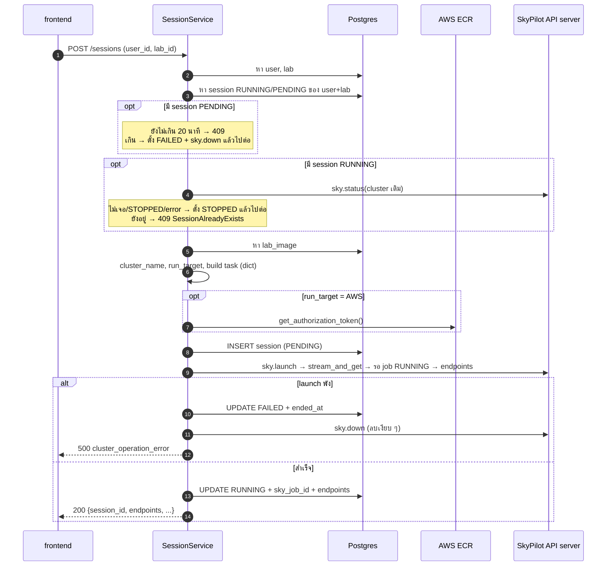

# Session Flow — เปิด/ปิด lab ไป K3s หรือ AWS

> อธิบายเส้น `POST /api/sessions` และ `DELETE /api/sessions/{id}` หลัง PR #88
> (`feature/sky-aws-launch`) ตั้งแต่ผู้ใช้กดปุ่มจนได้ endpoint ของ lab และตอนปิด lab

## 1. ภาพรวม

```
frontend (session.ts)
   │ POST /api/sessions {user_id, lab_id}
   ▼
session_route.py ─▶ SessionController ─▶ SessionService.create_session()
                                              │
                         อ่าน labs.run_target ─┤
                                              ├─ KUBERNETES ─▶ _build_k8s_task() ─▶ pod บน K3s
                                              └─ AWS ────────▶ _build_aws_task() ─▶ EC2 + docker run
                                              │
                                              ▼
                                  SkyPilot client (sky.launch)
                                              │ HTTP
                                              ▼
                                  SkyPilot API server ─▶ kubeconfig / AWS credential
```

ไฟล์ที่เกี่ยวข้อง

| ชั้น | ไฟล์ |
|---|---|
| route | `web-portal/backend/app/routes/session_route.py` |
| controller | `web-portal/backend/app/controllers/session_controller.py` |
| service (logic ทั้งหมด) | `web-portal/backend/app/services/session_service.py` |
| ขอ ECR token | `web-portal/backend/app/adapters/ecr_adapter.py` |
| model | `app/models/lab.py` (`run_target`), `app/models/session.py`, `app/models/lab_image.py` |
| config | `app/configs/settings.py`, `backend/.env` |

## 2. ตัวเลือก K3s / AWS อยู่ที่ไหน

- ตัวที่ตัดสินคือ **`labs.run_target`** (`KUBERNETES` | `AWS`) ตั้ง **ราย lab** ทุกคนที่เปิด lab
  เดียวกันไปที่เดียวกัน ไม่มีให้ผู้ใช้เลือก และไม่มี fallback ข้ามกัน
- `sessions.is_cloud` **ไม่ใช่ตัวเลือก** เป็นแค่บันทึกว่า session นี้รันที่ไหน
  (`is_cloud = run_target == AWS`) ไม่มีโค้ดไหนอ่านกลับไปตัดสินใจ
  แต่มีประโยชน์ตอนเปลี่ยน `run_target` ของ lab ทีหลัง เพราะ session เก่ายังบอกได้ว่ารันที่ไหน
- ตอนนี้ตั้ง `run_target` ผ่าน API ไม่ได้ (`LabCreateRequest`/`LabUpdateRequest` ไม่มี field นี้)
  ต้อง `UPDATE` ตรงใน DB หรือแก้ผ่านหน้า SQLAdmin

## 3. `create_session()` ทีละขั้น



### 3.1 ตรวจ input
1. หา `User` ไม่เจอ → `UserNotFoundError` (404)
2. หา `Lab` ไม่เจอ → `LabNotFoundError` (404)

### 3.2 กันเปิดซ้ำ
หา session ของ `user_id + lab_id` ที่สถานะ `RUNNING` **หรือ `PENDING`** (PENDING เพิ่มใน PR นี้)
และยังไม่ถูก soft delete

**ถ้าเป็น `PENDING`** (launch รอบก่อนยังไม่จบ) ไม่ถาม SkyPilot เลย

| อายุ session (`started_at`) | ทำอะไร |
|---|---|
| ไม่เกิน `PENDING_TIMEOUT` (20 นาที) | ตอบ 409 `SessionAlreadyExistsError` ("Session is still starting") |
| เกิน 20 นาที | ถือว่าค้าง (backend ตายกลาง launch) ตั้ง `FAILED` + `_down_quietly()` แล้วสร้างใหม่ต่อ |

ที่ห้ามถาม `sky.status` ตอน PENDING เพราะช่วงไม่กี่วินาทีแรกของ launch SkyPilot ยังไม่มี
record ของ cluster ถ้าถามจะได้ "ไม่มี record" แล้วถูกตีความว่า cluster หายไปแล้ว
(เทสกับ K3s จริงก่อนแก้: กด Start ซ้ำตอน t=2s ได้ 2 pod ของ user เดียวกัน)

**ถ้าเป็น `RUNNING`** และมี `sky_cluster_name` จะถาม SkyPilot ว่า cluster ยังอยู่ไหม

| ผล `sky.status` | ทำอะไร |
|---|---|
| ไม่มี record | ตั้ง session เดิมเป็น `STOPPED` แล้วสร้างใหม่ต่อ |
| `STOPPED` / `AUTOSTOPPING` | ตั้ง `STOPPED` แล้วสร้างใหม่ต่อ |
| สถานะอื่น (`INIT`, `UP`) | ตอบ 409 `SessionAlreadyExistsError` |
| เรียกแล้ว error | print warning ตั้ง `STOPPED` แล้วสร้างใหม่ต่อ |

### 3.3 เตรียม image และชื่อ cluster
- ไม่มี `lab.image_id` → `LabImageMissingError` (400) / หา `LabImage` ไม่เจอ → 404
- `_cluster_name()`: เอาส่วนท้ายของ `repository` ทำเป็นตัวเล็ก แทนตัวที่ไม่ใช่ `a-z0-9-` ด้วย `-`
  แล้วต่อ unix time เช่น `skypilot/music-lab` → `music-lab-1791702290`
  ถ้าไม่ได้ขึ้นต้นด้วยตัวอักษรจะเติม `lab-` ข้างหน้า (`org/2048-game` → `lab-2048-game-<ts>`)
  เพราะ SkyPilot ไม่รับชื่อ cluster ที่ขึ้นต้นด้วยตัวเลข

### 3.4 สร้าง task config
`create_fastapi_task()` คืน `dict` แล้วส่งเข้า `sky.Task.from_yaml_config()` ตรง ๆ
(เดิมต่อ YAML ด้วย f-string ซึ่งพังเมื่อ env มี `:`/`#` หรือ entrypoint หลายบรรทัด)

helper ที่ใช้ร่วมกัน
- `_lab_envs()` — `lab_image.env_vars` แปลงเป็น `str` ทุกค่า + `APP_ENV=staging`
  (copy ใหม่ ไม่แก้ dict ของ ORM เหมือนโค้ดเดิม)
- `_autostop()` — `idle_minutes = lifespan_minutes` (default 60), `down: true`, `wait_for: none`
  (`none` = ลบเมื่อครบเวลาโดยไม่รอ job/SSH → `lifespan_minutes` คืออายุสูงสุดของ lab)

#### K3s — `_build_k8s_task()`
SkyPilot รัน image ของ lab เป็น pod ตรง ๆ (container mode)

```yaml
name: music-lab-1791702290
resources:
  infra: kubernetes                 # ใช้ current-context ของ kubeconfig (ดูหัวข้อ 6)
  cpus: 2+                          # lab_images.cpu_requirement
  memory: 4+                        # lab_images.memory_requirement
  disk_size: 50
  image_id: docker:100.127.74.48:5001/skypilot/music-lab:lab-01   # DOCKER_REGISTRY_HOST
  ports: [8080, 5173, 8443]         # lab_images.exposed_ports
  autostop: {idle_minutes: 60, down: true, wait_for: none}
envs: {IDE_PASSWORD: musiclab, APP_ENV: staging}
workdir: ...                        # ถ้ามี
run: /bin/bash /run.sh              # lab_images.entrypoint_script
```

#### AWS — `_build_aws_task()`
VM mode: บูต EC2 จาก AMI ที่ bake SkyPilot runtime ไว้แล้ว (~1 นาที) แล้ว `docker run` image
จาก ECR เอง ไม่ใช้ `image_id: docker:` เพราะ container mode ต้องลง runtime ใหม่ทุกครั้ง (~5 นาที)

```yaml
name: music-lab-1791702290
resources:
  infra: aws/ap-southeast-1         # AWS_REGION
  instance_type: m7i-flex.large     # AWS_INSTANCE_TYPE
  disk_size: 30                     # AWS_DISK_SIZE
  image_id: ami-0da9046ec7f57f3af   # AWS_LAB_AMI (vlab-bake-0.12.3.post1-r2)
  ports: [8080, 5173, 8443]
  autostop: {idle_minutes: 60, down: true, wait_for: none}
setup: |
  echo "$ECR_TOKEN" | sudo docker login -u AWS --password-stdin <ECR_REGISTRY_HOST>
  sudo docker pull <ECR_REGISTRY_HOST>/skypilot/music-lab:lab-01
run: |
  sudo docker run --rm --name lab -p 8080:8080 -p 5173:5173 -p 8443:8443 \
    -e IDE_PASSWORD=musiclab -e APP_ENV=staging <image> /bin/bash -c '/bin/bash /run.sh'
```

- `entrypoint_script` ว่าง → ไม่ต่อคำสั่ง ใช้ ENTRYPOINT/CMD ของ image เอง (จำเป็นกับ image ที่ตั้ง
  ENTRYPOINT ไว้ เช่น code-server `vlab/music-lab-ide` ถ้าต่อคำสั่งจะกลายเป็น argument ของมัน)
- entrypoint ส่งเป็นก้อนเดียวผ่าน `bash -c` ถ้าต่อท้ายตรง ๆ แล้ว entrypoint มีหลายบรรทัด
  บรรทัดที่ 2 เป็นต้นไปจะไปรันบน VM แทนที่จะรันใน container

- ไม่ตั้ง `ECR_REGISTRY_HOST` หรือ `AWS_LAB_AMI` → `ClusterOperationError` ทันที
- env ของ lab ไปเป็น `-e` ของ `docker run` ไม่ใส่ `envs:` เพราะ `envs:` อยู่บน VM ไม่เข้า container
- ทุก argument ผ่าน `shlex.quote`
- `docker run` รัน foreground → job อยู่ใน RUNNING ตลอดที่ lab เปิด
- registry ต้องเป็นชื่อ dual-stack (`...dkr-ecr.<region>.on.aws`) เพราะ private subnet ออกได้แค่ IPv6

### 3.5 ECR token (AWS เท่านั้น)
- `get_ecr_token()` ใช้ boto3 credential chain ของ backend เรียก `ecr:GetAuthorizationToken`
  แล้ว decode `base64("AWS:<password>")` เอาแค่ password (อายุ 12 ชม.)
- ขอ **ก่อน** INSERT session ถ้าขอไม่ผ่านจะไม่มี record ค้าง → `ClusterOperationError`
- ส่งเป็น `secrets_overrides=[("ECR_TOKEN", ...)]` SkyPilot ซ่อนค่าใน log/dashboard
  ไม่อยู่ใน YAML และไม่ลง DB ของเรา
- ต้องขอเองเพราะ SkyPilot login ECR อัตโนมัติได้แค่ชื่อ `.dkr.ecr.` + `.amazonaws.com`

### 3.6 บันทึก PENDING → launch → RUNNING
1. `INSERT` session `status=PENDING`, `sky_cluster_name`, `is_cloud`, `started_at`
   (`sky_job_id`, `endpoints` ยังเป็น `NULL`)
2. `sky.launch()` → `sky.stream_and_get()` (รอจนเสร็จ: K3s วัดได้ 160–280 วินาที,
   AWS ~2.5 นาที HTTP request ค้างรอตลอด)
3. `_wait_job_running()` เรียก `sky.job_status()` ทุก 5 วินาที จนพ้น `INIT`/`PENDING`/`SETTING_UP`
   (timeout 10 นาที) ต้องเป็น `RUNNING` เท่านั้น เพราะ `sky.launch` คืนตั้งแต่ส่ง job ส่วน `setup:`
   (docker login + pull) รันต่อทีหลัง ถ้าไม่รอ pull ที่พังจะถูกบันทึกเป็น RUNNING (เจอจริงบน AWS)
4. `sky.endpoints()` → แปลงเป็น `{"8080": "http://..."}`
5. `UPDATE` เป็น `RUNNING` + `sky_job_id` + `endpoints`

ถ้าข้อ 2–4 พัง: `UPDATE` เป็น `FAILED` + `ended_at` → `_down_quietly()` (`sky.down` แล้วรอ
ถ้าไม่มี cluster ก็ข้าม ถ้าลบไม่ได้แค่ print warning) → `ClusterOperationError` (500)

เหตุผลที่บันทึกก่อน launch: ถ้า launch พังกลางทาง ยังรู้ชื่อ cluster ไว้ตามลบ บน AWS cluster
ที่ไม่มี record คือ EC2 ที่เปิดค้างเสียเงิน

## 4. `delete_session()`

```
หา session ─ ไม่เจอ → 404
   │
   ├─ status RUNNING หรือ PENDING
   │     ├─ มี sky_cluster_name → sky.get(sky.down(name))   ← รอจนลบเสร็จจริง
   │     │       ├─ สำเร็จ              → cluster_stopped = true
   │     │       ├─ ClusterDoesNotExist → ข้าม (autostop ลบไปแล้ว)
   │     │       └─ error อื่น          → 500 (ไม่ลบ session)
   │     └─ ตั้ง STOPPED + ended_at
   │
   └─ soft delete (deleted_at)
```

`sky.down` ใช้ชื่อ cluster อย่างเดียว SkyPilot รู้เองว่าอยู่ K3s หรือ AWS จึงไม่ต้องดู `is_cloud`

## 5. สถานะ session

```
            INSERT
              │
              ▼
          PENDING ──launch พัง / ค้างเกิน 20 นาที──▶ FAILED
              │
       launch สำเร็จ
              ▼
          RUNNING ──DELETE / ตรวจเจอว่า cluster หาย──▶ STOPPED
```

## 6. ใช้ cluster ไหน

- backend **ไม่ได้คุยกับ K3s เอง** ทุกอย่างผ่าน SkyPilot client → SkyPilot API server
  (`~/.sky/config.yaml` → `api_server.endpoint`)
- `infra: kubernetes` ใช้ **current-context** ของ kubeconfig ที่ฝั่ง SkyPilot อ่าน ตอน deploy
  ด้วย Ansible คือ `KUBECONFIG=/app/kubeconfig.yaml` ใน container backend ซึ่ง role
  `web-portal` ดึงมาจาก master แล้วเปลี่ยน `server:` เป็น Tailscale IP ของ master
- 1 master (k3s server) = 1 cluster เครื่องที่บ้านกับเครื่องที่มหาลัยถ้าต่างคนต่างรัน k3s server
  เป็น **2 cluster แยกกัน** และ backend จะใช้ตัวที่ kubeconfig ชี้อยู่ตัวเดียว
- ถ้าอยากให้ SkyPilot ใช้หลาย cluster: ใส่หลาย context ใน kubeconfig แล้วตั้ง
  `kubernetes.allowed_contexts` ใน config ของ SkyPilot → `infra: kubernetes` จะลองทีละ context
  (failover) หรือระบุ `infra: kubernetes/<context>` เพื่อบังคับตัวเดียว (โค้ดตอนนี้ยังไม่ได้ทำ)
- `DOCKER_REGISTRY_HOST` ต้องเป็น registry ที่ node ของ cluster นั้น pull ได้ด้วย

## 7. Config ที่ใช้

| ค่า | ใช้กับ | ที่มา |
|---|---|---|
| `DOCKER_REGISTRY_HOST` | K3s | `.env` (default `100.127.74.48:5001`) |
| `KUBECONFIG` | K3s | env ของ process ที่รัน SkyPilot |
| `AWS_REGION` | AWS | `.env` (default `ap-southeast-1`) |
| `AWS_LAB_AMI` | AWS | `.env` (ต้องตั้ง) |
| `AWS_INSTANCE_TYPE` | AWS | `.env` (default `m7i-flex.large`) |
| `AWS_DISK_SIZE` | AWS | `.env` (default `30`) |
| `ECR_REGISTRY_HOST` | AWS | `.env` (ต้องตั้ง, dual-stack) |
| AWS credential | AWS | boto3 chain ของ backend + ฝั่ง SkyPilot API server |

## 8. ผลเทส

### K3s (2026-10-11, ที่บ้าน: master 100.125.244.48 + worker-pete)

เทสผ่าน API จริงกับ backend ในเครื่อง + SkyPilot 0.12.3.post1

| เคส | ผล |
|---|---|
| migrate `labs.run_target` | ✅ lab เดิมได้ `KUBERNETES` ทุกตัว |
| launch lab (OOP, `skypilot/music-lab:lab-01`) | ✅ 201 ใน 160–280 วินาที PENDING → RUNNING ได้ endpoints 3 พอร์ตเข้าได้จริง |
| กด Start ซ้ำตอน t=3s (PENDING) | ✅ 409 ทันที (ก่อนแก้: ได้ cluster ซ้อนเป็น 2 pod) |
| session PENDING ค้างเกิน 20 นาที | ✅ ถูกตั้ง `FAILED` แล้ว launch ใหม่ได้ |
| launch พัง (provision ไม่ได้ / pod Failed ตอน setup) | ✅ `FAILED` + `ended_at`, 500 `cluster_operation_error`, cluster ถูกลบ |
| DELETE ตอน RUNNING | ✅ รอ `sky.down` เสร็จ (~17 วินาที) `cluster_stopped: true` pod หายจริง |
| DELETE ตอน cluster ถูกลบไปแล้ว | ✅ 200 `cluster_stopped: false` (`ClusterDoesNotExist` ผ่าน `sky.get` ได้จริง) |
| builder offline (YAML K3s เทียบของเดิม, quote env, AWS config + secret) | ✅ |

ข้อสังเกตจากการเทส

- venv ที่ลง `kubernetes` 36.x จะ launch ไม่ได้ (`No module named 'kubernetes.client.models.dict[str, str]'`)
  ต้องลงตาม `requirement.txt` (`<36`)
- k3s ไม่ได้ taint master ไว้ pod ของ lab จึงไปลง master ได้ด้วย ถ้าไม่ต้องการต้องใส่ taint
  `node-role.kubernetes.io/control-plane:NoSchedule`

### AWS (2026-10-11, VPC `vlab-ecr-pull`, lab เทส `vlab/music-lab-ide:lab-01` พอร์ต 8080)

SkyPilot API server ในเครื่อง ใช้ IAM user `Skypilot-IAM` (เพิ่ม inline policy `ecr-pull-lab`
ให้ขอ ECR token + pull `vlab/music-lab-ide`) ทั้งสำหรับ launch และสำหรับ backend ขอ token

| เคส | ผล |
|---|---|
| launch | ✅ 201 ใน 84–86 วินาที `is_cloud=true` endpoint `http://10.10.2.x:8080` (private IP เข้าผ่าน Tailscale router) |
| EC2 | ✅ `m7i-flex.large`, private-a, ไม่มี public IP, SG `vlab-lab-instances`, role `vlab-lab-ecr-pull` |
| เปิด IDE | ✅ 302 → `/login` (code-server ใช้ `PASSWORD` จาก env ของ lab) |
| กด Start ซ้ำตอน PENDING | ✅ 409 |
| `ECR_TOKEN` ใน log (`sky logs`, provision log, API server, backend) | ✅ ไม่พบ |
| DELETE | ✅ 11 วินาที EC2 terminate |
| pull ไม่ผ่าน (tag ไม่มี) | ✅ 500 `FAILED_SETUP` + `FAILED` + EC2 ถูกลบ (ก่อนเพิ่ม `_wait_job_running`: ได้ 201 RUNNING และ EC2 ค้าง) |
| autostop `down` (lifespan 1 นาที, AMI r2) | ✅ 201 เวลา 21:20:39 → EC2 `shutting-down` 21:22:09 (รอบแรกที่ใช้ AMI เดิมลบไม่ได้ ดูด้านล่าง) |

**autostop เคยลบเครื่องไม่ได้ (แก้แล้ว):** skylet สั่ง terminate ด้วย role ของเครื่อง (`vlab-lab-ecr-pull`)
ติด 3 จุด แก้ใน branch `infra/ecr-pull-experiment`
1. ทางเน็ต: skylet ตั้ง `AWS_CONFIG_FILE=/dev/null` เลยไม่ใช้ dual-stack ใน `~/.aws/config` แล้วค้างที่ EC2 API IPv4
   → AMI `ami-0da9046ec7f57f3af` (`vlab-bake-0.12.3.post1-r2`) ใส่ `AWS_USE_DUALSTACK_ENDPOINT=true` ใน `/etc/environment`
2. สิทธิ์อ่าน: `terminate_instances` เรียก `DescribeVpcs` / `DescribeSecurityGroups` ก่อนลบ
3. สิทธิ์ลบ: role มีแค่ ECR → เพิ่ม `TerminateInstances` / `StopInstances` เฉพาะ tag `skypilot-cluster-name`
   (2–3 อยู่ใน `terraform/lab_autostop.tf`)

**ข้อจำกัด:** หลัง autostop ลบเครื่อง session ใน DB ยังเป็น `RUNNING` จนกว่าจะมีคนกด Start (ไปเจอตอนเช็ก
`sky.status`) หรือ DELETE (`ClusterDoesNotExist` → `cluster_stopped: false`)

## 9. ที่ยังค้าง

| เรื่อง | รายละเอียด |
|---|---|
| race ของ 2 request พร้อมกันจริง ๆ | ทั้งคู่ผ่านการเช็กก่อนที่อีกตัวจะ INSERT (มีมาตั้งแต่ก่อน PR) ต้องใช้ unique index หรือ lock ถ้าจะกันให้ขาด |
| session ค้าง RUNNING หลัง autostop | backend ไม่รู้ว่าเครื่องถูกลบเอง ต้องมีตัว sync สถานะ (กำลังออกแบบ) |
| lab ที่ใช้ 5173 / 8443 บน AWS | router (`vlab-ts-router`) เปิด egress แค่ 8080 ต้องเพิ่มใน `lab_access.tf` |
| เทส K3s ซ้ำหลังเพิ่ม `_wait_job_running` | ยังไม่ได้ทำ registry ที่บ้าน (`100.127.74.48:5001`) ค้าง pull ไม่ได้ (`ErrImagePull`) path พังทำงานถูก (`FAILED` ไม่มี pod ค้าง) |
| `skypilot/music-lab` บน AWS | ยังไม่มีใน ECR (เทสแค่ `vlab/music-lab-ide`) |
| PENDING เกิน 20 นาทีแต่ launch ยังไม่จบจริง | จะถูกลบทิ้งตอนมีคนกด Start ใหม่ ถ้า image ใหญ่จน pull นานเกิน ต้องขยาย `PENDING_TIMEOUT` |
