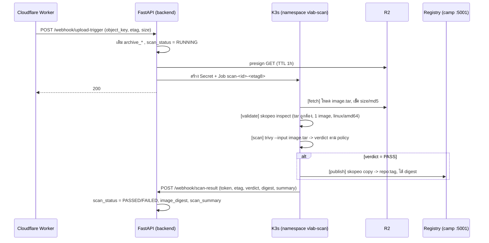

# Lab Image Scan Pipeline (แผน)

สถานะ: **แผน ยังไม่ได้เขียนโค้ด** ใช้ตัดสินใจก่อนลงมือ

เป้าหมาย: เมื่อ `.tar` ของ lab image ขึ้น R2 แล้ว (`handle_upload_event` ทำงาน) ให้ระบบสร้าง K8s Job
ไปตรวจ image ก่อน ถ้าผ่านค่อย push เข้า registry และบันทึก digest กลับมาที่ `lab_images`

---

## 1. เครื่องมือ: Trivy และ Skopeo คืออะไร

| เครื่องมือ | ทำอะไร | ทำไมเหมาะกับเคสนี้ |
|---|---|---|
| **Trivy** | สแกนความปลอดภัยของ image: ช่องโหว่ใน OS/library (CVE), secret ที่ฝังในไฟล์ (private key, token), misconfig | สแกนจากไฟล์ `.tar` ได้ตรงๆ (`trivy image --input image.tar`) ไม่ต้องมี Docker daemon และไม่ต้อง push ก่อน |
| **Skopeo** | ย้าย/ตรวจ image ระหว่าง storage ต่างๆ เช่น จาก `docker-archive:image.tar` ไปยัง `docker://registry/repo:tag` | ไม่ต้องมี Docker daemon และไม่ต้องรันเป็น root จึงรันใน Pod ได้ปลอดภัย, push ได้ทั้ง registry แบบ HTTP ของเรา (`--dest-tls-verify=false`) และ ECR, บอก digest ที่ได้ (`--digestfile`) |

ทางเลือกอื่นที่พิจารณาแล้ว:
- **crane** แทน skopeo: เบากว่า ใช้ `crane push image.tar registry/repo:tag` ได้ แต่ skopeo `inspect` ไฟล์ tar และอ่าน config ของ image ได้ดีกว่า จึงเลือก skopeo
- **docker build/load/push ใน Pod (DinD)**: ต้อง privileged ห้ามใช้กับไฟล์ที่ผู้ใช้อัปโหลดมา
- **ClamAV, Dockle, Grype/Syft**: ไม่จำเป็นใน v1 Trivy ครอบคลุม vuln + secret ไว้แล้ว เพิ่มทีหลังได้

**คำตอบข้อ "ควรมีอีกตัวไหม":** ไม่ต้องมี tool เพิ่ม แต่ควรมี **runner script เล็กๆ** (Python/bash)
ที่เรียก tool เหล่านี้ตามลำดับ ตัดสิน policy และรายงานผลกลับ แล้วรวมทั้งหมดไว้ใน **image เดียว**
(`vlab-scan-runner`: trivy + skopeo + curl + jq + script) ที่ pin เวอร์ชันและ build/push ลง registry ของเราเอง
ข้อดีคือคุมเวอร์ชันได้ ไม่ต้องไล่ดึง image ของหลายค่าย และไม่ต้องประกอบ shell ข้าม container

---

## 2. Pod โหลดไฟล์ยังไง: เลือก presigned GET ที่ backend ออกให้ตอนสร้าง Job

| ตัวเลือก | ข้อดี | ข้อเสีย |
|---|---|---|
| **A. Backend ออก presigned GET ตอนสร้าง Job แล้วส่งให้ Pod ผ่าน Secret (แนะนำ)** | Pod ไม่ต้องมี credential R2, ไม่ต้องมี endpoint ใหม่ให้ Pod เรียก, backend มี `r2_adapter` อยู่แล้ว เพิ่มแค่ `generate_presigned_get_url` | URL หมดอายุถ้า Pod รอคิวนาน (แก้ด้วย TTL 1 ชม. และ `activeDeadlineSeconds` สั้นกว่า TTL) |
| B. Pod ขอ presigned จาก FastAPI เอง | ได้ URL สดตอน Pod เริ่มจริง | ต้องมีระบบยืนยันตัวตน Pod -> backend, มี endpoint เพิ่ม, Pod ต้องเห็น backend ทาง network |
| C. ให้ Pod ถือ R2 token (read-only) | ง่ายสุด | Pod ประมวลผลไฟล์ที่ผู้ใช้อัปโหลด ถ้าถูกโจมตี credential รั่วไปด้วย ไม่ควรทำ |

ข้อควรระวังของ A:
- ใส่ URL ใน **Secret** ไม่ใส่ `env` ตรงๆ ใน Job spec (ใครอ่าน Job ได้ก็เห็น)
- เช็คความสมบูรณ์หลังโหลด: ขนาดไฟล์ต้องเท่ากับ `archive_size_bytes` และ `md5` ต้องเท่ากับ `archive_etag`
  (ETag ของ R2 สำหรับ PUT ก้อนเดียวคือ md5 ของไฟล์)

---

## 3. ภาพรวม flow

Pod หนึ่งตัว ประกอบด้วย initContainers ทำงานเรียงลำดับ ใช้ `emptyDir` ร่วมกัน:

1. `fetch`: curl โหลด tar + ตรวจ size/md5
2. `validate`: `skopeo inspect docker-archive:/work/image.tar` และ `--config` (ตรวจว่าเป็น image เดียว, architecture, ports ที่ expose ไม่ขัดกับที่ declare ตอน presign)
3. `scan`: `trivy image --input ... --scanners vuln,secret --format json` (ใช้ `--exit-code 0` เสมอเพื่อให้ได้ report แล้วให้ runner ตัดสิน policy เอง)
4. main `publish-and-report`: ถ้า PASS ให้ `skopeo copy` เข้า registry แล้ว POST ผลกลับ backend (ถ้า FAIL ก็ POST ผลเช่นกัน แต่ไม่ push)

---

## 4. Policy เริ่มต้น (ตั้งค่าได้ผ่าน settings)

| ข้อ | ค่าเริ่มต้นที่เสนอ |
|---|---|
| ช่องโหว่ที่ทำให้ไม่ผ่าน | `CRITICAL` ที่มี fix แล้ว (`--ignore-unfixed`) |
| ช่องโหว่ `HIGH` | เก็บใน report ไม่ block |
| Secret ที่ตรวจเจอ (private key, cloud token) | ไม่ผ่าน |
| รันเป็น root | เตือนอย่างเดียว (lab ที่มี code-server อาจต้องใช้) |
| ไฟล์ tar เสีย / หลาย image / ไม่ใช่ linux/amd64 | ไม่ผ่าน |
| ขนาด / เวลา | เกิน `activeDeadlineSeconds` หรือ ephemeral storage -> ERROR (ไม่ใช่ FAILED) |

ต้องตัดสินใจ: **สแกนไม่ผ่านแล้วทำอะไรต่อ** ข้อเสนอคือไม่ลบอัตโนมัติ ให้ตั้ง `scan_status = FAILED`
และเก็บ summary ไว้ให้อาจารย์เห็นว่าไม่ผ่านเพราะอะไร จากนั้นผู้มีสิทธิ์ค่อยเรียก reject webhook (ลบ) เอง

---

## 5. ผลกลับมาที่ backend: callback + token ผูกกับไฟล์ที่อัปโหลด

- Endpoint ใหม่ `POST /api/webhook/scan-result`
- approve / reject ไม่มี HTTP endpoint แล้ว (เหลือเป็น `LabImageService.approve_image` / `reject_image` ที่เรียกภายใน)
  `scan-result` จึงเรียก service ตรงๆ ตามผล scan Pod ไม่ถือสิทธิ์อนุมัติ/ลบทั่วไป ได้แค่รายงานผลของ image ตัวเอง
- ใช้ token ต่อ Job: `HMAC(SCAN_CALLBACK_SECRET, "{image_id}:{etag}")` ส่งใน header `Scan-Token`
  - ผูกกับ image และไฟล์ (etag) เดียว ใช้กับ image อื่นไม่ได้
  - ไม่ต้องเก็บ token ใน DB
- ถ้า `etag` ใน callback ไม่ตรงกับ `archive_etag` ปัจจุบัน (อาจารย์อัปไฟล์ทับระหว่างสแกน) ให้ทิ้งผลนั้น
- callback ต้อง idempotent (ส่งซ้ำได้)
- ทางเลือก: ไม่ใช้ callback แต่ให้ backend อ่านผลจาก `terminationMessage` ของ Pod ผ่าน reconciler
  ข้อดีคือ Pod ไม่ต้องเห็น backend ทาง network ข้อเสียคือต้องมี loop ตรวจ
  แผนนี้เลือก callback เป็นทางหลักก่อน แล้วเพิ่ม reconciler เป็นตัวกวาด Job ค้างใน Phase 4 (ต้องมีอยู่ดี เพราะ callback หายได้)

---

## 6. สิ่งที่ต้องเพิ่มใน backend

**settings**
- `LAB_IMAGE_SCAN_ENABLED` (ปิดไว้ก่อน เปิดทีละ environment)
- `SCAN_NAMESPACE=vlab-scan`, `SCAN_RUNNER_IMAGE`, `SCAN_JOB_DEADLINE_SECONDS`, `SCAN_CALLBACK_SECRET`, `SCAN_CALLBACK_URL`
- `SCAN_FAIL_SEVERITY`, `SCAN_IGNORE_UNFIXED`

**R2 adapter:** `generate_presigned_get_url(key, expires_in)`

**โมเดล `lab_images` (ต้องมี migration ใน `migrations/versions`):**
`scan_status` (NOT_STARTED / RUNNING / PASSED / FAILED / ERROR), `scan_job_name`,
`scan_started_at`, `scan_finished_at`, `scan_summary` (JSONB: จำนวนตาม severity + 20 รายการแรก)
ไม่แตะ `ImageStatus` เดิม (PENDING / APPROVED / REJECTED)

**ScanJobService (ใหม่):** สร้าง Secret + Job ผ่าน `BatchV1Api` (ตอนนี้ `KubernetesService` มีแค่ `CoreV1Api` กับ `AppsV1Api`
ต้องเพิ่ม `batch_v1`) โดยตั้งชื่อ Job แบบ deterministic `scan-{image_id.hex[:12]}-{etag[:8]}`
ถ้า K8s ตอบ `AlreadyExists` ให้ถือว่าสำเร็จ (Queue ส่ง event ซ้ำได้)

**`handle_upload_event`:** หลัง commit ข้อมูล archive ให้เรียก `ScanJobService.start_scan(image)` เมื่อเปิด flag
- ถ้าสร้าง Job ไม่สำเร็จ ให้คืน 5xx เพื่อให้ Cloudflare Queue retry (การเติม archive_* ทำซ้ำได้อยู่แล้ว)
- ถ้า retry หมดแล้วยังไม่สำเร็จ ตั้ง `scan_status = ERROR` และใช้ endpoint rescan ภายหลัง (Phase 4)

**Endpoint ใหม่:** `POST /api/webhook/scan-result`

**approve ต้องเช็คเพิ่ม:** เมื่อเปิด scan ให้ approve ได้เฉพาะ `scan_status = PASSED`

---

## 7. ฝั่ง Kubernetes

- namespace แยก `vlab-scan` (ไม่ปนกับ `default` ที่ lab pod ของนักศึกษาอยู่)
- ServiceAccount + Role ของ backend: สร้าง/อ่าน/ลบ `jobs` และ `secrets` ใน `vlab-scan` เท่านั้น
- Pod `securityContext`: `runAsNonRoot`, `readOnlyRootFilesystem` (เขียนได้เฉพาะ `emptyDir`), drop capabilities ทั้งหมด,
  `seccompProfile: RuntimeDefault`, `automountServiceAccountToken: false`, ไม่ privileged
- `resources` + `ephemeral-storage` limit (tar สูงสุด ~5 GiB, Trivy แตกไฟล์ใช้พื้นที่ราว 2-3 เท่า จึงเสนอ `emptyDir.sizeLimit` ~15 GiB), `activeDeadlineSeconds` ~ 30 นาที
- `ttlSecondsAfterFinished` และ `backoffLimit: 0` (ไม่ retry อัตโนมัติ ให้ backend เป็นคนตัดสิน)
- NetworkPolicy: egress ได้เฉพาะ R2 (`*.r2.cloudflarestorage.com`), registry `100.127.74.48:5001`, backend callback และที่อยู่ของฐานข้อมูลช่องโหว่ของ Trivy
  (NetworkPolicy ของ k3s กรองตาม IP ไม่ใช่ domain จึงอาจต้องใช้ mirror/cache ของ Trivy DB แทนการเปิดตามชื่อ)
- Trivy DB: ถ้าให้ทุก Pod โหลดเองจะช้าและโดน rate limit ของ ghcr.io เสนอให้มี cache แบบ `hostPath` ต่อ node
  (`/var/lib/vlab-trivy-cache`) แล้วใช้ `--skip-db-update` ใน Pod พร้อม CronJob รายวันที่อัปเดต DB
- เครื่อง K3s ที่รัน Job คือเครื่องแลปที่นักศึกษาใช้ด้วย ควรกำหนด `nodeSelector` / toleration ให้ Job ไปรันบนเครื่องที่กำหนดเท่านั้น

---

## 8. เฟสการทำงาน

**Phase 0: ตัดสินใจ (ก่อนเขียนโค้ด)**
- นโยบายหลังสแกนไม่ผ่าน (ข้อ 4) และ threshold severity
- Job จะรันบน node ไหน
- push เข้า registry ไหนบ้าง: camp registry อย่างเดียว หรือ ECR ด้วย (ดูหมายเหตุ)
- กำหนดให้ scan ผ่านแล้ว approve อัตโนมัติ หรือยังต้องมีคนกด approve

**Phase 1: backend (ทดสอบได้ด้วย fake K8s ที่มีอยู่ใน `tests/fakes.py`)**
settings, `generate_presigned_get_url`, คอลัมน์ scan + migration, `ScanJobService`, trigger ใน `handle_upload_event`,
endpoint `scan-result` พร้อมตรวจ token/etag, เงื่อนไขใน approve, เทสทั้งหมด

**Phase 2: runner + manifests**
`docker/scan-runner/Dockerfile` + script, เพิ่มเข้า `ansible/build-images.yml`, manifest ใน `k8s/` (namespace, RBAC, NetworkPolicy, CronJob อัปเดต Trivy DB)
เทส runner แยกต่างหากด้วย tar ตัวอย่าง: ปกติ, มี CVE CRITICAL, ฝัง private key, tar เสีย, หลาย image

**Phase 3: ทดสอบจริงบน cluster**
presign -> PUT -> เห็น Job ถูกสร้าง -> ดู log แต่ละ container -> ได้ digest ใน DB -> เห็น image ใน registry
กรณีล้มเหลว: ไฟล์เสีย, md5 ไม่ตรง, ฝัง secret, URL หมดอายุ, Pod โดน evict, callback หาย

**Phase 4: ทำให้แข็งแรง**
reconciler กวาด Job ที่ค้างเกินเวลา, endpoint rescan, เก็บ report เต็มใน R2, push ECR, log ลง SIEM, แจ้งอาจารย์เมื่อสแกนเสร็จ

---

## 9. ความเสี่ยงและข้อควรรู้

- **ไฟล์ tar มาจากผู้ใช้**: Trivy และ Skopeo ต้อง parse มัน ถ้ามีช่องโหว่ใน tool เองก็ถูกโจมตีได้
  จึงต้อง hardening Pod ตามข้อ 7 และไม่ให้ Pod ถือ credential ที่ทรงพลัง (มีแค่ presigned GET, token callback เฉพาะ image, และสิทธิ์ push registry ซึ่งเป็น HTTP ไม่มี auth ใน network ของเรา)
- **Trivy ไม่ได้รับประกันว่า image ปลอดภัย** บอกได้แค่ช่องโหว่ที่รู้จักและ secret ที่เข้ากับ pattern ไม่ครอบคลุม malware/backdoor ที่เขียนเอง
- **presigned PUT เดิมยังเขียนทับได้จนหมดอายุ (1 ชม.)** ถ้าอาจารย์อัปทับหลัง scan ผ่านแล้ว ไฟล์บน R2 จะไม่ตรงกับที่ push ไป
  ผลที่เกี่ยวข้อง: callback ผูกกับ etag (ข้อ 5) และควรตรวจ etag ซ้ำก่อนทำให้ image พร้อมใช้งาน
- **ECR**: ในโปรเจกต์ตอนนี้ยังไม่พบขั้นตอน push เข้า ECR (`ansible/build-images.yml` push เข้า camp registry อย่างเดียว) ถ้า lab ที่รันบน AWS ต้องมี image ใน ECR
  ต้องออกแบบเพิ่ม: สร้าง repository อัตโนมัติ (`ecr:CreateRepository`) และส่ง token ที่ `ecr_adapter.get_ecr_token` ให้ Pod ผ่าน Secret
  แนะนำเก็บไว้ Phase 4
- **registry ของเรา (`100.127.74.48:5001`) เป็น HTTP ไม่มี auth** Pod จึง push ได้โดยไม่ต้องมี credential แต่ใครใน tailnet ก็ push ได้เช่นกัน ซึ่งเป็นเรื่องเดิมของระบบ ไม่ได้เกิดจากแผนนี้
- ไม่ทำใน v1: สแกนต่อเนื่องหลัง push (ช่องโหว่ใหม่ที่ประกาศภายหลัง), เซ็น image (cosign), เก็บ SBOM
