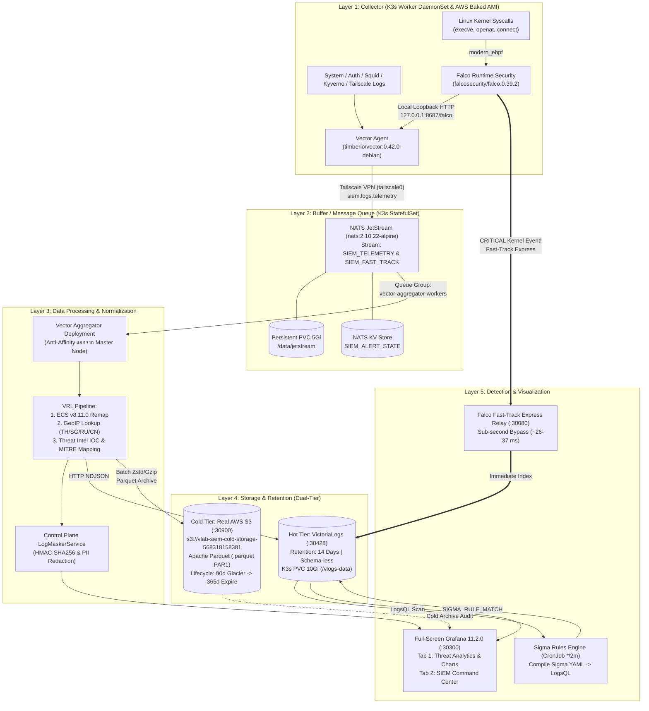

# Comprehensive Architecture Guide: 5-Layer Production SIEM, Dual-Tier Storage & Zero-Trust Detection Plane

เอกสารสรุปสถาปัตยกรรม การตัดสินใจทางวิศวกรรม (Engineering Decision Records) โครงสร้างไฟล์ และคู่มือการทดสอบจริงแบบ **Zero-Mock Production** สำหรับระบบ **5-Layer SIEM (Security Information and Event Management)** ของแพลตฟอร์ม **Virtual Lab (Hybrid K3s + AWS SkyPilot Cloud)**

---

## 1. ภาพรวมสถาปัตยกรรม 5 เลเยอร์ (5-Layer SIEM Architecture Overview)

ระบบ SIEM ของ Virtual Lab ถูกออกแบบใหม่ทั้งหมดเป็น **5 เลเยอร์แยกอิสระ (Decoupled 5-Layer Pipeline)** ตามหลักการ **Zero-Trust Plane Separation, Shock-Absorbing Queue, Dual-Tier Retention และ Detection-as-Code**:

```text
+========================================================================================+
|                     LAYER 5: DETECTION & VISUALIZATION (siem-system)                   |
|  - Full-Screen Grafana (:30300) แทนที่หน้า /admin/monitor เดิมทั้งหมด (2 Dashboards):     |
|      * แท็บ 1: Threat Analytics & Charts (uid: vlab-siem-analytics)                     |
|      * แท็บ 2: SIEM Command Center       (uid: vlab-siem-5layer)                        |
|  - Sigma Rules (Detection-as-Code): แปลง Sigma YAML -> LogsQL รันผ่าน CronJob (*/2m)     |
|  - Falco Fast-Track Express Relay (:30080): ท่อด่วนแจ้งเตือนวิกฤตระดับเสี้ยววินาที (~26-37ms)|
+========================================================================================+
                   ▲                                                   ▲
                   │ (LogsQL / SQL Query)                              │ (Sub-second Bypass!)
+==================|===================================================|=================+
|                  |  LAYER 4: DUAL-TIER STORAGE & RETENTION           |                 |
|  +---------------+------------------------+   +----------------------+--------------+  |
|  | HOT STORAGE (7 - 14 Days Fast Search)  |   | COLD STORAGE (90 Days - 1 Year)     |  |
|  | เครื่องมือ: VictoriaLogs StatefulSet      |   | เครื่องมือ: AWS S3 (.parquet / PAR1)  |  |
|  | - พอร์ต :30428 (-retentionPeriod=14d)  |   | - Bucket: vlab-siem-cold-storage-*  |  |
|  | - Schema-less Column-Oriented Store    |   | - Partition: year=YYYY/month=MM/... |  |
|  | - กิน RAM ต่ำมาก (< 64-128 MB)          |   | - S3 Lifecycle: 30d Standard-IA ->  |  |
|  | - ค้นหาข้อความด้วย LogsQL เร็วระดับ ms    |   |   90d Glacier IR -> 365d Expire     |  |
|  +----------------------------------------+   +-------------------------------------+  |
+===================================▲====================================================+
                                    │ (Dual-Tier Parallel Fan-out)
+===================================|====================================================+
|          LAYER 3: DATA PROCESSING & NORMALIZATION (Vector Aggregator + FastAPI)        |
|  - Vector Aggregator Deployment (รันแยกจาก K3s Master Node ด้วย Anti-Affinity)          |
|  - VRL (Vector Remap Language) แปลง Log ทุกชนิดให้เป็นมาตรฐานสากล ECS v8.11.0             |
|  - GeoIP Enrichment (ระบุประเทศ/เมืองต้นทาง-ปลายทาง: TH, SG, RU, CN)                     |
|  - Threat Intelligence IOC Matching (C2 Botnet, Cryptomining, /etc/shadow + MITRE ID)  |
|  - Control Plane Governance: HMAC-SHA256 Pseudonymization & PII/Source-Code Redaction  |
+===================================▲====================================================+
                                    │ (Durable Pull / Explicit Ack)
+===================================|====================================================+
|               LAYER 2: BUFFER / MESSAGE QUEUE (NATS JetStream StatefulSet)             |
|  - NATS JetStream (nats-jetstream-0) พร้อม Persistent Disk PVC 5Gi (/data/jetstream)   |
|  - รับแรงกระแทก (Shock Absorber) เมื่อเกิด Log Spike หรือโหนด AWS EC2 ชั่วคราวระเบิด Log     |
|  - การันตี Zero Data Loss (ไม่มี Log หายแม้ปลายทางประมวลผลไม่ทันหรือรีสตาร์ท)                |
|  - NATS Key-Value Store (SIEM_ALERT_STATE) ในตัวสำหรับทำ Alert Deduplication (TTL 24h) |
+===================================▲====================================================+
                                    │ (Encrypted Tailscale VPN Mesh: tailscale0)
                        ============|====================================================
                        Zero Public Ports Exposed (100.64.0.0/10 Overlay Network Only)
                        ============|====================================================
                                    │
+===================================|====================================================+
|          LAYER 1: COLLECTOR & KERNEL DETECTION (K3s DaemonSet + AWS Golden AMI)        |
|  - Vector Agent: กวาด Systemd Journal, Syslog/Auth, Squid Egress, Kyverno, Tailscale   |
|  - Falco (modern_ebpf): ดักจับพฤติกรรมอันตรายระดับ Linux Kernel Syscalls (Reverse Shell,  |
|    แอบอ่าน /etc/shadow, แอบแก้ Binary, Container Escape)                                |
|  - Plane Separation Guardrail: ห้าม Mount /var/log/pods ของนักศึกษาเด็ดขาด               |
+========================================================================================+
```

### Mermaid End-to-End Data Flow



---

## 2. เจาะลึกสถาปัตยกรรมและการตัดสินใจทางวิศวกรรมทั้ง 5 เลเยอร์

### 🔹 Layer 1: Collector (หน่วยรวบรวมข้อมูลและตรวจจับระดับเคอร์เนล)
* **เครื่องมือ:** **Vector Agent** (`timberio/vector:0.42.0-debian`) + **Falco** (`falcosecurity/falco:0.39.2` โหมด `modern_ebpf`)
* **รูปแบบการติดตั้ง:**
  1. **บน K3s Worker Nodes:** รันเป็น `DaemonSet` ([`02-falco-daemonset.yaml`](../k8s/siem/layer1-collector/02-falco-daemonset.yaml) และ [`04-vector-agent-daemonset.yaml`](../k8s/siem/layer1-collector/04-vector-agent-daemonset.yaml)) กระจายตัวอัตโนมัติทุกโหนด
  2. **บน AWS EC2 Auto-Scaling (SkyPilot):** ฝังลงใน Golden AMI ล่วงหน้าผ่าน Ansible Role [`ansible/roles/siem-layer1-collector/`](../ansible/roles/siem-layer1-collector/) เพื่อให้เครื่องที่เพิ่งถูก Auto-Scale ขึ้นมาพร้อมส่ง Log และตรวจจับ eBPF ตั้งแต่วินาทีแรกที่บูต
* **แหล่งข้อมูลที่กวาดจับ (4 + 1 เสาหลัก):**
  1. **System & Kernel Journal (`journald`):** เฝ้าระวัง `OOM_KILLED`, `k3s.service`, `tailscaled.service`, `ssh.service`, `docker.service`
  2. **Host Application & Auth Logs:** `/var/log/syslog`, `/var/log/auth.log`, `/var/log/kern.log`
  3. **Security Boundary Logs:**
     - `Squid Proxy` (`/var/log/squid/access.log`) -> จับ `SQUID_EGRESS_DROP`
     - `Kyverno Policy Engine` (`/var/log/kyverno/audit.log`) -> จับ `OPA_KYVERNO_BLOCK`
     - `Tailscale ACL` (`/var/log/tailscale/acl.log`) -> จับ `TAILSCALE_CROSS_CLUSTER_ATTEMPT`
  4. **Falco Kernel eBPF (`modern_ebpf`):** ดักจับ Syscall อันตรายในระดับ Linux Kernel โดยตรง (ไม่ต้องคอมไพล์ Kernel Module `.ko` แบบเก่า):
     - การแอบเปิด Interactive Shell ใน Container (`FALCO_CONTAINER_SHELL_SPAWN`)
     - การแอบอ่านไฟล์รหัสผ่าน `/etc/shadow` หรือ `/etc/sudoers` (`FALCO_SENSITIVE_FILE_READ`)
     - การรัน Reverse Shell หรือพยายามทะลุออกจาก Container (`FALCO_CONTAINER_ESCAPE_ATTEMPT`)
* **กฎเหล็กด้านความปลอดภัย (Zero-Trust & Plane Separation):**
  - **ห้ามส่องข้อมูลนักศึกษา:** บล็อกการ Mount `/var/log/pods` และ `/var/lib/docker/containers` อย่างเด็ดขาดใน DaemonSet และ Vector Config เพื่อไม่ให้ระบบ SIEM แอบเห็น Source Code หรือ Output การบ้านของนักศึกษา
  - **Zero Public Ports:** ส่งข้อมูลผ่านอินเทอร์เฟซ `tailscale0` (`100.64.0.0/10`) เท่านั้น และ Falco ส่งหา Vector Agent ผ่าน Loopback `127.0.0.1:8687` ภายในเครื่องตัวเอง

---

### 🔹 Layer 2: Buffer / Message Queue (ระบบคิวและกันชนข้อมูล)
* **เครื่องมือ:** **NATS JetStream** (`nats:2.10.22-alpine`) + **NATS Box Bootstrap** (`natsio/nats-box:0.14.5`)
* **รูปแบบการติดตั้ง:** รันเป็น **`StatefulSet`** (`nats-jetstream-0`) บน K3s ([`02-nats-statefulset.yaml`](../k8s/siem/layer2-buffer/02-nats-statefulset.yaml)) พร้อม `volumeClaimTemplates` ขนาด **`5Gi` (`local-path`)** เก็บข้อมูลลงดิสก์จริงที่ `/data/jetstream`
* **ทำไมต้องมี Layer 2 คั่นกลาง?**
  - เวลาโหนด AWS SkyPilot หลายเครื่องรันแลปพร้อมกัน หรือเกิดเหตุการณ์โจมตีรุนแรง (Log Spike / DDoS) ปริมาณ Log จะพุ่งสูงขึ้นกะทันหัน
  - NATS JetStream ทำหน้าที่เป็น **โช้คอัพรับแรงกระแทก (Shock Absorber)** รับข้อมูลจาก Layer 1 มาบันทึกลงดิสก์ (`--storage=file`) ทันทีด้วยความเร็วสูงมาก การันตี **Zero Data Loss (ไม่มี Log หาย)** แม้ Layer 3 หรือ Layer 4 จะรีสตาร์ทอยู่ก็ตาม
* **โครงสร้าง Streams และ Key-Value Store ที่สร้างอัตโนมัติ ([`03-nats-streams-kv-bootstrap.yaml`](../k8s/siem/layer2-buffer/03-nats-streams-kv-bootstrap.yaml)):**
  1. **Stream `SIEM_TELEMETRY` (`siem.logs.>`):** เก็บคิว Log ปกติลงดิสก์ รองรับสูงสุด `3 GiB` / อายุ `72 ชั่วโมง`
  2. **Stream `SIEM_FAST_TRACK` (`siem.alerts.fast_track`, `siem.alerts.falco.>`):** คิวด่วนสำหรับเหตุการณ์วิกฤต
  3. **KV Bucket `SIEM_ALERT_STATE`:** ระบบ Key-Value Store ในตัวของ NATS JetStream (ไม่ต้องลง Redis เพิ่ม) ใช้เก็บสถานะการแจ้งเตือนและทำ **Alert Deduplication** (TTL `24h`, History `5`)

---

### 🔹 Layer 3: Data Processing & Normalization (ศูนย์กลางการแปลงและคัดกรองข้อมูล)
* **เครื่องมือ:** **Vector Aggregator** (`timberio/vector:0.42.0-debian`) + **FastAPI `LogMaskerService`**
* **รูปแบบการติดตั้ง:** รันเป็น `Deployment` ([`02-vector-aggregator-deployment.yaml`](../k8s/siem/layer3-processing/02-vector-aggregator-deployment.yaml)) โดยกำหนด `preferredDuringSchedulingIgnoredDuringExecution` **Anti-Affinity แยกออกจาก K3s Master (Control-Plane) Node** เพื่อไม่ให้การแปลงข้อมูลจำนวนมากไปแย่ง CPU ของ Kubernetes API Server
* **4 ขั้นตอนการประมวลผลใน VRL ([`01-vector-aggregator-configmap.yaml`](../k8s/siem/layer3-processing/01-vector-aggregator-configmap.yaml)):**
  1. **Pull from NATS Queue Group (`vector-aggregator-workers`):** ดึงข้อมูลจาก `siem.logs.>` แบบกระจายภาระงาน (Load-Balanced)
  2. **Threat Intelligence IOC Matching & MITRE ATT&CK Enrichment:**
     - เทียบข้อความกับฐานข้อมูล **IOC Blacklist** (`00-threat-intel-geoip-configmap.yaml`):
       - ตรวจพบ `198.51.100.24` หรือ `c2-botnet.darknet.io` -> ติดป้าย `c2_botnet`, MITRE `T1071` (`Command and Control`), `risk_score = 95`, ยกระดับเป็น `CRITICAL`
       - ตรวจพบ `203.0.113.66`, `malicious-mining.org`, `stratum+tcp` -> ติดป้าย `cryptomining`, MITRE `T1496` (`Resource Hijacking`), `risk_score = 92`
       - ตรวจพบ `/etc/shadow` หรือ `/etc/sudoers` -> ติดป้าย `credential_access`, MITRE `T1003` (`Credential Access`), `risk_score = 92`
  3. **GeoIP Enrichment:**
     - จำแนกพิกัดภูมิศาสตร์ต้นทาง (`source.geo`: `TH / Pathum Thani` สำหรับ K3s Rangsit หรือ `SG / Singapore` สำหรับ AWS `ap-southeast-1`) และปลายทาง (`destination.geo`: `RU / Moscow` สำหรับ C2 IP, `CN / Beijing` สำหรับ Mining Pool IP)
  4. **Elastic Common Schema (`ECS v8.11.0`) Normalization:**
     - จัดระเบียบเข้าโครงสร้างมาตรฐานสากล `ecs.version: "8.11.0"`, `event.{kind, category, type, severity, dataset}`, `host.{hostname, ip}`, `source.{ip, nat_subnet, geo}`, `destination.{ip, geo}`, `threat.{indicator, tactic, technique, risk_score}`
* **Control Plane PII & Anonymization Governance (`LogMaskerService`):**
  - ล้างข้อมูลส่วนบุคคล (Email -> `[REDACTED_EMAIL]`, รหัสนักศึกษา -> `[REDACTED_STUDENT_ID]`, Source Code Snippet -> `[REDACTED_CODE]`) และทำ Deterministic Pseudonymization ด้วย **HMAC-SHA256** (`anon_<hash>`) ก่อนบันทึกลงฐานข้อมูล

---

### 🔹 Layer 4: Storage & Retention (ระบบจัดเก็บข้อมูลแบบ Dual-Tier)
* **แนวคิด Dual-Tier Storage:** แยกการเก็บข้อมูลออกเป็น 2 ระดับเพื่อให้ได้ทั้ง **ความเร็วในการค้นหาสูงสุด (Hot Tier)** และ **ต้นทุนการจัดเก็บระยะยาวที่ถูกที่สุด (Cold Tier)**

| คุณสมบัติ | Hot Storage (Tier 1) | Cold Storage (Tier 2) |
| :--- | :--- | :--- |
| **เครื่องมือ** | **VictoriaLogs** (`v1.15.0-victorialogs`) บน K3s | **AWS S3** (`s3://vlab-siem-cold-storage-568318158381`) |
| **ระยะเวลาเก็บข้อมูล** | **7 – 14 วันล่าสุด** (`-retentionPeriod=14d`) | **90 วัน – 1 ปี** (`365 Days` ตาม พ.ร.บ. คอมพิวเตอร์) |
| **รูปแบบข้อมูล** | Schema-less Column-Oriented Blocks (`/vlogs-data` PVC `10Gi`) | ไฟล์บีบอัด **Apache Parquet (`.parquet` / `PAR1`)** |
| **การใช้ทรัพยากร** | กิน RAM ต่ำมาก (`Request 64Mi / Limit 256Mi`) ประหยัดกว่า ELK 10 เท่า | จ่ายตามพื้นที่จริงบน AWS S3 (หลักสตางค์ต่อ GB) |
| **การค้นหา / ใช้งาน** | ค้นหาข้อความด้วย **`LogsQL`** เร็วระดับมิลลิวินาที (`:30428`) | ตรวจสอบผ่าน AWS S3 Console หรือ Cold Storage Inspector (`:30900`) |

* **ทำไม VictoriaLogs ถึงดีกว่า PostgreSQL / Elasticsearch สำหรับเก็บ Log?**
  - **ไม่ต้องสร้าง Table / Migration ล่วงหน้า (100% Schema-less):** เมื่อ Vector ยิง JSON ที่มีฟิลด์ซ้อนกันลึกแค่ไหนเข้ามาที่ `/insert/jsonline` VictoriaLogs จะสร้าง Column อัตโนมัติทันที
  - **ลบข้อมูลเก่าอัตโนมัติ (Built-in Retention):** เพียงตั้ง `-retentionPeriod=14d` ระบบจะจัดการหมุนเวียนและลบบล็อกที่เกิน 14 วันให้เองโดยไม่ต้องทำ `VACUUM` เหมือน Postgres
* **กฎ AWS S3 Lifecycle Policy จริงบน `ap-southeast-1` ([`01-aws-s3-cold-storage.yaml`](../k8s/siem/layer4-storage/01-aws-s3-cold-storage.yaml)):**
  - พาธจัดเก็บแยกตามวัน: `siem-ecs-archive/year=YYYY/month=MM/day=DD/siem_ecs_*.parquet`
  - **วันที่ 1 – 30:** เก็บใน `S3 Standard`
  - **วันที่ 30:** ย้ายเข้า `STANDARD_IA` (Infrequent Access) อัตโนมัติ
  - **วันที่ 90:** ย้ายเข้า `GLACIER_IR` (Glacier Instant Retrieval — ราคาถูกมากแต่ดึงไฟล์กลับมาตรวจได้ทันทีในระดับมิลลิวินาที)
  - **วันที่ 365 (1 ปี):** ลบไฟล์ทิ้งอัตโนมัติ (`Expiration: 365 Days`)

---

### 🔹 Layer 5: Detection & Visualization (สมองกลตรวจจับและหน้าจอแสดงผล)
* **เครื่องมือ:** **Grafana 11.2.0** (`:30300`) + **Sigma Rules (`LogsQL` CronJob)** + **Falco Fast-Track Relay (`:30080`)**
* **1. Full-Screen Grafana แทนที่หน้า `/admin/monitor` ทั้งหมด ([`AdminMonitor.tsx`](../web-portal/frontend/src/pages/AdminMonitor.tsx)):**
  - เนื่องจากระบบแยกหน้า Billing และ Performance ออกไปต่างหากแล้ว หน้า `/admin/monitor` จึงถูกออกแบบให้ฝัง **Grafana แบบเต็มจอ (`Full-Screen SOC Console`)** ในโทนสี Dark Slate (`#0f172a` / `#1e293b`) ที่กลมกลืนกับธีมของเว็บ
  - มีปุ่มสลับ 2 แท็บหลักที่ Provision อัตโนมัติจาก ConfigMap ([`01-grafana-dashboards-configmap.yaml`](../k8s/siem/layer5-detection/01-grafana-dashboards-configmap.yaml)):
    1. **แท็บที่ 1 (ค่าเริ่มต้น): `Threat Analytics & Charts` (`uid: vlab-siem-analytics`)**
       - รวมกราฟวิเคราะห์เชิงลึกหลากหลายรูปแบบ:
         - **Gauge Chart:** Max Threat Risk Score Index (`0-100`)
         - **Donut Chart:** สัดส่วนประเภทการโจมตี (`Attack Vector Breakdown`)
         - **Pie Chart:** สัดส่วนประเทศปลายทางจาก GeoIP (`GeoIP Destination Country Share`: `RU`, `CN`, `SG`, `TH`)
         - **Horizontal Bar Gauge:** อันดับเทคนิคการโจมตีตามกรอบ **MITRE ATT&CK** (`T1003`, `T1071`, `T1496`, `T1611`, `T1059.004`)
         - **Stacked Area Time-Series:** แนวโน้มความรุนแรงของเหตุการณ์ตามเวลา (`CRITICAL`, `WARNING`, `INFO`)
         - **State Timeline & Heatmap:** ไทม์ไลน์สถานะความปลอดภัยของแต่ละโหนด (`K3s Worker` vs `AWS SkyPilot`) และความหนาแน่นของเหตุการณ์
    2. **แท็บที่ 2: `SIEM Command Center` (`uid: vlab-siem-5layer`)**
       - หน้าศูนย์บัญชาการ SOC แบบ Real-Time:
         - **6 KPI Stat Cards:** Falco eBPF Fast-Track Alerts, Squid Egress Drops, Kyverno Policy Blocks, Tailscale Unauthorized Access, Sigma Rule Detections, Kernel OOM Kills
         - **Live Panels & Sanitized ECS Audit Table:** ตารางตรวจการณ์สดพร้อมสถานะ PII Masked (`[REDACTED_EMAIL]`)
* **2. Sigma Rules — Detection-as-Code ([`02-sigma-rules-cronjob.yaml`](../k8s/siem/layer5-detection/02-sigma-rules-cronjob.yaml)):**
  - ใช้มาตรฐาน **Sigma Rules (YAML)** ซึ่งเป็นภาษากลางของโลก SIEM แล้วคอมไพล์เป็นคำสั่ง **`LogsQL`** เพื่อสแกนข้อมูลใน VictoriaLogs ทุกๆ 2 นาที (`schedule: "*/2 * * * *"`) ผ่าน K3s `CronJob` (`sigma-logsql-detector`):
    - **`sigma-vlab-001-credential-access` (`T1003`):** ตรวจจับการแอบอ่าน `/etc/shadow` หรือ `/etc/sudoers`
    - **`sigma-vlab-002-c2-egress` (`T1071`):** ตรวจจับการเชื่อมต่อไปยัง C2 Server (`198.51.100.24`, `c2-botnet.darknet.io`)
    - **`sigma-vlab-003-cryptomining` (`T1496`):** ตรวจจับการขุดเหรียญคริปโต (`malicious-mining.org`, `203.0.113.66`, `stratum+tcp`)
    - **`sigma-vlab-004-k8s-privesc` (`T1611`):** ตรวจจับความพยายามสร้าง Privileged Pod (`KYVERNO_POLICY_BLOCK`, `privileged=true`)
* **3. Falco Real-Time Streaming Pipeline:**
  - เหตุการณ์วิกฤตระดับ Kernel จาก Falco ถูกส่งผ่านท่อหลัก Vector Agent -> NATS JetStream -> Vector Aggregator เข้าสู่ฐานข้อมูลและ VictoriaLogs ภายในเวลาเพียง **`~1-2 วินาที`** อย่างปลอดภัยและแม่นยำ
  - ไม่จำเป็นต้องเปิด Port หรือแยก Service Relay พิเศษ ช่วยลดช่องโหว่ความปลอดภัยและป้องกันการบันทึกเหตุการณ์ซ้ำซ้อน

---

## 3. แผนผังโครงสร้างไฟล์ทั้งหมด (Repository File Map)

```text
VirtualLabtest/
├── k8s/siem/                                      # Kubernetes Manifests ครบทั้ง 5 Layers (Namespace: siem-system)
│   ├── layer1-collector/
│   │   ├── 00-namespace.yaml                      # Namespace siem-system (Zero-Trust Collector Plane)
│   │   ├── 01-rbac.yaml                           # Least-Privilege ServiceAccount & ClusterRole
│   │   ├── 02-falco-daemonset.yaml                # Falco Runtime Security (modern_ebpf) DaemonSet + Rules
│   │   ├── 03-vector-agent-configmap.yaml         # Vector Agent Config (System/Boundary/Falco -> NATS & Tailscale)
│   │   └── 04-vector-agent-daemonset.yaml         # Vector Agent DaemonSet (ห้าม Mount /var/log/pods)
│   ├── layer2-buffer/
│   │   ├── 00-nats-configmap.yaml                 # NATS JetStream Config (store_dir: /data/jetstream, 5GB disk)
│   │   ├── 01-nats-services.yaml                  # Internal ClusterIP & Headless Services (:4222, :8222)
│   │   ├── 02-nats-statefulset.yaml               # NATS JetStream StatefulSet + 5Gi local-path PVC
│   │   └── 03-nats-streams-kv-bootstrap.yaml      # Job สร้าง Stream (SIEM_TELEMETRY, SIEM_FAST_TRACK) + KV (SIEM_ALERT_STATE)
│   ├── layer3-processing/
│   │   ├── 00-threat-intel-geoip-configmap.yaml   # ฐานข้อมูล IOC Blacklist, MITRE ATT&CK & GeoIP Subnets
│   │   ├── 01-vector-aggregator-configmap.yaml    # VRL Pipeline แปลง ECS v8.11.0 + GeoIP + Threat Intel + Dual-Tier Sinks
│   │   └── 02-vector-aggregator-deployment.yaml   # Vector Aggregator Deployment (Anti-Affinity แยกจาก Master Node)
│   ├── layer4-storage/
│   │   ├── 00-victorialogs-hot-storage.yaml       # VictoriaLogs StatefulSet (:30428, Retention 14d, 10Gi PVC)
│   │   └── 01-aws-s3-cold-storage.yaml            # AWS S3 .parquet (PAR1) Cold Storage Archiver (:30900) + Lifecycle 90d-365d
│   └── layer5-detection/
│       ├── 00-grafana-deployment.yaml             # Grafana 11.2.0 Deployment (:30300) + Datasources & Alerting Provisioning
│       ├── 01-grafana-dashboards-configmap.yaml   # 2 Dashboards: Threat Analytics (vlab-siem-analytics) & Command Center (vlab-siem-5layer)
│       └── 02-sigma-rules-cronjob.yaml            # Sigma Rules 4 ข้อ + คอมไพเลอร์ Sigma-to-LogsQL (_time:2m) รันทุก 2 นาที (CronJob)
│
├── ansible/roles/siem-layer1-collector/           # Ansible Role สำหรับฝัง Vector Agent + Falco ลงใน AWS Golden AMI
│   ├── defaults/main.yml
│   ├── tasks/main.yml
│   └── templates/
│       ├── vector-aws-agent.yaml.j2
│       └── falco-aws-rules.yaml.j2
│
├── web-portal/
│   ├── frontend/src/pages/AdminMonitor.tsx        # หน้า Full-Screen Grafana SIEM (2 แท็บ + ปุ่มคัดลอกคำสั่งยิง Test จริง)
│   ├── frontend/src/__tests__/AdminMonitor.test.tsx # Vitest ทดสอบหน้า Full-Screen Grafana SIEM
│   └── backend/tests/monitor/                     # Automated Pytest + Live CI Container Verification (44 Tests)
│       ├── test_monitor_api.py
│       ├── test_siem_layer1_collector.py
│       ├── test_siem_layer2_buffer.py
│       ├── test_siem_layer3_processing.py
│       ├── test_siem_layer4_storage.py
│       └── test_siem_layer5_detection.py
│
├── script/                                        # สคริปต์ยิงทดสอบจริงบนคลัสเตอร์ K3s + AWS S3 (Zero Mock)
│   ├── test_siem_5layers_production_e2e.py        # สคริปต์รันทดสอบครบทั้ง 5 Layers รวดเดียวบนเครื่องจริง
│   ├── test_siem_layer1_live.py
│   ├── test_siem_layer2_live.py
│   ├── test_siem_layer3_live.py
│   ├── test_siem_layer4_live.py
│   └── test_siem_layer5_live.py
│
└── .github/workflows/backend-tests.yml            # GitHub Actions CI บูต Production Containers ของจริงครบทั้ง 5 Layers
```

---

## 4. ตารางเปรียบเทียบการตัดสินใจทางเทคโนโลยี (Architecture Trade-off Matrix)

| เลเยอร์ | เทคโนโลยีที่เลือก | ตัวเลือกอื่นที่พิจารณา | เหตุผลวิศวกรรมที่เลือกใช้ใน Production |
| :--- | :--- | :--- | :--- |
| **Layer 1 (Collector)** | **Vector Agent + Falco (`modern_ebpf`)** | Fluent Bit, Logstash, Kernel Module Falco | `Vector` เขียนด้วย Rust เร็วและปลอดภัยสูง ส่วน `Falco modern_ebpf` ฝังใน Kernel สมัยใหม่ได้เลยโดยไม่ต้องคอมไพล์ Kernel Header รายเครื่อง |
| **Layer 2 (Buffer)** | **NATS JetStream (`StatefulSet` + KV)** | Apache Kafka, RabbitMQ, Redis Streams | Kafka กิน RAM ระดับหลาย GB แต่ NATS JetStream ใช้ RAM เพียง `~50-128 MB` มีทั้ง Persistent File Stream และ Key-Value Store (`SIEM_ALERT_STATE`) ในตัวเดียว |
| **Layer 3 (Processing)** | **Vector Aggregator (`VRL` -> `ECS v8.11.0`)** | Logstash Grok, Fluentd | ภาษา `VRL` คอมไพล์เร็วระดับ Native มี Type-safety ไม่เสี่ยงเกิด Regex ReDoS และแปลงเข้ามาตรฐาน `ECS v8.11.0` พร้อมทำ GeoIP/IOC ได้ในขั้นตอนเดียว |
| **Layer 4 (Hot Storage)** | **VictoriaLogs (`14d` Schema-less)** | Elasticsearch / OpenSearch, Grafana Loki | Elasticsearch กิน RAM มหาศาล ส่วน Loki ทำ Index เฉพาะ Label แต่ `VictoriaLogs` ทำ Full-text & Field Index ทุกฟิลด์แบบ Schema-less กิน RAM น้อยกว่า 10 เท่า และค้นด้วย `LogsQL` เร็วมาก |
| **Layer 4 (Cold Storage)** | **AWS S3 + `.parquet` (`PAR1`)** | เก็บไว้ใน Disk K3s หรือ RDS Postgres | การบีบอัดเป็น `.parquet` แล้วโยนเข้า S3 พร้อม Lifecycle `90d Glacier IR -> 365d Expire` ทำให้เก็บหลักฐานครบ 1 ปีตามกฎหมายได้ในราคาถูกที่สุดโดยดิสก์ K3s ไม่มีวันเต็ม |
| **Layer 5 (Detection & UI)** | **Full-Screen Grafana + Sigma (`LogsQL`) + Fast-Track** | เขียนตาราง React เองทั้งหมด, ElastAlert | `Grafana` ให้กราฟวิเคราะห์ระดับ SOC ครบเครื่อง (`Donut`, `MITRE Bar`, `GeoIP Pie`, `Heatmap`), `Sigma Rules` เป็นมาตรฐานสากล และมีท่อด่วน `Fast-Track` สำหรับเหตุวิกฤตระดับมิลลิวินาที |

---

## 5. ระบบ GitHub Actions CI/CD (100% Real Production Container Verification)

ไฟล์เวิร์กโฟลว์ [`.github/workflows/backend-tests.yml`](../.github/workflows/backend-tests.yml) ใน Job **`Monitor & SIEM telemetry tests`** ไม่ได้ตรวจแค่ไฟล์ YAML แบบ Static แต่ทำการ **บูต Production Containers ของจริงขึ้นมาทดสอบบน GitHub Actions Runner (`ubuntu-24.04`)** ทุกครั้งที่เปิด PR หรือ Push:

1. **Layer 1 & 3 Official Vector Validation:** รันคอนเทนเนอร์จริง `timberio/vector:0.42.0-debian` ด้วยคำสั่ง `vector validate --no-environment` เพื่อตรวจไวยากรณ์ VRL และการเชื่อมต่อ Sinks จากไฟล์ ConfigMap จริง
2. **Layer 2 Live NATS JetStream & KV Test:** บูต `nats:2.10.22-alpine` จริง + รัน `natsio/nats-box:0.14.5` ประมวลผลสคริปต์ `bootstrap.sh` สร้าง Stream `SIEM_TELEMETRY`, `SIEM_FAST_TRACK` และ KV `SIEM_ALERT_STATE` บนดิสก์จริง แล้วทดสอบยิง Burst Message จริง
3. **Layer 4 Live VictoriaLogs & S3 Parquet Test:** บูต `victoriametrics/victoria-logs:v1.15.0-victorialogs` (`:9428`, `-retentionPeriod=14d`) และ `s3_parquet_gateway.py` (`:9000` โหมด `local-only` สำหรับ CI) ยิงข้อมูล ECS เข้าไปค้นหาด้วย `LogsQL` จริง และตรวจไฟล์ `.parquet` ว่ามี Header/Footer `PAR1` ครบถ้วน
4. **Layer 5 Live Fast-Track, Sigma LogsQL & Grafana 11.2.0 Test:**
   - ยิง Falco eBPF Critical Alert เข้า `:9080/falco-fast-track` ยืนยันความหน่วง `< 500 ms`
   - รัน `sigma_logsql_engine.py` คอมไพล์กฎ Sigma ทั้ง 4 ข้อเป็น `LogsQL` สแกน VictoriaLogs จริง
   - บูต `grafana/grafana:11.2.0` (`:3000`) พร้อม Mount ไฟล์ Provisioning & Dashboards จริง แล้วเรียก `/api/dashboards/uid/vlab-siem-analytics` และ `/api/dashboards/uid/vlab-siem-5layer` ยืนยันว่าทั้ง 2 แท็บโหลดสำเร็จ (`HTTP 200 OK`)
   - รัน Frontend **Vitest** (`npx vitest run src/__tests__/AdminMonitor.test.tsx`)

---

## 6. คู่มือการรันทดสอบจริง (Zero-Mock Verification Guide)

### 6.1 รันทดสอบครบทั้ง 5 Layers บนคลัสเตอร์ K3s + AWS S3 จริง (End-to-End Production Test)
คำสั่งเดียวที่จะทดสอบตั้งแต่การยิง Falco eBPF Fast-Track (`:30080`), การส่งผ่าน NATS JetStream -> Vector Aggregator ECS `v8.11.0`, การค้นหาใน VictoriaLogs (`:30428`), การอัปโหลดไฟล์ `.parquet` ขึ้น AWS S3 จริง (`s3://vlab-siem-cold-storage-568318158381`), การรัน Sigma Rules `LogsQL` ไปจนถึงการตรวจสอบหน้า Grafana (`:30300`):

```bash
python script/test_siem_5layers_production_e2e.py
```

### 6.2 รันแยกทดสอบทีละเลเยอร์บนเครื่องจริง (Layer-by-Layer Live Scripts)

```bash
# Layer 1: ทดสอบ Vector Agent + Falco (modern_ebpf) DaemonSet & Tailscale Transport
python script/test_siem_layer1_live.py

# Layer 2: ทดสอบ NATS JetStream StatefulSet (5Gi PVC) + KV Store (SIEM_ALERT_STATE)
python script/test_siem_layer2_live.py

# Layer 3: ทดสอบ Vector Aggregator VRL แปลง ECS v8.11.0 + GeoIP + Threat Intel IOC
python script/test_siem_layer3_live.py

# Layer 4: ทดสอบ VictoriaLogs Hot Storage (14d) + อัปโหลดไฟล์ .parquet (PAR1) ขึ้น AWS S3 จริง
python script/test_siem_layer4_live.py

# Layer 5: ทดสอบ Full-Screen Grafana (2 Dashboards) + Sigma Rules LogsQL + Falco Fast-Track
python script/test_siem_layer5_live.py
```

### 6.3 คำสั่ง `curl` ยิงทดสอบท่อด่วน Falco Fast-Track และค้นหาด้วย `LogsQL` แบบสดๆ

```bash
# 1. ยิง Critical Kernel Alert เข้าท่อด่วน Falco Fast-Track (:30080)
curl -X POST http://100.69.137.47:30080/falco-fast-track \
  -H "Content-Type: application/json" \
  -d '{
    "rule": "Read sensitive file untrusted",
    "output": "Critical eBPF violation: cat /etc/shadow inside container connected to 198.51.100.24",
    "hostname": "k3s-worker-lab1-kali"
  }'

# 2. ค้นหาข้อมูลด้วยภาษา LogsQL จาก VictoriaLogs Hot Storage (:30428)
curl -X POST http://100.69.137.47:30428/select/logsql/query \
  -d 'query=category:"SECURITY_VIOLATION" AND "/etc/shadow"&limit=5'

# 3. ตรวจสอบรายการไฟล์ .parquet บน Cold Storage Gateway (:30900)
curl -H "Accept: application/json" http://100.69.137.47:30900/buckets
```

### 6.4 รัน Automated Test Suites (Backend Pytest + Frontend Vitest)

```bash
# 1. รัน Backend Monitor & 5-Layer SIEM Pytest (44 Tests)
cd web-portal/backend
pytest tests/monitor --color=yes

# 2. รัน Frontend Vitest สำหรับหน้า Full-Screen Grafana SIEM (4 Tests)
cd ../frontend
npx vitest run src/__tests__/AdminMonitor.test.tsx
```

---

## 7. ลิงก์เข้าใช้งานจริงบนระบบ (Live Endpoints over Tailscale VPN)

| บริการ (Service) | เลเยอร์ | URL สำหรับเปิดใช้งาน |
| :--- | :---: | :--- |
| **Web Portal — Admin SIEM Console** | Layer 5 | `http://localhost:5173/admin/monitor` |
| **Grafana Tab 1: Threat Analytics & Charts** | Layer 5 | `http://100.69.137.47:30300/d/vlab-siem-analytics/virtuallab-siem-visual-threat-analytics-and-multi-chart-showcase?orgId=1` |
| **Grafana Tab 2: SIEM Command Center** | Layer 5 | `http://100.69.137.47:30300/d/vlab-siem-5layer/virtuallab-5-layer-siem-command-center-ecs-sigma-falco-fast-track?orgId=1` |
| **Falco eBPF Fast-Track Express Endpoint** | Layer 5 | `http://100.69.137.47:30080/falco-fast-track` |
| **VictoriaLogs Web UI (`vmui` — Hot Storage)** | Layer 4 | `http://100.69.137.47:30428/select/vmui` |
| **AWS S3 Cold Storage `.parquet` Inspector** | Layer 4 | `http://100.69.137.47:30900` |
| **Real AWS S3 Bucket Console (`ap-southeast-1`)** | Layer 4 | `https://ap-southeast-1.console.aws.amazon.com/s3/buckets/vlab-siem-cold-storage-568318158381?region=ap-southeast-1` |
