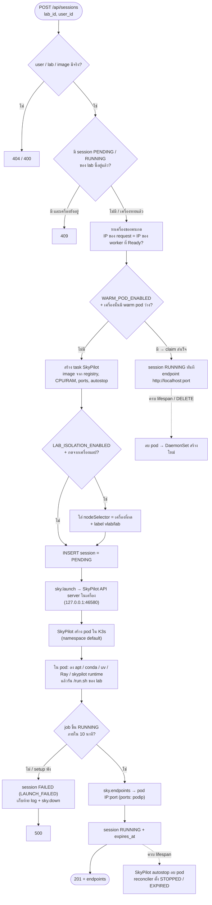

# Runbook — เปิดระบบ / launch lab / ACL

ฉบับสั้น อ่านจบใน 3 นาที (สถานะ 2026-10-17, branch `feature/lab-isolation`)

---

## 1. เครื่องที่เกี่ยวข้อง

| เครื่อง | Tailscale IP | หน้าที่ |
|---|---|---|
| master | `100.125.244.48` | K3s server (ssh `vboxuser@`) |
| thinkpad | `100.93.121.17` | backend + Postgres + SkyPilot ในเครื่อง + K3s worker |
| worker-pete | `100.83.96.97` | K3s worker |
| register | `100.127.74.48` | 9registry `:5001` |

---

## 2. เปิดระบบ (บน ThinkPad)

```bash
# 1) DB
docker start virtual_lab_db

# 2) SkyPilot API server ในเครื่อง (ถ้ายังไม่รัน) — config อยู่ที่ ~/.sky/config.yaml
cd ~/document/VirtualLabtest/web-portal/backend
venv/bin/sky api start            # ได้ http://127.0.0.1:46580

# 3) backend
venv/bin/uvicorn app.main:app --host 0.0.0.0 --port 8000
```

`--host 0.0.0.0` ต้องมี: warm pod / การบังคับเครื่องดู **IP จริงของเครื่องที่กด Start**
→ เรียก backend ผ่าน `http://100.93.121.17:8000` ไม่ใช่ `localhost`

---

## 3. สวิตช์ใน `web-portal/backend/.env`

| ค่า | ทำอะไร |
|---|---|
| `PREWARM_ENABLED=true` | scheduler pull image ลงทุก worker ก่อนคาบ (ตาม `class_slots`) |
| `WARM_POD_ENABLED=true` | ช่วงคาบมี pod รอไว้ทุกเครื่อง กด Start จากเครื่องนั้นได้ทันที |
| `LAB_ISOLATION_ENABLED=true` | lab เปิดได้แค่จากเครื่องตัวเอง (localhost / บังคับ pod ลงเครื่องที่กด) |
| `PREWARM_LEAD_MINUTES` | เริ่ม pull ก่อนคาบกี่นาที (ทดลอง 1, ใช้จริง 30) |

แก้แล้วต้อง restart backend

---

## 4. launch lab

```bash
# ผ่าน backend (เหมือนกด Start ในหน้าเว็บ)
curl -X POST http://100.93.121.17:8000/api/sessions -H 'Content-Type: application/json' \
  -d '{"lab_id":"<lab id>","user_id":"<user id>"}'

# ปิด
curl -X DELETE http://100.93.121.17:8000/api/sessions/<session id>

# ดูของที่ SkyPilot สร้าง
venv/bin/sky status
kubectl get pods -o wide
```

ใช้ ~2 นาทีบน worker-pete (มี image แล้ว) / ช้ากว่าบน thinkpad (Wi-Fi)

---

## 5. Tailscale ACL (กันเครื่องแลปคุยกันเอง)

```bash
cd ~/document/VirtualLabtest
./script/tailscale-acl.sh plan                 # ดูก่อน ไม่เขียน
./script/tailscale-acl.sh apply                # ตั้งจริง (พิมพ์ yes)
./script/tailscale-acl.sh check                # ทดสอบจาก worker-pete ต้องผ่าน 8/8
./script/tailscale-acl.sh rollback tailscale/backup/<ไฟล์>.hujson   # ถอยกลับ
```

- token: admin console → Settings → Keys → *Generate access token* (อายุสั้น, revoke หลังใช้)
- policy: `tailscale/vlab-acl.hujson` / tag ของแต่ละเครื่อง: `tailscale/vlab-tags.tsv`
- `check` ข้อ "thinkpad backend 8000" ผ่านเฉพาะตอน backend รันอยู่

---

## 6. NetworkPolicy (กันเปิด lab ข้ามเครื่องทาง pod IP)

```bash
kubectl apply -f k8s/lab-isolation-networkpolicy.yaml     # ตอนนี้ใช้แค่ตัวใน namespace default
kubectl get networkpolicy -A
```

---

## 7. ข้อควรรู้

- **SkyPilot ที่ backend ใช้ = ตัวในเครื่อง ThinkPad** (`~/.sky/config.yaml` ไม่มี endpoint) ไม่ใช่ `skypilot.bell-lab.space`
- `https://skypilot.bell-lab.space` (helm บน cluster) **เปิดสาธารณะ ไม่มี auth** และมี AWS credential — ยังไม่ได้แก้
- `~/.kube/config` ชี้ cluster ที่บ้านแล้ว (ของเดิม minikube: `~/.kube/config.minikube-*.bak`)
- launch บางครั้งพังในนาทีแรก (`curl: Could not resolve host` / `Failed to connect`) ยังไม่รู้สาเหตุ — ลองใหม่มักผ่าน
- worker-pete หลุด NotReady เป็นพัก ๆ

---

## 8. เส้น `POST /api/sessions` (lab แบบ K3s)



lab แบบ AWS: ข้ามขั้น warm pod / nodeSelector ใช้ AMI ที่ bake ไว้ + `docker pull` จาก ECR (ดู `docs/Flow.md`)
