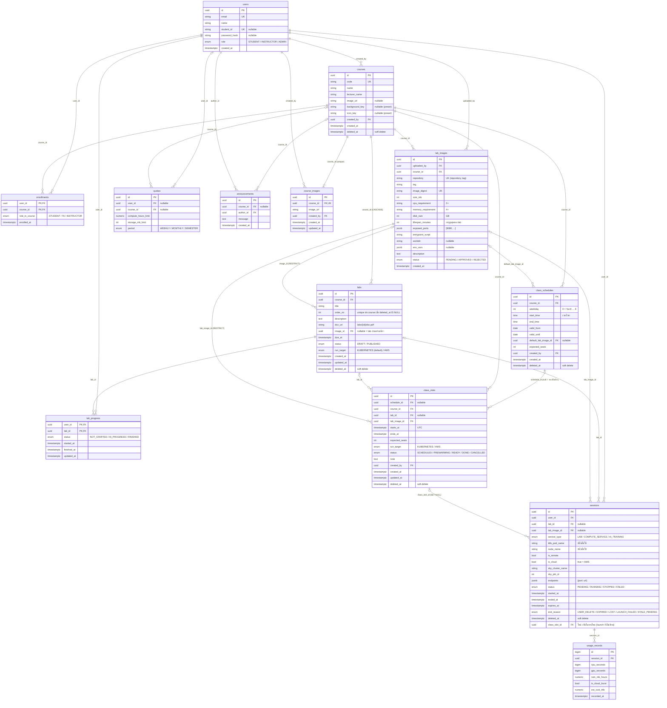
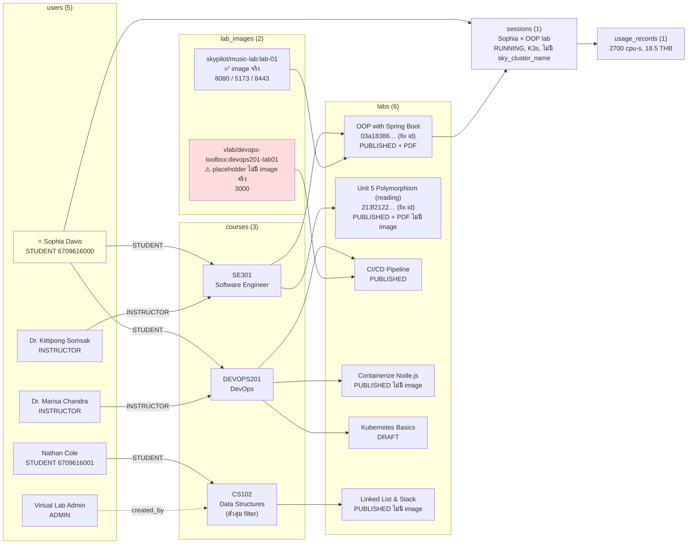

# Database ณ ปัจจุบัน + Seed

> อ่านจาก `web-portal/backend/app/models/*.py` และ `app/seeds/seed.py` บน branch `feature/sky-aws-launch`
> สถานะ ณ 2026-10-17 (อัปเดตหลังเพิ่มตารางเรียน, branch `experiment/prewarm-daemonset`)
> ยังไม่มี Alembic — schema สร้างด้วย `script/init_db.py` (`create_all`) ตอนเพิ่มตารางใหม่ใช้วิธี drop DB + init + seed

---

## 1. ER Diagram (13 ตาราง)

### Constraint / index ที่ควรรู้

| ตาราง | constraint | ผล |
|---|---|---|
| `labs` | `unique_course_order` (`course_id`, `order_no`) **WHERE `deleted_at IS NULL`** | ลบ lab แล้วใช้เลขลำดับเดิมซ้ำได้ |
| `labs.course_id` | `ON DELETE CASCADE` | ลบ course (hard) → lab หายตาม |
| `labs.image_id` | `ON DELETE RESTRICT` | ลบ image ไม่ได้ถ้ายังมี lab ใช้อยู่ |
| `lab_images` | `uq_repository_tag`, `image_digest` unique | image ซ้ำไม่ได้ |
| `enrollments`, `lab_progress` | composite PK | 1 คน ลง 1 วิชา / มี progress 1 แถวต่อ lab |
| `course_images.course_id` | unique | 1 course มี 1 รูป |
| `sessions` | **ไม่มี** unique กัน PENDING/RUNNING ซ้อน | กันที่ service เท่านั้น (race ยังค้าง ดู `Flow.md`) |
| `class_slots` | `ex_class_slots_no_overlap` EXCLUDE gist (`course_id =`, `tstzrange(starts_at, ends_at) &&`) WHERE ไม่ลบ + ไม่ CANCELLED | slot วิชาเดียวกันห้ามทับกัน (ต้องมี extension `btree_gist` สร้างให้ตอน create_all) |
| `class_slots` / `class_schedules` | CHECK เวลา / วันที่ / weekday 0–6 / seats > 0 | ค่าผิดเข้า DB ไม่ได้ |

Soft delete มี 5 ตาราง: `courses`, `labs`, `sessions`, `class_schedules`, `class_slots`

---

## 2. Seed — persona "Sophia Davis"

`python script/run_seed.py` (ข้ามทั้งหมดถ้ามี user อยู่แล้ว ต้อง drop DB ก่อนถ้าจะ seed ใหม่)

เส้นทับ (enrollment) คือ `role_in_course` · เส้นประคือ `created_by` อย่างเดียว ไม่ได้ลงเรียน

### จำนวนแถวต่อตาราง

| ตาราง | แถว | รายละเอียด |
|---|---|---|
| `users` | 5 | admin 1, instructor 2, student 2 |
| `courses` | 3 | SE301, DEVOPS201, CS102 |
| `course_images` | **0** | ใช้ `background_key` / `icon_key` (preset) แทน |
| `enrollments` | 5 | Sophia 2, instructor 2, Nathan 1 |
| `lab_images` | 2 | APPROVED ทั้งคู่ |
| `labs` | 6 | **ทุกตัว `run_target` = KUBERNETES** (default) |
| `lab_progress` | 2 | Sophia: OOP = IN_PROGRESS, CI/CD = NOT_STARTED |
| `sessions` | 1 | RUNNING, เริ่ม 45 นาทีก่อน, `expires_at` +2 ชม. |
| `usage_records` | 1 | ผูกกับ session ข้างบน |
| `quotas` | 2 | Sophia 50 ชม./เดือน, SE301 500 ชม./เทอม |
| `announcements` | 3 | SE301 2, DEVOPS201 1 |
| `class_schedules` | 1 | SE301 ทุกจันทร์ 09:00–12:00 เทอม 8 สัปดาห์ (เริ่ม 4 สัปดาห์ก่อนวันรัน seed) 40 ที่ |
| `class_slots` | 9 | SE301 8 (ผ่านแล้ว 4 / ยังไม่ถึง 4) + DEVOPS201 จองครั้งเดียวศุกร์ที่จะถึง 13:00–16:00 25 ที่ |

### บัญชี login

| ใคร | email | password |
|---|---|---|
| Sophia (persona) | `sophia.dav@dome.tu.ac.th` / `6709616000` | `sophia6764` |
| คนอื่นทั้งหมด | ตามตารางข้างบน | `labpass123` |

---

## 3. ข้อสังเกต: seed เทียบกับโค้ด session ตอนนี้

| เรื่อง | ผล |
|---|---|
| ไม่มี lab ที่ `run_target = AWS` | เทสเส้น AWS ต้องแก้ DB เอง (`UPDATE labs SET run_target='AWS' ...`) และ image ต้องมีใน ECR — `skypilot/music-lab` ยังไม่มีใน ECR (มีแค่ `vlab/music-lab-ide`) |
| session seed ไม่มี `sky_cluster_name` | reconciler ข้ามแถวนี้ (ตั้งใจ) และ DELETE ได้ไม่พัง แต่ Sophia กด Start lab OOP จะได้ **409** จนกว่าจะลบ session นี้ |
| `endpoints` ของ seed ใช้ key `ide/client/server` | session จริงใช้ key เป็นเลขพอร์ต (`"8080": "http://..."`) — frontend ต้องรองรับทั้งสองแบบ หรือปรับ seed ให้ตรง |
| `expires_at` ของ seed = +2 ชม. แต่ `lifespan_minutes` = 60 | ไม่ตรงกัน แต่ไม่มีผลเพราะไม่มี cluster จริง |
| lab CI/CD ผูก `vlab/devops-toolbox` (placeholder) | กด Start จะ launch แล้วพังที่ pull → `FAILED` / `LAUNCH_FAILED` |
| `end_reason` ไม่มีใน seed | ถูกต้อง เพราะ session ยัง RUNNING |
| `k8s_pod_name`, `node_name` | มีค่าแค่ใน seed โค้ด launch ไม่เคยเขียน |
| `course_images` | มี model แต่ไม่มี seed และไม่มี relationship ฝั่ง `Course` |
